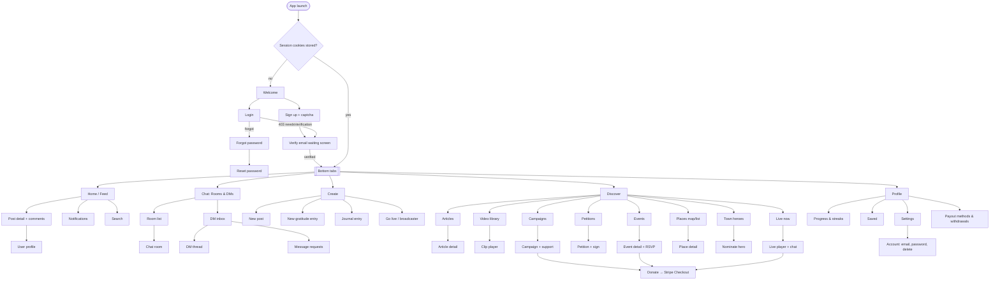

# WorldWeCare — Backend Feature Specification (for the React Native app)

> Derived **only** from the backend source code of `worldwecare.com` (Next.js route handlers, `src/lib`, `prisma/schema.prisma`, `src/middleware.ts`, `scripts/`, `prisma/*.ts`, `deploy/`). Every feature lists the source files it comes from. Features that exist only as server-rendered web pages (no API a mobile app can call) are marked 🌐 **Web-only**. No secret values appear in this documentation.

## Table of Contents

1. [App Overview](#1-app-overview)
2. [User Roles & Permissions](#2-user-roles--permissions)
3. [Feature List (Summary)](#3-feature-list-summary)
4. [Detailed Features](#4-detailed-features) → module files in [`features/`](features/)
   - [Auth, Account, Profile & Social](features/account.md)
   - [Community Feed, Gratitude, Confessions, Uploads & Utilities](features/feed.md)
   - [Chat Rooms, Direct Messages & Live Streaming](features/messaging-live.md)
   - [Articles, Video Library, Events, Petitions & Campaigns](features/content.md)
   - [Places, Town Heroes, Geography, Donations & Payouts](features/places-money.md)
   - [Admin: Auth, Team, Users, Moderation, Settings, Money, Media](features/admin-core.md)
   - [Admin: Content & Catalog Management](features/admin-content.md)
5. [Data Models](#5-data-models) → [`features/data-models.md`](features/data-models.md)
6. [Complete API Reference](#6-complete-api-reference-quick-index)
7. [Background Jobs, Webhooks & Scripts](#7-background-jobs-webhooks--scripts) → details in [`features/platform.md`](features/platform.md)
8. [Notifications & Messaging](#8-notifications--messaging)
9. [File Uploads & Media](#9-file-uploads--media)
10. [Suggested Mobile App Structure](#10-suggested-mobile-app-structure)
11. [Gaps & Missing Pieces for Mobile](#11-gaps--missing-pieces-for-mobile)
12. [Open Questions](#12-open-questions)
13. [Documentation Self-Check](#13-documentation-self-check)
14. [Appendix: Web Pages → Documentation](#14-appendix-web-pages--documentation)
- TypeScript types for the app: [`api-types.ts`](api-types.ts)

---

# 1. App Overview

## What the app does

**WorldWeCare** is an online wellbeing and mutual-support community. Members create an account (with a captcha and email verification), then share posts in a community feed — optionally **anonymously** — react, comment, save and report content, and follow other members. Beyond the feed, the platform offers topic and **support chat rooms** (including crisis rooms with a "panic" alert to moderators), **private direct messages** (with message requests), a private **journal** and **streaks/progress** tracking, a **gratitude wall**, a magazine of **articles**, a **video library** of clips organised in themes, **live video broadcasting** (members broadcast from the browser via WHIP to a MediaMTX server; viewers watch over HLS with a live comment chat), **events** with RSVP, **petitions** that members sign, **campaigns** that members support, a **map/directory of places** (support services, donors), and **"town heroes"** nominations.

Money flows through **donations** (Stripe Checkout) to campaigns, event hosts, live broadcasters and the charity itself. Members who receive donations can register a **payout method** and request **withdrawals**, which admins process. Content is **multi-language**: UI strings and user content can be machine-translated with Google Translate. Everything is run by staff through an **admin dashboard** with three roles (Owner, Admin, Moderator) for moderation, content management, settings, email templates, payments and payouts.

## Who the users are

| Role | Description |
|---|---|
| **Guest** (not signed in) | Can read most public content (feed, articles, petitions, events, places, heroes, public categories) — "reading costs nothing". Cannot write anything. |
| **Unverified member** | Has an account and session cookie but has not confirmed their email. Every member API returns `403 { needsVerification: true }` except `/api/user/auth/*` (resend verification, refresh, change pending email, logout). |
| **Member** (verified) | Full community access: post, comment, chat, DM, journal, donate, submit events/petitions/campaigns/places/heroes, broadcast live, receive donations and request payouts. |
| **Chat room moderator** | A member with `role: MODERATOR` on a specific chat room membership — can moderate that room (see messaging module). Not a site admin. |
| **Admin – MODERATOR** | Lowest staff tier: content moderation and most admin CRUD. Blocked from payments/payouts/donations, stream settings, admin-team management, permanent post deletion and some deletes (campaigns, places, library themes). Note: the code currently lets moderators change email/translation API keys and permanently delete members (see admin-core gaps). |
| **Admin – ADMIN** | Everything a moderator can do plus viewing payment settings, donations and payouts (processing payout requests), saving stream settings, pruning translation strings. |
| **Admin – OWNER** | Full control, including managing admin accounts, payment settings (Stripe), ffmpeg install, permanent post deletion. |
| **System callers** | Stripe (webhook, signed) and MediaMTX (stream auth hook). |

## Backend tech stack

- **Next.js 15** (App Router) — the backend is ~356 HTTP endpoints implemented as Route Handlers in `src/app/api/**/route.ts`, plus `src/middleware.ts`. No server actions, no `pages/api`.
- **TypeScript** (strict), **React 19** (the web frontend lives in the same project).
- **Prisma 6 ORM** on **MySQL** — 93 models, 39 enums (`prisma/schema.prisma`). Schema applied with `prisma db push` (no migration history).
- **bcryptjs** (password hashing), Web Crypto HMAC-SHA256 (session cookies), AES-256-GCM (`src/lib/secret-box.ts`, for Stripe key and payout details).
- **Stripe** SDK (donations), **sharp** (image processing), **ffmpeg** (video transcoding), **MediaMTX** (live streaming server, config in `deploy/mediamtx/`).

## Base URL, authentication and how a mobile app should authenticate

- **Base URL pattern:** `https://<domain>/api/...` — groups: `/api/user/*` (members), `/api/public/*` (anyone), `/api/admin/*` (staff), `/api/webhooks/stripe`, `/api/mediamtx/auth`. The canonical site URL comes from the `APP_URL` env var.
- **Auth method:** **cookie sessions only.** On login the server sets HttpOnly cookies:
  - `wwc-user-session` — member session (`base64url(userId:issuedAtMs).hmac`), valid 30 days.
  - `wwc-user-verified` — "email confirmed" claim checked by middleware; must belong to the same user.
  - `wwc-admin-session` — admin session (separate secret), valid 30 days.
  - Cookies are `HttpOnly`, `SameSite=Lax`, `Secure` in production, `Path=/`.
- **There are no bearer tokens, no refresh tokens and no token endpoint.** A React Native app must either (a) use a cookie-persisting HTTP client (e.g. `@react-native-cookies/cookies` with `fetch(..., { credentials: "include" })`) and re-send both member cookies on every request, or (b) the backend must be extended with a token-based login — see [Section 11](#11-gaps--missing-pieces-for-mobile).
- **Session revocation:** a password change/reset or deactivation stamps `sessionsValidFrom`; cookies issued earlier stop working (the API answers 401). Banned/deactivated/unverified accounts are treated as signed out.
- **Request/response format:** JSON bodies (`Content-Type: application/json`) except uploads (multipart or raw body — see module docs). Errors: `{ "error": "message" }` with an HTTP status (400/401/403/404/409/429/500). Dates are ISO-8601 strings; money is integer **cents**.
- **Real-time:** chat rooms, DMs, live comments and admin notifications use **Server-Sent Events** (`text/event-stream`) over long-lived GET requests.

## External services

| Service | Used for | Where |
|---|---|---|
| **Stripe** | Donation checkout (Stripe Checkout sessions), webhook for payment/refund/dispute events. Secret key + webhook secret are stored encrypted in the DB and set by an Owner in admin settings. | `src/lib/stripe.ts`, `donations.ts`, `payments.ts`, `src/app/api/webhooks/stripe` |
| **Resend** (email API) | All transactional email (verification, password reset, email change, notifications, digests). API key stored in DB settings (`email.resendApiKey`). | `src/lib/email.ts` |
| **Google Cloud Translation** | Machine translation of UI strings and user content. Key from DB setting or `GOOGLE_TRANSLATE_API_KEY`. | `src/lib/google-translate.ts`, `content-translate.ts` |
| **OpenStreetMap Nominatim** | Geocoding place addresses to coordinates (1 request/second courtesy limit). | `src/lib/geocode.ts` |
| **MediaMTX** | Live video server: WHIP publish from the browser, HLS playback, recording; calls back `/api/mediamtx/auth`. | `src/lib/mediamtx.ts`, `whip.ts`, `deploy/mediamtx/` |
| **ffmpeg / ffprobe** | Video transcoding and thumbnails for uploaded videos. Can be auto-installed by an Owner. | `src/lib/ffmpeg.ts`, `video.ts` |
| **sharp** | Image resizing, WebP conversion, thumbnails, decompression-bomb protection. | `src/lib/image-variants.ts` |
| **Map tiles (Leaflet)** | Places map in the web frontend (client side). | `src/components/site/place-map.tsx` |
| **Link previews** | Server fetches Open Graph tags of URLs pasted into posts. | `src/lib/link-preview.ts` |

No SMS provider, no push-notification provider (FCM/APNs), no OAuth/social login and no cloud object storage are used.

## Environment variables (names only)

| Variable | Purpose |
|---|---|
| `DATABASE_URL` | MySQL connection string used by Prisma. |
| `ADMIN_SESSION_SECRET` | Signs admin session cookies. |
| `USER_SESSION_SECRET` | Signs member session cookies (and, with a suffix, the email-verified claim); fallback key source for payments encryption. |
| `PAYMENTS_SECRET` | Key for encrypting the Stripe secret key and members' payout details in the DB. |
| `CAPTCHA_SECRET` | Signs signup captcha challenges (random per-process key if unset). |
| `APP_URL` | Public base URL used to build links in emails and redirects. |
| `GEOCODER_CONTACT` | Contact URL/email sent in the Nominatim User-Agent (required by their policy). |
| `NOMINATIM_URL` | Optional self-hosted Nominatim endpoint. |
| `GEOCODING_DISABLED` | Set to `1` to turn geocoding off (e.g. staging). |
| `GOOGLE_TRANSLATE_API_KEY` | Fallback Google Translate key if none is saved in admin settings. |
| `FFMPEG_PATH`, `FFMPEG_HOME` | Location of the ffmpeg binary / install directory. |
| `FFMPEG_SHA256` | Expected checksum when auto-installing ffmpeg. |
| `MAX_UPLOAD_BODY_MB` | Build-time maximum request body size for uploads (`next.config.ts`). |
| `NODE_ENV` | Standard; enables secure cookies and production logging. |

Many runtime settings (email provider, storage limits, payments, streaming, site name, translations) are stored in the database `PlatformSetting` table and edited in the admin dashboard — see [platform.md](features/platform.md).

---

# 2. User Roles & Permissions

| Role | What they can do | What they cannot do | How the role is decided in the code |
|---|---|---|---|
| **Guest** | Read public feed, articles, petitions, events, campaigns, places, heroes, library, public categories, live stream pages; sign up; log in; request password reset; solve captcha. | Any write action (post, comment, like, sign, RSVP, donate as a member, DM, chat). | No valid `wwc-user-session` cookie → `getCurrentUser()` returns `null` (`src/lib/user-auth.ts`). Routes using `requireUser` answer `401 Unauthorized`. |
| **Unverified member** | Log out, resend verification email, change the pending email address, refresh verification status. | Everything else under `/api/user/*` (403 `needsVerification`). | Session valid but `emailVerifiedAt` is null: middleware (`src/middleware.ts`) blocks with 403; `getCurrentUser()` also returns null. |
| **Member** | All community features: posts, comments, reactions, saves, reports, follows, blocks, chat rooms, DMs, journal, streaks, gratitude, live broadcasting, events/petitions/campaigns/places/heroes submissions, donations, payout methods and withdrawals, settings, account deletion. | Admin endpoints; acting on other members' content (edit/delete own only); posting in rooms they are banned from. | `getCurrentUser()` returns a user that is active, not banned, email-verified and whose cookie was issued after `sessionsValidFrom`. |
| **Banned / deactivated member** | Nothing (treated as signed out); login returns 403 with an explanatory message. | Everything. | `User.bannedAt` set or `User.isActive = false`. |
| **Chat room moderator** | Moderate a specific room (see [messaging-live.md](features/messaging-live.md)); receives crisis alerts for the room. | Moderate other rooms; any admin API. | `ChatMembership.role = MODERATOR` for that room. |
| **Admin – MODERATOR** | Sign in to the admin dashboard; moderation and most content/catalog CRUD (see admin modules for per-endpoint roles). | Payments, payouts, donations, stream settings, managing admin accounts, permanent post deletion. | `AdminUser.role = "MODERATOR"`; `requireAdmin()` admits it; `requireMoneyAdmin()` and `requireOwner()` and some inline checks reject it. |
| **Admin – ADMIN** | Everything a moderator can do + view payment settings, donations and payouts (process payout requests), save stream settings, prune translation strings. | Admin-team management, saving/testing payment settings (Stripe), ffmpeg install/removal, permanent post deletion. | `AdminUser.role = "ADMIN"`. |
| **Admin – OWNER** | Everything, including admin accounts (create, edit others, change roles, reset password, deactivate, delete), saving/testing payment settings, ffmpeg install/removal, permanent post deletion. | — (the last active owner cannot be demoted/removed). | `AdminUser.role = "OWNER"`; `requireOwner()` / `requireMoneyAdmin(req, "owner")`. |
| **Stripe** | Deliver payment events. | — | `stripe-signature` header verified against the webhook secret. |
| **MediaMTX** | Ask whether a publish/read is allowed. | — | Optional source-IP allow-list + stream grant tokens (`src/app/api/mediamtx/auth/route.ts`). |

Admin sessions and member sessions are completely separate: a member cookie gives no admin access and vice versa. A person can have both a member account and an admin account (different tables: `User` vs `AdminUser`).

# 3. Feature List (Summary)

Status legend: ✅ Complete · ⚠️ Partial / Unclear · 🌐 Web-only (no API — the mobile app cannot use it without backend work)

### Auth, Account, Profile & Social
_Details: [features/account.md](features/account.md)_

- [ ] ✅ Auth: Captcha challenge
- [ ] ✅ Auth: Sign up
- [ ] ✅ Auth: Email verification gate
- [ ] 🌐 Auth: Confirm email link (/verify)
- [ ] ✅ Auth: Log in
- [ ] ✅ Auth: Log out
- [ ] ✅ Auth: Forgot password
- [ ] ✅ Auth: Reset password
- [ ] ✅ Settings: Overview
- [ ] ✅ Settings: Change email
- [ ] 🌐 Settings: Confirm email change link (/verify-email-change)
- [ ] ✅ Settings: Change password
- [ ] ✅ Settings: Preferences
- [ ] ⚠️ Settings: Appearance
- [ ] ⚠️ Settings: Daily digest
- [ ] ✅ Settings: Deactivate account
- [ ] ✅ Settings: Delete account
- [ ] ✅ Profile: My profile
- [ ] ✅ Profile: My posts
- [ ] ✅ Profile: Journey stats
- [ ] ⚠️ Profile: Public profile
- [ ] 🌐 Profile: Public streaks, badges, follow/block state
- [ ] ✅ Social: Followers & following lists
- [ ] ✅ Social: Follow / unfollow
- [ ] ✅ Social: Who to follow
- [ ] ✅ Social: Members directory
- [ ] ✅ Social: Block / unblock
- [ ] ✅ Notifications: Inbox
- [ ] ✅ Navigation: Sidebar summary
- [ ] ✅ Search: Site-wide search
- [ ] ✅ Saved: Saved posts, articles & clips
- [ ] ✅ Progress: Overview & badges
- [ ] ✅ Progress: Streaks
- [ ] ✅ Journal: Private journal
- [ ] ✅ Journal: Share entry as post
- [ ] ✅ Journal: Daily reflection

### Community Feed, Gratitude, Confessions, Uploads & Utilities
_Details: [features/feed.md](features/feed.md)_

- [ ] ✅ Feed: List posts
- [ ] ✅ Feed: Create post (anonymous, images, video, country)
- [ ] ⚠️ Feed: Edit post / comment
- [ ] ✅ Feed: Delete own post
- [ ] ✅ Feed: React to post
- [ ] ✅ Feed: Save post
- [ ] ✅ Feed: Report post
- [ ] ✅ Feed: Post comments (list + add)
- [ ] ✅ Feed: Delete own comment
- [ ] ✅ Feed: React to comment
- [ ] ⚠️ Feed: Report comment
- [ ] 🌐 Feed: Post detail (single post)
- [ ] ✅ Gratitude: List wall
- [ ] ✅ Gratitude: Create entry
- [ ] ✅ Gratitude: Delete own entry
- [ ] ✅ Gratitude: React to entry
- [ ] ✅ Gratitude: Comments (list + add, one-level replies)
- [ ] ✅ Gratitude: Delete own comment
- [ ] ✅ Gratitude: React to comment
- [ ] ⚠️ Gratitude: Categories & category tiles
- [ ] 🌐 Gratitude: Entry detail (single entry)
- [ ] 🌐 Confessions wall (REMOVED: DB tables only, no API, no pages)
- [ ] ✅ Uploads: Image upload
- [ ] ✅ Uploads: Video upload + limits
- [ ] ✅ Uploads: Video status polling & discard
- [ ] ✅ Utilities: Link preview
- [ ] ✅ Utilities: Translate content

### Chat Rooms, Direct Messages & Live Streaming
_Details: [features/messaging-live.md](features/messaging-live.md)_

- [ ] ✅ Chat: Browse rooms
- [ ] ✅ Chat: Room detail & permissions
- [ ] ⚠️ Chat: Join / leave room
- [ ] ✅ Chat: Members roster
- [ ] ✅ Chat: List messages
- [ ] ⚠️ Chat: Send message
- [ ] ✅ Chat: Edit / report / moderate message
- [ ] ✅ Chat: Delete own message
- [ ] ✅ Chat: Reactions
- [ ] ✅ Chat: Panic / crisis alert
- [ ] ✅ Chat: Read markers & unread
- [ ] ⚠️ Chat: Real-time stream (SSE)
- [ ] ✅ DM: Inbox & requests list
- [ ] ✅ DM: Unread counts
- [ ] ✅ DM: Thread & send
- [ ] ✅ DM: Accept / decline request
- [ ] ✅ DM: Read receipts
- [ ] ✅ DM: Typing indicator
- [ ] ✅ DM: Delete message
- [ ] ⚠️ DM: Real-time stream (SSE)
- [ ] ✅ Live: Browse live now
- [ ] ✅ Live: Categories
- [ ] ✅ Live: Create stream
- [ ] ✅ Live: My streams
- [ ] ⚠️ Live: Watch stream
- [ ] 🌐 Live: Start broadcast (publish grant)
- [ ] ✅ Live: Confirm go-live
- [ ] ⚠️ Live: Recording toggle
- [ ] ✅ Live: End broadcast
- [ ] ⚠️ Live: Viewer count
- [ ] ✅ Live: Chat comments
- [ ] ✅ Live: Remove comment
- [ ] ✅ Live: Comments stream (SSE)
- [ ] ✅ Live: MediaMTX auth hook
- [ ] ⚠️ Live: Broadcasting infrastructure (WHIP/HLS/recording)

### Articles, Video Library, Events, Petitions & Campaigns
_Details: [features/content.md](features/content.md)_

- [ ] ✅ Articles: Browse & search magazine
- [ ] 🌐 Articles: Category tiles
- [ ] 🌐 Articles: Article detail (body, gallery, related, view count)
- [ ] ✅ Articles: React to article
- [ ] ✅ Articles: Save (bookmark)
- [ ] ⚠️ Articles: Comments
- [ ] ✅ Articles: Delete own comment
- [ ] ✅ Articles: React to comment
- [ ] ✅ Library: Themes & clip feeds
- [ ] ✅ Library: Follow theme
- [ ] 🌐 Library: Theme detail page
- [ ] 🌐 Library: Clip detail page
- [ ] ✅ Library: React to clip
- [ ] ✅ Library: Save clip
- [ ] ✅ Library: Clip comments
- [ ] ✅ Library: Delete own clip comment
- [ ] ✅ Library: React to clip comment
- [ ] ✅ Events: Categories
- [ ] ✅ Events: Browse calendar
- [ ] 🌐 Events: Event detail & attendees
- [ ] ✅ Events: Submit an event
- [ ] ✅ Events: RSVP
- [ ] ⚠️ Events: My submissions & moderation status
- [ ] ✅ Petitions: Categories
- [ ] ✅ Petitions: Browse
- [ ] ✅ Petitions: Detail & signers
- [ ] ✅ Petitions: Start a petition
- [ ] ✅ Petitions: Sign / withdraw
- [ ] ✅ Petitions: React
- [ ] ✅ Petitions: Close own petition
- [ ] ⚠️ Petitions: My petitions
- [ ] ✅ Campaigns: Categories
- [ ] ✅ Campaigns: Browse
- [ ] 🌐 Campaigns: Campaign detail
- [ ] ✅ Campaigns: Submit a campaign
- [ ] ✅ Campaigns: Support
- [ ] 🌐 Campaigns: My submitted campaigns
- [ ] ✅ Shared: Gratitude categories

### Places Directory, Town Heroes, Geography, Donations & Payouts
_Details: [features/places-money.md](features/places-money.md)_

- [ ] ✅ Geography: Country list
- [ ] ✅ Geography: State/region list
- [ ] ✅ Places: Type tiles & category pages
- [ ] ✅ Places: Browse / search / map
- [ ] 🌐 Places: Place detail
- [ ] ✅ Places: Submit a place
- [ ] ✅ Places: Save / unsave
- [ ] ✅ Places: Saved filter sets
- [ ] ✅ Places: Report a listing
- [ ] ✅ Town Heroes: List / search
- [ ] 🌐 Town Heroes: Hero detail
- [ ] ✅ Town Heroes: Home highlights
- [ ] ✅ Town Heroes: Categories
- [ ] ✅ Town Heroes: Nominate
- [ ] ✅ Town Heroes: Heart
- [ ] ✅ Donations: Config
- [ ] ⚠️ Donations: Start checkout (Stripe Checkout)
- [ ] 🌐 Donations: Thanks / cancelled return pages
- [ ] ✅ Donations: History (given/received)
- [ ] ✅ Donations: Stripe webhook
- [ ] ✅ Payouts: Overview & balance
- [ ] ✅ Payouts: Request withdrawal
- [ ] ✅ Payouts: Cancel request
- [ ] ✅ Payouts: Payout methods (list/add/default/remove)

### Admin: Auth, Team, Users, Moderation, Chat, Live, Notifications, Settings, Money, Media, Translations
_Details: [features/admin-core.md](features/admin-core.md)_

- [ ] ✅ Admin Auth: Login
- [ ] ✅ Admin Auth: Logout
- [ ] 🌐 Admin Auth: Current admin / role
- [ ] 🌐 Admin: Dashboard overview
- [ ] ✅ Team: List admins
- [ ] ✅ Team: Invite admin
- [ ] ✅ Team: View / edit admin
- [ ] ✅ Team: Delete admin
- [ ] ✅ Team: Reset admin password
- [ ] ✅ Team: Activate / deactivate admin
- [ ] ✅ Users: List users
- [ ] ✅ Users: Create user
- [ ] ✅ Users: View / edit / delete user
- [ ] ✅ Users: Activate / deactivate / ban / unban
- [ ] ✅ Users: Activity & audit feed
- [ ] ⚠️ Users: Send password-reset email
- [ ] ✅ Users: Send template email
- [ ] ✅ Moderation: Posts list & stats
- [ ] ✅ Moderation: Post detail & permanent delete
- [ ] ✅ Moderation: Post actions
- [ ] ✅ Moderation: Comment actions
- [ ] ✅ Moderation: Reports queue
- [ ] ✅ Moderation: Banned words
- [ ] ✅ Chat: Categories
- [ ] ✅ Chat: Rooms
- [ ] ✅ Chat: Members
- [ ] ✅ Chat: Message moderation
- [ ] ✅ Live: Broadcast moderation
- [ ] ✅ Notifications: Admin bell
- [ ] ✅ Settings: General
- [ ] ✅ Settings: Email delivery
- [ ] ✅ Settings: Email templates
- [ ] ⚠️ Settings: Email logs
- [ ] ✅ Settings: Storage
- [ ] ✅ Settings: Cache
- [ ] ✅ Settings: Streaming server
- [ ] ✅ Money: Payment & payout settings
- [ ] ✅ Money: Payout queue
- [ ] ✅ Money: Donations ledger
- [ ] ✅ Media: ffmpeg management
- [ ] ✅ Media: Admin image upload
- [ ] ✅ Media: Admin video upload
- [ ] ✅ Translations: Languages & Google key
- [ ] ✅ Translations: String catalogue
- [ ] ✅ Translations: Machine translate
- [ ] ✅ Translations: Extract strings
- [ ] ✅ Translations: Content translation health

### Admin: Content & Catalog Management
_Details: [features/admin-content.md](features/admin-content.md)_

- [ ] ✅ Articles: List & search
- [ ] ⚠️ Articles: Create, view, edit & delete
- [ ] ✅ Articles: Categories
- [ ] ✅ Campaigns: List
- [ ] ✅ Campaigns: Create, view, edit & delete
- [ ] ✅ Campaigns: Review submission
- [ ] ✅ Campaigns: Attachments (attach/detach/reorder/search)
- [ ] 🌐 Campaigns: Uncategorised backlog filter
- [ ] ⚠️ Events: List, create, view, edit & delete
- [ ] ✅ Events: Review / cancel
- [ ] ✅ Events: Categories
- [ ] ✅ Petitions: Queue, view & delete
- [ ] ✅ Petitions: Review / close
- [ ] ✅ Places: List, create, view, edit & delete
- [ ] ✅ Places: Review submission
- [ ] ✅ Places: Re-geocode
- [ ] ✅ Places: Reports queue
- [ ] ✅ Geography: Stats & picker options
- [ ] ✅ Geography: Regions
- [ ] ✅ Geography: Sub-regions
- [ ] ✅ Geography: Countries
- [ ] ✅ Geography: States (US only)
- [ ] ✅ Gratitude: Moderation queue
- [ ] ✅ Gratitude: Categories
- [ ] ⚠️ Town Heroes: Review queue, edit & delete
- [ ] ✅ Town Heroes: Categories
- [ ] ✅ Library: Themes
- [ ] ✅ Library: Clips
- [ ] ✅ Library: Reorder
- [ ] ✅ Library: Clip comment moderation
- [ ] ✅ Live: Categories
- [ ] ✅ Daily Reflections: Quote & question calendar
- [ ] ⚠️ Campaign & Petition categories management
- [ ] ⚠️ Article comment moderation

# 4. Detailed Features

The detailed write-up of every feature (description, flow, screens, every API with request/response/error tables, form fields, business rules, edge cases and status) lives in one file per module:

| # | Module | File | Features | Endpoints |
|---|---|---|---|---|
| 1 | Auth, Account, Profile & Social | [features/account.md](features/account.md) | 36 | 51 |
| 2 | Community Feed, Gratitude, Confessions, Uploads & Utilities | [features/feed.md](features/feed.md) | 27 | 26 |
| 3 | Chat Rooms, Direct Messages & Live Streaming | [features/messaging-live.md](features/messaging-live.md) | 35 | 39 |
| 4 | Articles, Video Library, Events, Petitions & Campaigns | [features/content.md](features/content.md) | 38 | 31 |
| 5 | Places Directory, Town Heroes, Geography, Donations & Payouts | [features/places-money.md](features/places-money.md) | 24 | 26 |
| 6 | Admin: Auth, Team, Users, Moderation, Chat, Live, Notifications, Settings, Money, Media, Translations | [features/admin-core.md](features/admin-core.md) | 47 | 91 |
| 7 | Admin: Content & Catalog Management | [features/admin-content.md](features/admin-content.md) | 34 | 92 |

# 5. Data Models

All 93 Prisma models and 39 enums — every field, type, default, uniqueness, relations and per-domain Mermaid ER diagrams — are documented in **[features/data-models.md](features/data-models.md)**.

Model list

`AdminUser`, `User`, `VerificationToken`, `UserActivity`, `AdminActionLog`, `AdminNotification`, `Post`, `PostComment`, `PostLike`, `PostSave`, `PostReport`, `Region`, `SubRegion`, `Country`, `State`, `Locale`, `TranslationString`, `Translation`, `ContentTranslation`, `PlatformSetting`, `DailyQuote`, `DailyQuestion`, `DailyReflection`, `UserStreak`, `UserBadge`, `EmailTemplate`, `EmailLog`, `CampaignCategory`, `PetitionCategory`, `Petition`, `PetitionSignature`, `PetitionReaction`, `ChatCategory`, `ChatRoom`, `ChatMembership`, `ChatMessage`, `ChatMessageReaction`, `ChatMessageReport`, `UserBlock`, `UserFollow`, `UserNotification`, `ConfessionCategory`, `Confession`, `ConfessionSupport`, `ConfessionComment`, `GratitudeCategory`, `GratitudeEntry`, `GratitudeComment`, `GratitudeHeart`, `Conversation`, `ConversationParticipant`, `DirectMessage`, `BannedWord`, `PageBanner`, `ArticleCategory`, `Article`, `ArticleComment`, `ArticleCommentLike`, `ArticleLike`, `ArticleSave`, `Event`, `EventRsvp`, `VideoAsset`, `LibraryTheme`, `ThemeFollow`, `Clip`, `ClipComment`, `ClipCommentLike`, `PostCommentReaction`, `ConfessionCommentReaction`, `GratitudeCommentReaction`, `ClipLike`, `ClipSave`, `UploadedFile`, `Campaign`, `CampaignArticle`, `CampaignEvent`, `CampaignSupport`, `Place`, `PlaceReport`, `PlaceSave`, `PlaceFilterSet`, `EventCategory`, `LiveCategory`, `LiveStream`, `LiveComment`, `LiveStreamGrant`, `Donation`, `PayoutMethod`, `Payout`, `TownHeroCategory`, `TownHero`, `TownHeroHeart`

Enum list

`AdminRole`, `VerificationPurpose`, `UserActivityType`, `AdminAction`, `AdminNotifType`, `PostStatus`, `Reaction`, `ReportTargetType`, `ReportStatus`, `ReportReason`, `TextDirection`, `TranslationSource`, `StreakKind`, `EmailStatus`, `PetitionStatus`, `ChatTier`, `ChatRoomStatus`, `ChatMemberRole`, `ChatMemberStatus`, `ChatMessageStatus`, `UserNotifType`, `ConfessionStatus`, `GratitudeStatus`, `ArticleStatus`, `ArticleCommentStatus`, `EventStatus`, `VideoStatus`, `ClipCommentStatus`, `ClipKind`, `CampaignStatus`, `PlaceType`, `PlaceStatus`, `PlaceReportKind`, `LiveStreamStatus`, `LiveStreamVisibility`, `DonationStatus`, `PayoutMethodType`, `PayoutStatus`, `TownHeroStatus`

# 6. Complete API Reference (quick index)

Auth legend: **Public** = no login · **Optional** = works signed-out, richer when signed in · **Member** = verified member session · **Admin** = any admin (OWNER/ADMIN/MODERATOR) unless roles say otherwise · **Signature** = Stripe-signed webhook · **MediaMTX** = called by the media server.

| Method | Path | Feature | Auth | Roles | Description |
|---|---|---|---|---|---|
| GET | `/api/admin/admins` | Team: List admins | Admin | OWNER, ADMIN, MODERATOR | Paginated admin list with search/role/status filters |
| POST | `/api/admin/admins` | Team: Invite admin | Owner | OWNER | Create admin; returns initialPassword once |
| DELETE | `/api/admin/admins/[id]` | Team: Delete admin | Owner | OWNER | Hard delete admin (not self, not last owner) |
| GET | `/api/admin/admins/[id]` | Team: View / edit admin | Admin | OWNER, ADMIN, MODERATOR | Single admin |
| PUT | `/api/admin/admins/[id]` | Team: View / edit admin | Admin | Self (name/email only): any role; others or any role change: OWNER | Update displayName/email/role |
| POST | `/api/admin/admins/[id]/reset-password` | Team: Reset admin password | Owner | OWNER | Set/generate new password; returned once |
| POST | `/api/admin/admins/[id]/status` | Team: Activate / deactivate admin | Owner | OWNER | activate \| deactivate |
| GET | `/api/admin/article-categories` | Articles: Categories | Admin | OWNER, ADMIN, MODERATOR | List article categories with counts |
| POST | `/api/admin/article-categories` | Articles: Categories | Admin | OWNER, ADMIN, MODERATOR | Create category |
| DELETE | `/api/admin/article-categories/[id]` | Articles: Categories | Admin | OWNER, ADMIN, MODERATOR | Delete category (articles become uncategorised) |
| PATCH | `/api/admin/article-categories/[id]` | Articles: Categories | Admin | OWNER, ADMIN, MODERATOR | Update category |
| GET | `/api/admin/articles` | Articles: List & search | Admin | OWNER, ADMIN, MODERATOR | Paginated article list (q, status, categoryId, page, perPage<=100) |
| POST | `/api/admin/articles` | Articles: Create/edit/delete | Admin | OWNER, ADMIN, MODERATOR | Create article (photos ignored) |
| DELETE | `/api/admin/articles/[id]` | Articles: Create/edit/delete | Admin | OWNER, ADMIN, MODERATOR | Delete article and its uploaded images |
| GET | `/api/admin/articles/[id]` | Articles: Create/edit/delete | Admin | OWNER, ADMIN, MODERATOR | Full article row + category |
| PATCH | `/api/admin/articles/[id]` | Articles: Create/edit/delete | Admin | OWNER, ADMIN, MODERATOR | Partial update incl. status/featured |
| POST | `/api/admin/auth/login` | Admin Auth: Login | Public | - | Email+password login; sets wwc-admin-session cookie |
| POST | `/api/admin/auth/logout` | Admin Auth: Logout | Public | - | Clears the admin cookie |
| GET | `/api/admin/banned-words` | Moderation: Banned words | Admin | OWNER, ADMIN, MODERATOR | List banned words |
| POST | `/api/admin/banned-words` | Moderation: Banned words | Admin | OWNER, ADMIN, MODERATOR | Add words (comma/newline separated) |
| DELETE | `/api/admin/banned-words/[id]` | Moderation: Banned words | Admin | OWNER, ADMIN, MODERATOR | Remove a banned word |
| GET | `/api/admin/campaigns` | Campaigns: List | Admin | OWNER, ADMIN, MODERATOR | All campaigns, optional status filter, unpaginated |
| POST | `/api/admin/campaigns` | Campaigns: Create/edit/delete | Admin | OWNER, ADMIN, MODERATOR | Create campaign (category required) |
| DELETE | `/api/admin/campaigns/[id]` | Campaigns: Create/edit/delete | Admin | OWNER, ADMIN (MODERATOR 403) | Delete campaign and media |
| GET | `/api/admin/campaigns/[id]` | Campaigns: Create/edit/delete | Admin | OWNER, ADMIN, MODERATOR | Campaign + attached articles/events + room |
| PATCH | `/api/admin/campaigns/[id]` | Campaigns: Create/edit/delete | Admin | OWNER, ADMIN, MODERATOR | Update; merged row re-validated |
| POST | `/api/admin/campaigns/[id]/attachments` | Campaigns: Attachments | Admin | OWNER, ADMIN, MODERATOR | attach/detach/reorder articles or events |
| POST | `/api/admin/campaigns/[id]/review` | Campaigns: Review | Admin | OWNER, ADMIN, MODERATOR | Approve (publish) or reject a member submission |
| GET | `/api/admin/campaigns/attachables` | Campaigns: Attachments | Admin | OWNER, ADMIN, MODERATOR | Search articles/events/rooms to attach (12 each) |
| GET | `/api/admin/chat/categories` | Chat: Categories | Admin | OWNER, ADMIN, MODERATOR | List chat categories |
| POST | `/api/admin/chat/categories` | Chat: Categories | Admin | OWNER, ADMIN, MODERATOR | Create category |
| DELETE | `/api/admin/chat/categories/[id]` | Chat: Categories | Admin | OWNER, ADMIN, MODERATOR | Delete category (rooms become uncategorised) |
| PATCH | `/api/admin/chat/categories/[id]` | Chat: Categories | Admin | OWNER, ADMIN, MODERATOR | Rename / reorder category |
| GET | `/api/admin/chat/rooms` | Chat: Rooms | Admin | OWNER, ADMIN, MODERATOR | List rooms with filters |
| POST | `/api/admin/chat/rooms` | Chat: Rooms | Admin | OWNER, ADMIN, MODERATOR | Create room |
| DELETE | `/api/admin/chat/rooms/[id]` | Chat: Rooms | Admin | OWNER, ADMIN, MODERATOR | Delete room |
| GET | `/api/admin/chat/rooms/[id]` | Chat: Rooms | Admin | OWNER, ADMIN, MODERATOR | Room detail with pending counts |
| PATCH | `/api/admin/chat/rooms/[id]` | Chat: Rooms | Admin | OWNER, ADMIN, MODERATOR | Update room |
| GET | `/api/admin/chat/rooms/[id]/members` | Chat: Members | Admin | OWNER, ADMIN, MODERATOR | Room members by status |
| DELETE | `/api/admin/chat/rooms/[id]/members/[memberId]` | Chat: Members | Admin | OWNER, ADMIN, MODERATOR | Remove membership |
| PATCH | `/api/admin/chat/rooms/[id]/members/[memberId]` | Chat: Members | Admin | OWNER, ADMIN, MODERATOR | Change role/status/approveFirstPost |
| GET | `/api/admin/chat/rooms/[id]/messages` | Chat: Message moderation | Admin | OWNER, ADMIN, MODERATOR | Latest 100 messages by status |
| DELETE | `/api/admin/chat/rooms/[id]/messages/[messageId]` | Chat: Message moderation | Admin | OWNER, ADMIN, MODERATOR | Hard-delete message |
| PATCH | `/api/admin/chat/rooms/[id]/messages/[messageId]` | Chat: Message moderation | Admin | OWNER, ADMIN, MODERATOR | approve \| remove \| restore \| pin \| unpin |
| DELETE | `/api/admin/daily-reflections` | Daily Reflections | Admin | OWNER, ADMIN, MODERATOR | Delete quote/question (JSON body) |
| GET | `/api/admin/daily-reflections` | Daily Reflections | Admin | OWNER, ADMIN, MODERATOR | Latest 60 quotes and 60 questions |
| POST | `/api/admin/daily-reflections` | Daily Reflections | Admin | OWNER, ADMIN, MODERATOR | Create quote/question for a date |
| PUT | `/api/admin/daily-reflections` | Daily Reflections | Admin | OWNER, ADMIN, MODERATOR | Update quote/question |
| GET | `/api/admin/donations` | Money: Donations ledger | Money-admin | OWNER, ADMIN | Donation rows + totals |
| GET | `/api/admin/email-templates` | Settings: Email templates | Admin | OWNER, ADMIN, MODERATOR | List templates |
| POST | `/api/admin/email-templates` | Settings: Email templates | Admin | OWNER, ADMIN, MODERATOR | Create template |
| DELETE | `/api/admin/email-templates/[id]` | Settings: Email templates | Admin | OWNER, ADMIN, MODERATOR | Delete (protected slugs refused) |
| GET | `/api/admin/email-templates/[id]` | Settings: Email templates | Admin | OWNER, ADMIN, MODERATOR | Full template |
| PUT | `/api/admin/email-templates/[id]` | Settings: Email templates | Admin | OWNER, ADMIN, MODERATOR | Partial update |
| POST | `/api/admin/email-templates/[id]/test` | Settings: Email templates | Admin | OWNER, ADMIN, MODERATOR | Send a real test email |
| GET | `/api/admin/event-categories` | Events: Categories | Admin | OWNER, ADMIN, MODERATOR | List event categories with counts |
| POST | `/api/admin/event-categories` | Events: Categories | Admin | OWNER, ADMIN, MODERATOR | Create event category |
| DELETE | `/api/admin/event-categories/[id]` | Events: Categories | Admin | OWNER, ADMIN, MODERATOR | Delete unused event category |
| PATCH | `/api/admin/event-categories/[id]` | Events: Categories | Admin | OWNER, ADMIN, MODERATOR | Update / retire event category |
| GET | `/api/admin/events` | Events: Manage | Admin | OWNER, ADMIN, MODERATOR | Paginated events + pendingCount |
| POST | `/api/admin/events` | Events: Manage | Admin | OWNER, ADMIN, MODERATOR | Create event (auto-APPROVED, creates chatroom) |
| DELETE | `/api/admin/events/[id]` | Events: Manage | Admin | OWNER, ADMIN, MODERATOR | Delete event, RSVPs cascade, room kept |
| GET | `/api/admin/events/[id]` | Events: Manage | Admin | OWNER, ADMIN, MODERATOR | Full event row |
| PATCH | `/api/admin/events/[id]` | Events: Manage | Admin | OWNER, ADMIN, MODERATOR | Update event (clears categoryId - bug) |
| POST | `/api/admin/events/[id]/review` | Events: Review/cancel | Admin | OWNER, ADMIN, MODERATOR | approve/reject/cancel with notifications |
| DELETE | `/api/admin/ffmpeg` | Media: ffmpeg management | Owner | OWNER (inline role check) | Forget managed install |
| GET | `/api/admin/ffmpeg` | Media: ffmpeg management | Admin | OWNER, ADMIN, MODERATOR | ffmpeg readiness report |
| POST | `/api/admin/ffmpeg/install` | Media: ffmpeg management | Owner | OWNER (inline role check) | Download + install static ffmpeg |
| GET | `/api/admin/geography/countries` | Geography: Countries | Admin | OWNER, ADMIN, MODERATOR | Paginated countries |
| POST | `/api/admin/geography/countries` | Geography: Countries | Admin | OWNER, ADMIN, MODERATOR | Create country |
| DELETE | `/api/admin/geography/countries/[id]` | Geography: Countries | Admin | OWNER, ADMIN, MODERATOR | Delete country (blocked if states) |
| GET | `/api/admin/geography/countries/[id]` | Geography: Countries | Admin | OWNER, ADMIN, MODERATOR | One country |
| PUT | `/api/admin/geography/countries/[id]` | Geography: Countries | Admin | OWNER, ADMIN, MODERATOR | Update country |
| GET | `/api/admin/geography/options` | Geography: Stats & options | Admin | OWNER, ADMIN, MODERATOR | Slim picker lists by level |
| GET | `/api/admin/geography/regions` | Geography: Regions | Admin | OWNER, ADMIN, MODERATOR | List regions |
| POST | `/api/admin/geography/regions` | Geography: Regions | Admin | OWNER, ADMIN, MODERATOR | Create region |
| DELETE | `/api/admin/geography/regions/[id]` | Geography: Regions | Admin | OWNER, ADMIN, MODERATOR | Delete region (blocked if sub-regions) |
| PUT | `/api/admin/geography/regions/[id]` | Geography: Regions | Admin | OWNER, ADMIN, MODERATOR | Update region |
| GET | `/api/admin/geography/states` | Geography: States | Admin | OWNER, ADMIN, MODERATOR | List states (defaults to US) |
| POST | `/api/admin/geography/states` | Geography: States | Admin | OWNER, ADMIN, MODERATOR | Create US state |
| DELETE | `/api/admin/geography/states/[id]` | Geography: States | Admin | OWNER, ADMIN, MODERATOR | Delete state |
| PUT | `/api/admin/geography/states/[id]` | Geography: States | Admin | OWNER, ADMIN, MODERATOR | Update state |
| GET | `/api/admin/geography/stats` | Geography: Stats & options | Admin | OWNER, ADMIN, MODERATOR | Total/active counts per level |
| GET | `/api/admin/geography/sub-regions` | Geography: Sub-regions | Admin | OWNER, ADMIN, MODERATOR | List sub-regions |
| POST | `/api/admin/geography/sub-regions` | Geography: Sub-regions | Admin | OWNER, ADMIN, MODERATOR | Create sub-region |
| DELETE | `/api/admin/geography/sub-regions/[id]` | Geography: Sub-regions | Admin | OWNER, ADMIN, MODERATOR | Delete sub-region (blocked if countries) |
| PUT | `/api/admin/geography/sub-regions/[id]` | Geography: Sub-regions | Admin | OWNER, ADMIN, MODERATOR | Update sub-region |
| GET | `/api/admin/gratitude` | Gratitude: Moderation | Admin | OWNER, ADMIN, MODERATOR | Cursor-paginated gratitude queue + pendingCount |
| GET | `/api/admin/gratitude-categories` | Gratitude: Categories | Admin | OWNER, ADMIN, MODERATOR | List gratitude categories |
| POST | `/api/admin/gratitude-categories` | Gratitude: Categories | Admin | OWNER, ADMIN, MODERATOR | Create gratitude category |
| DELETE | `/api/admin/gratitude-categories/[id]` | Gratitude: Categories | Admin | OWNER, ADMIN, MODERATOR | Delete category, returns orphaned count |
| PATCH | `/api/admin/gratitude-categories/[id]` | Gratitude: Categories | Admin | OWNER, ADMIN, MODERATOR | Update gratitude category |
| POST | `/api/admin/gratitude/[id]` | Gratitude: Moderation | Admin | OWNER, ADMIN, MODERATOR | approve/reject entry |
| GET | `/api/admin/library` | Library: Themes | Admin | OWNER, ADMIN, MODERATOR | List themes |
| POST | `/api/admin/library` | Library: Themes | Admin | OWNER, ADMIN, MODERATOR | Create theme |
| DELETE | `/api/admin/library/[id]` | Library: Themes | Admin | OWNER, ADMIN (MODERATOR 403) | Delete theme, clips and videos |
| GET | `/api/admin/library/[id]` | Library: Themes | Admin | OWNER, ADMIN, MODERATOR | Theme + its clips |
| PATCH | `/api/admin/library/[id]` | Library: Themes | Admin | OWNER, ADMIN, MODERATOR | Update theme |
| POST | `/api/admin/library/clips` | Library: Clips | Admin | OWNER, ADMIN, MODERATOR | Add EMBED or UPLOAD clip |
| DELETE | `/api/admin/library/clips/[id]` | Library: Clips | Admin | OWNER, ADMIN, MODERATOR | Delete clip (+ uploaded video) |
| PATCH | `/api/admin/library/clips/[id]` | Library: Clips | Admin | OWNER, ADMIN, MODERATOR | Update clip |
| GET | `/api/admin/library/clips/[id]/comments` | Library: Clip comments | Admin | OWNER, ADMIN, MODERATOR | All comments on a clip incl. removed |
| POST | `/api/admin/library/comments/[id]` | Library: Clip comments | Admin | OWNER, ADMIN, MODERATOR | remove/restore a clip comment |
| POST | `/api/admin/library/reorder` | Library: Reorder | Admin | OWNER, ADMIN, MODERATOR | Persist theme or clip order |
| GET | `/api/admin/live` | Live: Broadcast moderation | Admin | OWNER, ADMIN, MODERATOR | All streams, live first (max 50) |
| GET | `/api/admin/live-categories` | Live: Categories | Admin | OWNER, ADMIN, MODERATOR | List live categories |
| POST | `/api/admin/live-categories` | Live: Categories | Admin | OWNER, ADMIN, MODERATOR | Create live category |
| DELETE | `/api/admin/live-categories/[id]` | Live: Categories | Admin | OWNER, ADMIN, MODERATOR | Delete unused live category |
| PATCH | `/api/admin/live-categories/[id]` | Live: Categories | Admin | OWNER, ADMIN, MODERATOR | Update live category |
| POST | `/api/admin/live/[id]/end` | Live: Broadcast moderation | Admin | OWNER, ADMIN, MODERATOR | Force-end a stream |
| POST | `/api/admin/live/owner/[userId]` | Live: Broadcast moderation | Admin | OWNER, ADMIN, MODERATOR | Allow/block a member from streaming |
| GET | `/api/admin/notifications` | Notifications: Admin bell | Admin | OWNER, ADMIN, MODERATOR | Unread count + latest 20 |
| POST | `/api/admin/notifications/read` | Notifications: Admin bell | Admin | OWNER, ADMIN, MODERATOR | Mark ids or all read |
| GET | `/api/admin/notifications/stream` | Notifications: Admin bell | Admin | OWNER, ADMIN, MODERATOR | SSE stream of bell payload (5s poll) |
| GET | `/api/admin/payments/settings` | Money: Payment & payout settings | Money-admin | OWNER, ADMIN | Stripe + payout settings (secrets masked) |
| PUT | `/api/admin/payments/settings` | Money: Payment & payout settings | Owner | OWNER (requireMoneyAdmin owner) | Save Stripe + payout settings |
| POST | `/api/admin/payments/test` | Money: Payment & payout settings | Owner | OWNER (requireMoneyAdmin owner) | Test a Stripe secret key |
| GET | `/api/admin/payouts` | Money: Payout queue | Money-admin | OWNER, ADMIN | Payout queue + totals |
| GET | `/api/admin/payouts/[id]` | Money: Payout queue | Money-admin | OWNER, ADMIN | Payout + decrypted details + balance (audited) |
| PUT | `/api/admin/payouts/[id]` | Money: Payout queue | Money-admin | OWNER, ADMIN | approve \| paid \| reject \| reverse |
| GET | `/api/admin/petitions` | Petitions: Queue | Admin | OWNER, ADMIN, MODERATOR | Petition queue (max 200) |
| DELETE | `/api/admin/petitions/[id]` | Petitions: Queue | Admin | OWNER, ADMIN, MODERATOR | Delete petition, signatures, media, video |
| GET | `/api/admin/petitions/[id]` | Petitions: Queue | Admin | OWNER, ADMIN, MODERATOR | Full petition row |
| POST | `/api/admin/petitions/[id]/review` | Petitions: Review/close | Admin | OWNER, ADMIN, MODERATOR | approve/reject/close |
| GET | `/api/admin/places` | Places: Manage | Admin | OWNER, ADMIN, MODERATOR | Paginated places + pending count |
| POST | `/api/admin/places` | Places: Manage | Admin | OWNER, ADMIN, MODERATOR | Create place (geocoded, default APPROVED) |
| DELETE | `/api/admin/places/[id]` | Places: Manage | Admin | OWNER, ADMIN (MODERATOR 403) | Delete place and media |
| GET | `/api/admin/places/[id]` | Places: Manage | Admin | OWNER, ADMIN, MODERATOR | Full place row |
| PATCH | `/api/admin/places/[id]` | Places: Manage | Admin | OWNER, ADMIN, MODERATOR | Update; re-geocodes on address change |
| POST | `/api/admin/places/[id]/geocode` | Places: Re-geocode | Admin | OWNER, ADMIN, MODERATOR | Re-run Nominatim lookup for one place |
| POST | `/api/admin/places/[id]/review` | Places: Review | Admin | OWNER, ADMIN, MODERATOR | approve/reject submitted place |
| GET | `/api/admin/places/reports` | Places: Reports | Admin | OWNER, ADMIN, MODERATOR | Place report queue (50 newest) + open count |
| POST | `/api/admin/places/reports/[id]` | Places: Reports | Admin | OWNER, ADMIN, MODERATOR | resolve/dismiss a report |
| GET | `/api/admin/posts` | Moderation: Posts list & stats | Admin | OWNER, ADMIN, MODERATOR | Paginated wall posts with filters |
| DELETE | `/api/admin/posts/[id]` | Moderation: Post detail & permanent delete | Owner | OWNER (inline role check) | Permanent delete incl. media |
| GET | `/api/admin/posts/[id]` | Moderation: Post detail & permanent delete | Admin | OWNER, ADMIN, MODERATOR | Post + all comments |
| POST | `/api/admin/posts/[id]/action` | Moderation: Post actions | Admin | OWNER, ADMIN, MODERATOR | remove \| restore \| feature \| unfeature |
| POST | `/api/admin/posts/comments/[id]/action` | Moderation: Comment actions | Admin | OWNER, ADMIN, MODERATOR | remove \| restore a comment |
| GET | `/api/admin/posts/reports` | Moderation: Reports queue | Admin | OWNER, ADMIN, MODERATOR | Paginated post/comment reports |
| POST | `/api/admin/posts/reports/[id]` | Moderation: Reports queue | Admin | OWNER, ADMIN, MODERATOR | Resolve report: remove \| keep \| dismiss |
| GET | `/api/admin/posts/reports/count` | Moderation: Reports queue | Admin | OWNER, ADMIN, MODERATOR | Open report count (badge) |
| GET | `/api/admin/posts/stats` | Moderation: Posts list & stats | Admin | OWNER, ADMIN, MODERATOR | Overview counters |
| DELETE | `/api/admin/settings/cache` | Settings: Cache | Admin | OWNER, ADMIN, MODERATOR | Purge settings cache |
| GET | `/api/admin/settings/cache` | Settings: Cache | Admin | OWNER, ADMIN, MODERATOR | Cache config + stats |
| PUT | `/api/admin/settings/cache` | Settings: Cache | Admin | OWNER, ADMIN, MODERATOR | Update cache.enabled / TTL |
| GET | `/api/admin/settings/email` | Settings: Email delivery | Admin | OWNER, ADMIN, MODERATOR | Read email.* (API key masked) |
| PUT | `/api/admin/settings/email` | Settings: Email delivery | Admin | OWNER, ADMIN, MODERATOR | Update email.* settings |
| GET | `/api/admin/settings/general` | Settings: General | Admin | OWNER, ADMIN, MODERATOR | Read general.* settings |
| PUT | `/api/admin/settings/general` | Settings: General | Admin | OWNER, ADMIN, MODERATOR | Update general.* settings |
| GET | `/api/admin/settings/storage` | Settings: Storage | Admin | OWNER, ADMIN, MODERATOR | Read storage.* + bodyLimitMB |
| PUT | `/api/admin/settings/storage` | Settings: Storage | Admin | OWNER, ADMIN, MODERATOR | Update storage.* with range checks |
| GET | `/api/admin/settings/stream` | Settings: Streaming server | Admin | OWNER, ADMIN, MODERATOR | Read stream.* (password masked) |
| POST | `/api/admin/settings/stream` | Settings: Streaming server | Admin | OWNER, ADMIN, MODERATOR | Run MediaMTX health check |
| PUT | `/api/admin/settings/stream` | Settings: Streaming server | Admin | OWNER, ADMIN (inline: MODERATOR gets 403) | Update stream.* settings |
| GET | `/api/admin/town-hero-categories` | Town Heroes: Categories | Admin | OWNER, ADMIN, MODERATOR | List hero categories |
| POST | `/api/admin/town-hero-categories` | Town Heroes: Categories | Admin | OWNER, ADMIN, MODERATOR | Create hero category |
| DELETE | `/api/admin/town-hero-categories/[id]` | Town Heroes: Categories | Admin | OWNER, ADMIN, MODERATOR | Delete unused hero category |
| PATCH | `/api/admin/town-hero-categories/[id]` | Town Heroes: Categories | Admin | OWNER, ADMIN, MODERATOR | Update hero category |
| GET | `/api/admin/town-heroes` | Town Heroes: Review | Admin | OWNER, ADMIN, MODERATOR | Nomination queue (max 50) + pendingCount |
| DELETE | `/api/admin/town-heroes/[id]` | Town Heroes: Review | Admin | OWNER, ADMIN, MODERATOR | Delete nomination |
| PATCH | `/api/admin/town-heroes/[id]` | Town Heroes: Review | Admin | OWNER, ADMIN, MODERATOR | Edit nomination |
| POST | `/api/admin/town-heroes/[id]` | Town Heroes: Review | Admin | OWNER, ADMIN, MODERATOR | approve/reject nomination |
| GET | `/api/admin/translations/content` | Translations: Content translation health | Admin | OWNER, ADMIN, MODERATOR | Member-content translation diagnostics |
| POST | `/api/admin/translations/extract` | Translations: Extract strings | Admin | OWNER, ADMIN, MODERATOR (prune=true: OWNER, ADMIN only) | Scan source code into catalogue (dry run by default) |
| GET | `/api/admin/translations/locales` | Translations: Languages & Google key | Admin | OWNER, ADMIN, MODERATOR | Locales with progress + key status |
| POST | `/api/admin/translations/locales` | Translations: Languages & Google key | Admin | OWNER, ADMIN, MODERATOR | sync \| key \| picker \| enable/order a locale |
| GET | `/api/admin/translations/strings` | Translations: String catalogue | Admin | OWNER, ADMIN, MODERATOR | Strings for one locale, filtered |
| POST | `/api/admin/translations/strings` | Translations: String catalogue | Admin | OWNER, ADMIN, MODERATOR | Save translation or mark reviewed |
| POST | `/api/admin/translations/translate` | Translations: Machine translate | Admin | OWNER, ADMIN, MODERATOR | Google-fill missing/stale strings |
| POST | `/api/admin/upload` | Media: Admin image upload | Admin | OWNER, ADMIN, MODERATOR | Multipart image upload |
| GET | `/api/admin/upload/video` | Media: Admin video upload | Admin | OWNER, ADMIN, MODERATOR | Current video limits |
| POST | `/api/admin/upload/video` | Media: Admin video upload | Admin | OWNER, ADMIN, MODERATOR | Raw-body streamed video upload |
| DELETE | `/api/admin/upload/video/[id]` | Media: Admin video upload | Admin | OWNER, ADMIN, MODERATOR | Discard any video asset |
| GET | `/api/admin/upload/video/[id]` | Media: Admin video upload | Admin | OWNER, ADMIN, MODERATOR | Conversion status (any asset) |
| GET | `/api/admin/users` | Users: List users | Admin | OWNER, ADMIN, MODERATOR | Paginated member list with search/status/sort |
| POST | `/api/admin/users` | Users: Create user | Admin | OWNER, ADMIN, MODERATOR | Admin-create a member account |
| DELETE | `/api/admin/users/[id]` | Users: View / edit / delete user | Admin | OWNER, ADMIN, MODERATOR | Permanent hard delete of a member |
| GET | `/api/admin/users/[id]` | Users: View / edit / delete user | Admin | OWNER, ADMIN, MODERATOR | Single member |
| PUT | `/api/admin/users/[id]` | Users: View / edit / delete user | Admin | OWNER, ADMIN, MODERATOR | Edit displayName/email/avatarUrl/anonymousByDefault |
| GET | `/api/admin/users/[id]/activity` | Users: Activity & audit feed | Admin | OWNER, ADMIN, MODERATOR | Member activity (kind=user) or admin actions on member (kind=admin) |
| POST | `/api/admin/users/[id]/reset-password` | Users: Send password-reset email | Admin | OWNER, ADMIN, MODERATOR | Emails password_reset template with placeholder link |
| POST | `/api/admin/users/[id]/send-email` | Users: Send template email | Admin | OWNER, ADMIN, MODERATOR | Send any email template to the member |
| POST | `/api/admin/users/[id]/status` | Users: Activate / deactivate / ban / unban | Admin | OWNER, ADMIN, MODERATOR | Moderation state transitions |
| GET | `/api/mediamtx/auth` | Live: MediaMTX auth hook | MediaMTX | none — always 401 | Always 401 empty body (anti-probing) |
| POST | `/api/mediamtx/auth` | Live: MediaMTX auth hook | MediaMTX | MediaMTX server (IP allowlist) — not for apps | Allow/deny publish (grant token) and read (stream LIVE); empty 200/401 |
| GET | `/api/public/campaign-categories` | Campaigns: Categories | Public | anyone | Active campaign categories with liveCount (optional countryId) |
| GET | `/api/public/categories` | Shared: Gratitude categories | Public | anyone | Active categories for kind=gratitude (only allowed kind); cached 60s |
| GET | `/api/public/donations/config` | Donations: Config | Public | - | Donations enabled flag, min/max cents, currency |
| GET | `/api/public/event-categories` | Events: Categories | Public | anyone | Active event categories with upcomingCount (optional countryId) |
| GET | `/api/public/geo/countries` | Geography: Country list | Public | - | Active countries for pickers (cached 60s) |
| GET | `/api/public/geo/states` | Geography: State/region list | Public | - | Active states of one country (?countryId) |
| GET | `/api/public/petition-categories` | Petitions: Categories | Public | anyone | Active petition categories with openCount (optional countryId) |
| GET | `/api/public/place-types` | Places: Type tiles | Public | - | All 10 place types with approved counts, optional countryId |
| GET | `/api/public/town-hero-categories` | Town Heroes: Categories | Public | - | Active hero categories with approved counts |
| GET | `/api/public/town-heroes` | Town Heroes: Home highlights | Public | - | Approved heroes for home strip (take default 6, max 12) |
| GET | `/api/user/articles` | Articles: Browse & search magazine | Optional | anyone (signed-in must be verified) | Published articles, paged (page/perPage<=48), filter by category slug + q; includes non-empty categories |
| GET | `/api/user/articles/[id]/comments` | Articles: Comments | Optional | anyone | Flat list of published comments, oldest first, with viewer's reaction |
| POST | `/api/user/articles/[id]/comments` | Articles: Comments | Member | member | Add a comment or one-level reply (max 4000 chars, optional anonymous) |
| POST | `/api/user/articles/[id]/like` | Articles: React to article | Member | member | Add/change/remove a reaction; returns liked, likeCount, myReaction |
| POST | `/api/user/articles/[id]/save` | Articles: Save (bookmark) | Member | member | Toggle bookmark; returns saved, saveCount |
| DELETE | `/api/user/articles/comments/[commentId]` | Articles: Delete own comment | Member | comment author | Hard-delete own comment (replies cascade); returns commentCount |
| POST | `/api/user/articles/comments/[commentId]/like` | Articles: React to comment | Member | member | Add/change/remove a reaction on an article comment |
| GET | `/api/user/auth/captcha` | Auth: Captcha challenge | Public | - | Issue a signed arithmetic challenge {question, token} for signup (40/IP/10min) |
| POST | `/api/user/auth/forgot-password` | Auth: Forgot password | Public | - | Always-same answer; emails 10-minute reset link if account active |
| POST | `/api/user/auth/login` | Auth: Log in | Public | - | Email+password login; sets wwc-user-session (+ wwc-user-verified if email confirmed) |
| POST | `/api/user/auth/logout` | Auth: Log out | Public | - | Clears session + verified cookies; responds 303 redirect to / |
| POST | `/api/user/auth/pending-email` | Auth: Email verification gate | Member | Signed-in AND unverified | Fix a mistyped address from inside the gate (needs current password) |
| GET | `/api/user/auth/refresh-verified` | Auth: Email verification gate | Member | Signed-in, verified or not | Re-check emailVerifiedAt, mint verified cookie, 303 redirect to ?next or /verify-email |
| POST | `/api/user/auth/refresh-verified` | Auth: Email verification gate | Member | Signed-in, verified or not | Re-check emailVerifiedAt, mint verified cookie, returns {verified} |
| POST | `/api/user/auth/resend-verification` | Auth: Email verification gate | Member | Signed-in, verified or not | Re-send email confirmation link (30s throttle) |
| POST | `/api/user/auth/reset-password` | Auth: Reset password | Public | Token holder | Consume reset token, set new password, sign out all devices |
| POST | `/api/user/auth/signup` | Auth: Sign up | Public | - | Create account (captcha + honeypot + IP limits), sets session cookie, sends confirm email |
| POST | `/api/user/block` | Social: Block / unblock | Member | Verified member | Block (default) or unblock ({block:false}); severs follows |
| GET | `/api/user/blocks` | Social: Block / unblock | Member | Verified member | List the viewer's blocked accounts |
| GET | `/api/user/campaigns` | Campaigns: Browse | Member | member | Published campaigns; filters countryId, category slug, live=1; optional take+page (no take = all) |
| POST | `/api/user/campaigns` | Campaigns: Submit a campaign | Member | member | Submit campaign; lands PENDING; admins notified |
| POST | `/api/user/campaigns/[id]/support` | Campaigns: Support | Member | member | Toggle 'I support this' on a PUBLISHED campaign |
| GET | `/api/user/chatrooms` | Chat: Browse rooms | Member | any verified member | List ACTIVE rooms with viewer membership + unread counts; optional ?countryId |
| GET | `/api/user/chatrooms/[slug]` | Chat: Room detail & permissions | Member | any verified member | Room detail, rules, slow mode, pinned (max 3), viewer flags canRead/canPost/isModerator |
| POST | `/api/user/chatrooms/[slug]/join` | Chat: Join / leave room | Member | any verified member (not BANNED in room) | Create ACTIVE membership (idempotent) |
| POST | `/api/user/chatrooms/[slug]/leave` | Chat: Join / leave room | Member | any verified member | Delete membership (idempotent) |
| GET | `/api/user/chatrooms/[slug]/members` | Chat: Members roster | Member | members who canRead | Up to 200 ACTIVE members, moderators first |
| GET | `/api/user/chatrooms/[slug]/messages` | Chat: List messages | Member | members who canRead | Keyset-paged messages (?before / ?after / ?limit) |
| POST | `/api/user/chatrooms/[slug]/messages` | Chat: Send message | Member | PUBLIC room: any member; other tiers: ACTIVE members | Post text/images, reply, mentions, anonymous; slow mode enforced |
| DELETE | `/api/user/chatrooms/[slug]/messages/[id]` | Chat: Delete own message | Member | author only | Hard-delete own message |
| PATCH | `/api/user/chatrooms/[slug]/messages/[id]` | Chat: Edit / report / moderate message | Member | edit=author; report=any; pin/unpin/remove/approve=room MODERATOR | action=edit\|report\|pin\|unpin\|remove\|approve |
| POST | `/api/user/chatrooms/[slug]/messages/[id]/react` | Chat: Reactions | Member | any verified member | Toggle one of 6 curated emoji reactions |
| POST | `/api/user/chatrooms/[slug]/panic` | Chat: Panic / crisis alert | Member | any verified member | Notify room moderators (CRISIS_ALERT) and return hotline info |
| POST | `/api/user/chatrooms/[slug]/read` | Chat: Read markers & unread | Member | any verified member | Set membership lastReadAt = now |
| GET | `/api/user/chatrooms/[slug]/stream` | Chat: Real-time stream (SSE) | Member | members who canRead | SSE; event 'messages' every 2.5s poll, ': ping' heartbeat 20s |
| POST | `/api/user/clips/[id]/like` | Library: React to clip | Member | member | Add/change/remove a reaction on a clip |
| POST | `/api/user/clips/[id]/save` | Library: Save clip | Member | member | Toggle saving a clip |
| GET | `/api/user/daily-reflection` | Journal: Daily reflection | Optional | Anyone; member gets own answer | Today's (UTC) quote and question, plus viewer's reflection |
| POST | `/api/user/daily-reflection` | Journal: Daily reflection | Member | Verified member | Upsert answer to today's question (1-2,000 chars) |
| GET | `/api/user/donations` | Donations: History | Member | verified member | Given + received donations and balance |
| POST | `/api/user/donations/checkout` | Donations: Start checkout | Optional | anyone (a signed-in member must be verified) | Create PENDING donation + Stripe Checkout session; returns hosted URL |
| GET | `/api/user/events` | Events: Browse calendar | Optional | anyone (signed-in must be verified) | Approved upcoming (or past=1) events, paged, filter by countryId, category slug, q |
| POST | `/api/user/events` | Events: Submit an event | Member | verified member | Submit event; lands PENDING; admins notified |
| POST | `/api/user/events/[id]/rsvp` | Events: RSVP | Member | member | Toggle RSVP on an APPROVED event; capacity enforced |
| POST | `/api/user/follow` | Social: Follow / unfollow | Member | Verified member | Follow (default) or unfollow ({follow:false}); notifies on new follow |
| GET | `/api/user/follow/suggestions` | Social: Who to follow | Member | Verified member | 3 suggested members with structured reason |
| GET | `/api/user/gratitude` | Gratitude: List wall | Member | verified member | Cursor-paged gratitude wall (APPROVED + own entries), optional ?category=<slug> |
| POST | `/api/user/gratitude` | Gratitude: Create entry | Member | verified member | Create a gratitude entry (held PENDING for admin approval) |
| DELETE | `/api/user/gratitude/[id]` | Gratitude: Delete own entry | Member | entry author | Delete own gratitude entry (and its video asset) |
| GET | `/api/user/gratitude/[id]/comments` | Gratitude: Comments | Optional | any / signed-out | Whole thread, flat, oldest first (max 500), one-level replies via parentId |
| POST | `/api/user/gratitude/[id]/comments` | Gratitude: Comments | Member | verified member | Add a comment or reply (optionally anonymous); notifies entry author |
| POST | `/api/user/gratitude/[id]/heart` | Gratitude: React to entry | Member | verified member | Add / change / remove a reaction on an APPROVED entry |
| DELETE | `/api/user/gratitude/comments/[commentId]` | Gratitude: Delete own comment | Member | comment author | Delete own comment; replies cascade |
| POST | `/api/user/gratitude/comments/[commentId]/like` | Gratitude: React to comment | Member | verified member | Add / change / remove a reaction on a gratitude comment |
| GET | `/api/user/journal` | Journal: Private journal | Member | Verified member | Own entries newest first, id cursor, limit 1-50 (default 20), total |
| POST | `/api/user/journal` | Journal: Private journal | Member | Verified member | Write a free-form entry (max 20,000 chars) |
| DELETE | `/api/user/journal/[id]` | Journal: Private journal | Member | Verified member (owner) | Delete entry |
| PATCH | `/api/user/journal/[id]` | Journal: Private journal | Member | Verified member (owner) | Edit entry body |
| POST | `/api/user/journal/[id]/share` | Journal: Share entry as post | Member | Verified member (owner) | Copy entry into a new public post (once), optional anonymous |
| GET | `/api/user/library` | Library: Themes & clip feeds | Member | member | Themes list (default), clips of one theme (scope=clips&themeId), or followed-themes feed (scope=following) |
| POST | `/api/user/library/[id]/follow` | Library: Follow theme | Member | member | Toggle following a theme; returns following, followerCount |
| GET | `/api/user/library/clips/[id]/comments` | Library: Clip comments | Optional | anyone | Flat list of published clip comments with masked anonymous authors, isOwn, myReaction |
| POST | `/api/user/library/clips/[id]/comments` | Library: Clip comments | Member | member | Add a clip comment or reply (max 4000 chars) |
| DELETE | `/api/user/library/comments/[commentId]` | Library: Delete own clip comment | Member | comment author | Hard-delete own clip comment (replies cascade) |
| POST | `/api/user/library/comments/[commentId]/like` | Library: React to clip comment | Member | member | Add/change/remove a reaction on a clip comment |
| GET | `/api/user/link-preview` | Utilities: Link preview | Member | verified member | Open Graph preview for ?url= |
| GET | `/api/user/live` | Live: Browse live now | Optional | public; signed-in adds blockedReason | PUBLIC+LIVE streams (max 30) + categories; ?countryId ?categoryId ?category(slug) |
| POST | `/api/user/live` | Live: Create stream | Member | member with canStream, not banned, email verified (setting) | Create IDLE stream (title, categoryId, summary, visibility) |
| GET | `/api/user/live/[slug]` | Live: Watch stream | Member | any verified member (session cookie) | Stream card + HLS watchUrl while LIVE |
| GET | `/api/user/live/[slug]/comments` | Live: Chat comments | Member | any verified member (session cookie) | Recent comments (10-100, default 50) or ?after tail; canPost |
| POST | `/api/user/live/[slug]/comments` | Live: Chat comments | Member | any verified member; stream must be LIVE | Post comment (max 500 chars, 12/min) |
| DELETE | `/api/user/live/[slug]/comments/[id]` | Live: Remove comment | Member | comment author or broadcaster | Soft-remove comment |
| GET | `/api/user/live/[slug]/comments/stream` | Live: Comments stream (SSE) | Member | any verified member (session cookie) | SSE event 'comments', poll 1.5s, heartbeat 20s |
| POST | `/api/user/live/[slug]/end` | Live: End broadcast | Member | stream owner | End stream, revoke grant, kick publisher, stop recording |
| POST | `/api/user/live/[slug]/live` | Live: Confirm go-live | Member | stream owner | Ask MediaMTX if a playable publisher is present; flip to LIVE |
| POST | `/api/user/live/[slug]/recording` | Live: Recording toggle | Member | stream owner | Turn MediaMTX recording on/off ({wanted}) |
| POST | `/api/user/live/[slug]/start` | Live: Start broadcast (publish grant) | Member | stream owner | Mint WHIP publish token + URLs; starts recording if enabled |
| GET | `/api/user/live/[slug]/viewers` | Live: Viewer count | Member | any verified member (session cookie) | Viewer count from MediaMTX readers; {viewers, live} |
| GET | `/api/user/live/categories` | Live: Categories | Public | anyone | Active categories with liveCount + viewerCount |
| GET | `/api/user/live/mine` | Live: My streams | Member | any verified member | Own streams (max 50) + blockedReason |
| GET | `/api/user/members` | Social: Members directory | Member | Verified member | Directory ordered by followerCount; q, country, cursor, limit (max 60) |
| GET | `/api/user/messages` | DM: Inbox & requests list | Member | any verified member | Conversations, ?box=primary\|requests, max 100 |
| POST | `/api/user/messages/conversations/[id]/accept` | DM: Accept / decline request | Member | participant | Move request into primary inbox |
| POST | `/api/user/messages/conversations/[id]/decline` | DM: Accept / decline request | Member | participant | Delete the whole conversation |
| POST | `/api/user/messages/conversations/[id]/read` | DM: Read receipts | Member | participant | Set participant lastReadAt = now |
| GET | `/api/user/messages/conversations/[id]/stream` | DM: Real-time stream (SSE) | Member | participant | SSE events messages/seen/typing, poll 2s, heartbeat 20s |
| POST | `/api/user/messages/conversations/[id]/typing` | DM: Typing indicator | Member | participant | Set typingAt = now (fresh for 6s) |
| DELETE | `/api/user/messages/messages/[id]` | DM: Delete message | Member | sender only | Soft-delete own DM (deletedAt) |
| GET | `/api/user/messages/thread/[userId]` | DM: Thread & send | Member | any verified member | Thread with a user (virtual empty if none), ?cursor for older |
| POST | `/api/user/messages/thread/[userId]` | DM: Thread & send | Member | any verified member, not blocked either way | Send DM (text and/or imageUrl); first message may create a request |
| GET | `/api/user/messages/unread` | DM: Unread counts | Member | any verified member | {inbox, requests} = number of threads with unread messages |
| GET | `/api/user/notifications` | Notifications: Inbox | Member | Verified member | Cursor-paged notifications + unread count (limit 10-50) |
| POST | `/api/user/notifications/read` | Notifications: Inbox | Member | Verified member | Mark given ids (or all) read |
| GET | `/api/user/payouts` | Payouts: Overview & balance | Member | verified member | Balance, methods, payout history and withdrawal limits |
| POST | `/api/user/payouts` | Payouts: Request withdrawal | Member | verified member | Request a payout (min amount, fee, balance check) |
| DELETE | `/api/user/payouts/[id]` | Payouts: Cancel request | Member | verified member | Cancel own payout while REQUESTED |
| GET | `/api/user/payouts/methods` | Payouts: Payout methods | Member | verified member | List saved payout methods (masked) |
| POST | `/api/user/payouts/methods` | Payouts: Payout methods | Member | verified member | Add PAYPAL/BANK/WISE/CHECK method (details encrypted) |
| DELETE | `/api/user/payouts/methods/[id]` | Payouts: Payout methods | Member | verified member | Remove a method (refused while an open payout uses it) |
| PATCH | `/api/user/payouts/methods/[id]` | Payouts: Payout methods | Member | verified member | Make a method the default ({isDefault:true} only) |
| GET | `/api/user/petitions` | Petitions: Browse | Optional | anyone (signed-in must be verified) | Approved/closed petitions newest first; filters country, category slug, open=1; take<=60 + page |
| POST | `/api/user/petitions` | Petitions: Start a petition | Member | member | Create petition; lands PENDING; admins notified |
| DELETE | `/api/user/petitions/[slug]` | Petitions: Close own petition | Member | creator | Creator closes an APPROVED petition (status CLOSED, nothing deleted) |
| GET | `/api/user/petitions/[slug]` | Petitions: Detail & signers | Optional | anyone; creator also sees own PENDING/REJECTED | One petition + up to 50 named signatures |
| POST | `/api/user/petitions/[slug]/react` | Petitions: React | Member | member | Add/change/remove a reaction on APPROVED or CLOSED petition |
| POST | `/api/user/petitions/[slug]/sign` | Petitions: Sign / withdraw | Member | member | Toggle signature with optional comment (400 chars) and anonymous flag; 409 when closed |
| GET | `/api/user/places` | Places: Browse / search / map | Member | verified member | Filtered, paginated approved places; map bounding box via lat/lng/km |
| POST | `/api/user/places` | Places: Submit a place | Member | verified member | Submit a place; geocoded; lands PENDING for admin review |
| POST | `/api/user/places/[id]/report` | Places: Report a listing | Member | verified member | Report wrong listing (one open report per member per place) |
| POST | `/api/user/places/[id]/save` | Places: Save / unsave | Member | verified member | Toggle save; returns saved + saveCount |
| GET | `/api/user/places/filters` | Places: Saved filter sets | Member | verified member | List up to 20 saved filter sets |
| POST | `/api/user/places/filters` | Places: Saved filter sets | Member | verified member | Save a named filter set (max 20) |
| DELETE | `/api/user/places/filters/[id]` | Places: Saved filter sets | Member | verified member | Delete own filter set (silent no-op if not owned) |
| POST | `/api/user/posts` | Feed: Create post | Member | verified member | Create a post (text, up to 6 images, optional READY video asset, anonymous flag, country) |
| DELETE | `/api/user/posts/[id]` | Feed: Delete own post | Member | post author | Hard-delete own post plus its uploaded images and video |
| GET | `/api/user/posts/[id]/comments` | Feed: Post comments | Optional | any / signed-out | Cursor-paged flat comment list, newest first |
| POST | `/api/user/posts/[id]/comments` | Feed: Post comments | Member | verified member | Add a comment (optionally anonymous); notifies post author |
| POST | `/api/user/posts/[id]/like` | Feed: React to post | Member | verified member | Add / change / remove a reaction (LIKE, HEART, CARE, STRENGTH, PROUD, SAME) |
| POST | `/api/user/posts/[id]/report` | Feed: Report post | Member | verified member | Report a post with a reason; notifies all admins |
| POST | `/api/user/posts/[id]/save` | Feed: Save post | Member | verified member | Toggle bookmark on a post |
| DELETE | `/api/user/posts/comments/[id]` | Feed: Delete own comment | Member | comment author | Hard-delete own comment |
| POST | `/api/user/posts/comments/[id]/like` | Feed: React to comment | Member | verified member | Add / change / remove a reaction on a post comment |
| POST | `/api/user/posts/comments/[id]/report` | Feed: Report comment | Member | verified member | Report a post comment with a reason; notifies all admins |
| GET | `/api/user/posts/feed` | Feed: List posts | Optional | any / signed-out | Cursor-paged community feed (newest first), optional country filter; viewer reaction/save state joined when signed in |
| GET | `/api/user/profile` | Profile: My profile | Member | Verified member | Own profile incl. email |
| PATCH | `/api/user/profile` | Profile: My profile | Member | Verified member | Edit name, bio, location, avatarUrl, coverUrl |
| GET | `/api/user/profile/posts` | Profile: My posts | Member | Verified member | Own published posts (incl. anonymous), cursor-paged FeedPage |
| GET | `/api/user/profile/stats` | Profile: Journey stats | Member | Verified member | Posts, replies, rooms, saved, followers, following, memberSince |
| GET | `/api/user/progress` | Progress: Overview & badges | Member | Verified member | Recomputes badges; returns streaks, full badge grid, journaling day streak |
| GET | `/api/user/saved` | Saved: Saved posts, articles & clips | Member | Verified member | Bookmarked posts, cursor-paged FeedPage |
| GET | `/api/user/saved/articles` | Saved: Saved posts, articles & clips | Member | Verified member | Up to 50 saved articles |
| GET | `/api/user/saved/clips` | Saved: Saved posts, articles & clips | Member | Verified member | Up to 50 saved library clips |
| GET | `/api/user/search` | Search: Site-wide search | Member | Verified member | Members/articles/places/events/campaigns/rooms, 6 per type, min 2 chars |
| GET | `/api/user/settings` | Settings: Overview | Member | Verified member | Email, pending email, name, country, anonymous default, verified date, blocked list |
| PATCH | `/api/user/settings/appearance` | Settings: Appearance | Member | Verified member | Set colour theme, light/dark/system mode, brand tone 0-4 |
| POST | `/api/user/settings/deactivate` | Settings: Deactivate account | Member | Verified member | Freeze account (current password); signs out everywhere |
| POST | `/api/user/settings/delete` | Settings: Delete account | Member | Verified member | Permanently erase account (current password + typed DELETE) |
| PATCH | `/api/user/settings/digest` | Settings: Daily digest | Member | Verified member | Opt in/out of daily digest email, hour 0-23, IANA timezone |
| DELETE | `/api/user/settings/email` | Settings: Change email | Member | Verified member | Cancel a pending email change |
| POST | `/api/user/settings/email` | Settings: Change email | Member | Verified member | Request email change (current password); confirm link sent to new address |
| POST | `/api/user/settings/password` | Settings: Change password | Member | Verified member | Change password; other devices signed out, this one re-issued |
| PATCH | `/api/user/settings/preferences` | Settings: Preferences | Member | Verified member | Set country and anonymous-by-default |
| GET | `/api/user/sidebar` | Navigation: Sidebar summary | Member | Verified member | Stats, top streak, 6 badges, badge count, 8 joined rooms with unread |
| GET | `/api/user/streaks` | Progress: Streaks | Member | Verified member | Own streaks (archived last) |
| POST | `/api/user/streaks` | Progress: Streaks | Member | Verified member | Start a streak (kind, startedOn, label, isPublic default true) |
| DELETE | `/api/user/streaks/[id]` | Progress: Streaks | Member | Verified member (owner) | Delete, or archive with ?archive=1 |
| PATCH | `/api/user/streaks/[id]` | Progress: Streaks | Member | Verified member (owner) | Edit (startedOn/label/isPublic) or reset ({reset:true,startedOn}) |
| GET | `/api/user/town-heroes` | Town Heroes: List / search | Member | verified member | Approved heroes plus viewer's own nominations; filters + page/take |
| POST | `/api/user/town-heroes` | Town Heroes: Nominate | Member | verified member | Nominate a hero; lands PENDING |
| POST | `/api/user/town-heroes/[id]/heart` | Town Heroes: Heart | Member | verified member | Toggle heart on an APPROVED hero |
| POST | `/api/user/translate-content` | Utilities: Translate content | Optional | any; signed-out rate-limited 60/min/IP | Machine-translate stored content by id refs into the locale cookie language |
| GET | `/api/user/u/[id]` | Profile: Public profile | Member | Verified member | Another member's public profile + isSelf |
| GET | `/api/user/u/[id]/followers` | Social: Followers & following lists | Member | Verified member | Up to 200 followers with viewer follow state |
| GET | `/api/user/u/[id]/following` | Social: Followers & following lists | Member | Verified member | Up to 200 followed accounts with viewer follow state |
| GET | `/api/user/u/[id]/posts` | Profile: Public profile | Member | Verified member | A member's non-anonymous published posts, cursor-paged |
| POST | `/api/user/upload` | Uploads: Image upload | Member | verified member | multipart image upload; resized to WebP + thumbnail; returns public URL |
| GET | `/api/user/upload/video` | Uploads: Video upload | Member | verified member | Current video limits { maxMB, maxSeconds } |
| POST | `/api/user/upload/video` | Uploads: Video upload | Member | verified member (email verified) | Raw-body video upload with x-filename header; returns VideoAsset id, converts in background |
| DELETE | `/api/user/upload/video/[id]` | Uploads: Video status & discard | Member | asset owner | Discard a video asset and its files |
| GET | `/api/user/upload/video/[id]` | Uploads: Video status & discard | Member | asset owner | Poll conversion status / progress |
| POST | `/api/webhooks/stripe` | Donations: Stripe webhook | Signature | Stripe | Applies 8 Stripe events to donation rows (signature verified) |

_Total: 356 endpoints in 252 route files._

# 7. Background Jobs, Webhooks & Scripts

Full details (every npm script, every `prisma/*.ts` and `scripts/*.ts` file, flags, destructiveness): **[features/platform.md](features/platform.md)**.

**Summary**

| Item | What it does | Schedule / trigger | Affects the mobile app? |
|---|---|---|---|
| `POST /api/webhooks/stripe` | Receives Stripe events (checkout completed/expired, refunds, disputes) and marks donations succeeded/failed/refunded, updating recipients' balances. Signature-verified. | Called by Stripe | Indirectly: a donation only shows as "succeeded" after this webhook arrives, so the app must poll/refresh after returning from checkout. |
| `POST /api/mediamtx/auth` | MediaMTX asks whether a publish (broadcaster) or read (viewer) is allowed. | Called by MediaMTX for every connection | Yes for live streaming: publishing needs a grant token from the app's API. |
| `npm run digest:send` (`prisma/send-digests.ts`) | Sends the daily digest email to opted-in members at their chosen local hour. | **Must be run hourly by an external scheduler (cron) — no scheduler is defined in the project** (⚠️). | Only via digest settings in Settings. |
| Maintenance scripts (`counters:*`, `follows:*`, `reports:*`, `donations:*`, `heroes:*`, `media:*`) | Recount denormalised counters, fix duplicate reports, diagnose donations, sweep orphaned media, backfill thumbnails/posters. Dry-run unless `--apply`. | Manual | No. |
| Seed scripts (`db:seed*`) | Create initial admin, email templates, categories, geography, demo content. | Manual, one-off | No (but demo data may appear in the app if seeded). |
| Dev checks (`scripts/*.ts`, `theme:check`, `i18n:*`, `check:boundary`) | Developer tooling (string extraction, contrast checks, client/server boundary check, media reference check). | Manual | No. |
| In-process video queue (`src/lib/video.ts`) | Transcodes uploaded videos with ffmpeg (max 2 at a time) after upload. | Runs inside the web server process on upload | Yes: the app must poll the video status endpoint until the video is ready. |
| In-process geocoding queue (`src/lib/geocode.ts`) | Geocodes place addresses (1 request/second). | On place submission / admin re-geocode | Places may have no coordinates until geocoded. |

# 8. Notifications & Messaging

No SMS and no mobile push notifications exist in the backend. Channels used: **email** (via Resend), **in-app notifications** (UserNotification, polled), **admin notifications** (AdminNotification, SSE stream to the admin dashboard) and **SSE real-time streams** for chat/DMs/live comments.

| Channel | Trigger | Recipient | Content | Source |
|---|---|---|---|---|
| in-app | Chat reply to a member's message (published, not pending) | Author of the parent message | CHAT_REPLY — '<sender\|Someone> replied to you'; body = first 120 chars; actionUrl /chatrooms/<slug> | src/lib/chat-user.ts:467 |
| in-app | @mention in a chat message | Mentioned ACTIVE room members (excluding sender & parent author) | CHAT_MENTION — '<sender> mentioned you in <room>'; actionUrl /chatrooms/<slug> | src/lib/chat-user.ts:482 |
| in-app | Emoji reaction added to a chat message | Message author (not self) | CHAT_REACTION — 'Someone reacted <emoji> to your message' | src/lib/chat-user.ts:542 |
| in-app | Panic / crisis alert in a room | Room MODERATOR members (ACTIVE) | CRISIS_ALERT — 'Crisis alert in <room>'; body 'A member asked for urgent help...' | src/lib/chat-user.ts:686 |
| in-app | Reaction on a wall post | Post author (not self) | POST_LIKE — '<name\|Someone> <reaction verb> your post'; body first 120 chars; actionUrl /post/<id> | src/lib/posts-feed.ts:495 |
| in-app | Comment on a wall post | Post author (not self) | POST_COMMENT — '<name\|Someone> commented on your post'; actionUrl /post/<id> | src/lib/comments.ts:176 |
| in-app | New follower | Followed member | FOLLOW — '<name> started following you'; actionUrl /u/<followerId> | src/lib/follows.ts:62 |
| in-app | Admin approves/rejects an event | Event host | EVENT_APPROVED / EVENT_REJECTED — 'Your event was approved' / 'wasn't approved' + reason | src/lib/events.ts:475 |
| in-app | Admin cancels an event | Every RSVP'd member | EVENT_CANCELLED — 'An event you're going to was cancelled' | src/lib/events.ts:509 |
| in-app | Admin approves/rejects a place | Place submitter | PLACE_APPROVED / PLACE_REJECTED — 'Your place was added' / 'wasn't added' | src/lib/places-admin.ts:415 |
| in-app | Admin approves/rejects a petition | Petition creator | PETITION_APPROVED / PETITION_REJECTED — 'Your petition is live' / 'wasn't approved' | src/lib/petitions-admin.ts:90 |
| in-app | Admin approves/rejects a campaign | Campaign submitter | CAMPAIGN_APPROVED / CAMPAIGN_REJECTED — 'Your campaign is live' / 'wasn't approved' | src/lib/campaigns-admin.ts:394 |
| in-app | Stripe donation succeeds (webhook) | Donation recipient member | DONATION_RECEIVED — '<donor\|Someone> donated $X'; actionUrl /settings/donations | src/lib/payment-notify.ts:80 |
| in-app | Admin approves / pays / rejects / reverses a payout | Payout requester | PAYOUT_APPROVED / PAYOUT_PAID / PAYOUT_REJECTED (REVERSED also uses PAYOUT_REJECTED); actionUrl /settings/payouts | src/lib/payment-notify.ts:132 |
| in-app | Admin approves/rejects a town hero nomination | Nominator | TOWN_HERO_APPROVED / TOWN_HERO_REJECTED — 'Your nomination is up' / 'wasn't published' | src/lib/town-heroes.ts:465 |
| in-app | Admin moderates a gratitude entry | Entry author | SYSTEM — 'Your gratitude post was approved' / 'wasn't approved'; actionUrl /gratitude | src/lib/gratitude.ts:474 |
| in-app | Reply on a gratitude entry | Entry author (not self) | SYSTEM — '<name\|Someone> replied to your gratitude post' | src/lib/gratitude-comments.ts:169 |
| admin-notification | Member signs up | All active admins | USER_SIGNED_UP — '<name> joined'; message = email; /admin/users/<id> | src/app/api/user/auth/signup/route.ts:213 |
| admin-notification | Post or comment reported | All active admins | POST_REPORTED — 'Post reported (<reason>)' / 'Comment reported (...)'; /admin/posts/reports | src/lib/posts-user.ts:138 |
| admin-notification | Chat message reported | All active admins | POST_REPORTED — 'Chat message reported'; /admin/chatrooms | src/lib/chat-user.ts:604 |
| admin-notification | Member submits an event | All active admins | EVENT_PENDING — 'An event is waiting for review' | src/lib/events.ts:295 |
| admin-notification | Member submits a place | All active admins | PLACE_PENDING — 'A place is waiting for review' | src/lib/places-admin.ts:382 |
| admin-notification | Member reports a place | All active admins | PLACE_REPORTED — 'A place was reported' | src/lib/place-reports.ts:77 |
| admin-notification | Member submits a petition | All active admins | PETITION_PENDING — 'A petition is waiting for review' | src/lib/petitions.ts:443 |
| admin-notification | Member submits a campaign | All active admins | CAMPAIGN_PENDING — 'A campaign is waiting for review' | src/lib/campaigns.ts:383 |
| email | Signup / resend verification | Member | email_confirm (name, siteName, appUrl, confirmLink) | src/lib/verification.ts:134 |
| email | Email-change request | New address | email_confirm reused (confirmLink to verify-email-change) | src/lib/verification.ts:234 |
| email | Forgot password | Member | password_reset (name, siteName, appUrl, resetLink, minutes=10) | src/lib/verification.ts:167 |
| email | Password changed (reset or settings) | Member | password_reset_confirmed (name, supportEmail, siteName, appUrl) | src/lib/verification.ts:201 |
| email | Donation succeeded (webhook) | Donor email | donation_receipt (name, amount, cause, date, siteName, appUrl) | src/lib/payment-notify.ts:42 |
| email | Hourly digest runner (cron) | Members with digestEnabled at their local digestHour | daily_digest (name, siteName, appUrl, quote, attribution, question, streakLine, suggestion, settingsUrl) | src/lib/digest.ts:202 |
| email | Admin sends template to a user / test send / admin reset | User or test address | Any template slug; admin reset uses placeholder link | src/app/api/admin/users/[id]/send-email/route.ts:59 |
| SSE | Admin bell stream | Admin | GET /api/admin/notifications/stream | src/app/api/admin/notifications/stream/route.ts |
| SSE | Chat room / DM conversation / live comments streams | Member | /api/user/chatrooms/[slug]/stream, /api/user/messages/conversations/[id]/stream, /api/user/live/[slug]/comments/stream | src/app/api/user/**/stream/route.ts |
| email | Sign up | New member | Template email_confirm: confirm link {appUrl}/verify?token=… (24h) | src/app/api/user/auth/signup/route.ts:229 (src/lib/verification.ts:135) |
| email | Resend verification | Unverified member | Template email_confirm with fresh 24h link | src/app/api/user/auth/resend-verification/route.ts:74 |
| admin-notification | Sign up | All admins | USER_SIGNED_UP '<name> joined', message=email, actionUrl /admin/users/<id> | src/app/api/user/auth/signup/route.ts:213 |
| email | Forgot password (active, non-banned account, max 1/min) | Account email | Template password_reset: {appUrl}/reset-password?token=… valid 10 minutes | src/app/api/user/auth/forgot-password/route.ts:90 (src/lib/verification.ts:168) |
| email | Password reset via link or changed in settings | Account email | Template password_reset_confirmed (security notice, supportEmail) | src/app/api/user/auth/reset-password/route.ts:118; src/app/api/user/settings/password/route.ts:63 |
| email | Email change requested (settings or verification gate) | The NEW address | Template email_confirm with {appUrl}/verify-email-change?token=… valid 1 hour | src/lib/account.ts:65 (src/lib/verification.ts:236) |
| in-app | New follow | Followed member | FOLLOW '<name> started following you', actionUrl /u/<followerId> | src/lib/follows.ts:62 |
| email | Daily digest run (operator cron script) for members with digestEnabled at their local digestHour | Opted-in member | Template daily_digest: quote, streak reminder, suggestion | src/lib/digest.ts:203 |
| in-app | New reaction on a post (not a change/removal, not own post) | Post author | Type POST_LIKE, title "<liker displayName> <verb> your post" (e.g. liked / loved / sent love on / is rooting for you on / is proud of / said "same here" on), body = first 120 chars of post, actionUrl /post/<id> | src/lib/posts-feed.ts:495 |
| in-app | New comment on a post (not own post) | Post author | Type POST_COMMENT, title "<name or Someone if anonymous> commented on your post", body = first 120 chars of comment, actionUrl /post/<id> | src/lib/comments.ts:176 |
| admin-notification | Post or post comment reported (not a duplicate) | All active admins | Type POST_REPORTED, title "Post reported (<reason>)" / "Comment reported (<reason>)", message with author label + 80-char snippet, actionUrl /admin/posts/reports | src/lib/posts-user.ts:138 |
| in-app | New comment/reply on a gratitude entry (not own entry) | Entry author | Type SYSTEM, title "<name or Someone> replied to your gratitude post", body first 120 chars, actionUrl /gratitude | src/lib/gratitude-comments.ts:169 |
| in-app | Admin approves or rejects a gratitude entry | Entry author | Type SYSTEM, title "Your gratitude post was approved" / "Your gratitude post wasn't approved", body with reason, actionUrl /gratitude | src/lib/gratitude.ts:474 |
| in-app | Reply to a chat message (published) | Parent message author (not self) | type CHAT_REPLY, title '<name\|Someone> replied to you', body first 120 chars, actionUrl /chatrooms/<slug> | src/lib/chat-user.ts:467 |
| in-app | @mention in chat message (mentions[] user ids) | Mentioned ACTIVE room members (excl. sender and reply parent) | type CHAT_MENTION, title '<name> mentioned you in <room>', body first 120 chars | src/lib/chat-user.ts:482 |
| in-app | New reaction added to chat message | Message author (not self) | type CHAT_REACTION, title 'Someone reacted <emoji> to your message' | src/lib/chat-user.ts:542 |
| in-app | Panic button pressed in a room | All ACTIVE MODERATOR members of the room (excl. presser) | type CRISIS_ALERT, title 'Crisis alert in <room>', body 'A member asked for urgent help...' | src/lib/chat-user.ts:686 |
| admin-notification | Chat message reported | All admins | type POST_REPORTED, title 'Chat message reported', snippet 80 chars, actionUrl /admin/chatrooms | src/lib/chat-user.ts:604 |
| SSE | New chat messages in open room | Clients connected to /api/user/chatrooms/[slug]/stream | event 'messages' with ChatMessageDto[] | src/app/api/user/chatrooms/[slug]/stream/route.ts:59 |
| SSE | New DMs / other side read / other side typing | Clients connected to /api/user/messages/conversations/[id]/stream | events 'messages' (DmMessage[]), 'seen' {otherLastReadAt}, 'typing' {typing} | src/app/api/user/messages/conversations/[id]/stream/route.ts:42 |
| SSE | New live-stream comments | Clients connected to /api/user/live/[slug]/comments/stream | event 'comments' with LiveCommentDTO[] | src/app/api/user/live/[slug]/comments/stream/route.ts:58 |
| admin-notification | Member submits an event | All admins | EVENT_PENDING 'An event is waiting for review' -> /admin/events?status=PENDING | src/lib/events.ts:295 |
| in-app | Admin cancels an event | Every member who RSVP'd | EVENT_CANCELLED 'An event you're going to was cancelled' | src/lib/events.ts:509 |
| admin-notification | Member starts a petition | All admins | PETITION_PENDING 'A petition is waiting for review' | src/lib/petitions.ts:443 |
| admin-notification | Member submits a campaign | All admins | CAMPAIGN_PENDING 'A campaign is waiting for review' | src/lib/campaigns.ts:383 |
| admin-notification | Member submits a place | All admins | PLACE_PENDING 'A place is waiting for review' -> /admin/places?status=PENDING | src/lib/places-admin.ts:382 |
| in-app | Admin approves/rejects a submitted place | Submitter | PLACE_APPROVED 'Your place was added' / PLACE_REJECTED with reason | src/lib/places-admin.ts:415 |
| admin-notification | First open report on a place by a member | All admins | PLACE_REPORTED 'A place was reported' -> /admin/places?reports=1 | src/lib/place-reports.ts:77 |
| in-app | Admin approves/rejects a hero nomination | Nominator | TOWN_HERO_APPROVED 'Your nomination is up' / TOWN_HERO_REJECTED with reason | src/lib/town-heroes.ts:465 |
| email | Donation transitions to SUCCEEDED (webhook) | Donor email (member or guest) | Template donation_receipt: amount, cause, date | src/lib/payment-notify.ts:42 |
| in-app | Donation transitions to SUCCEEDED and has a recipient | Recipient member | DONATION_RECEIVED '<Donor\|Someone> donated $X' + withdrawable date -> /settings/donations | src/lib/payment-notify.ts:80 |
| in-app | Admin approves / pays / rejects / reverses a payout | Requesting member | PAYOUT_APPROVED / PAYOUT_PAID / PAYOUT_REJECTED -> /settings/payouts | src/lib/payment-notify.ts:132 |
| SSE | Every 5s poll finds unread count or newest notification changed | Connected admin | event: bell, data: { unread, items[20] }; ': keep-alive' comment every 20s when idle | src/app/api/admin/notifications/stream/route.ts:36 |
| admin-notification | Member reports a wall post or comment | All active admins | POST_REPORTED — 'Post reported (<reason>)' / 'Comment reported (<reason>)' | src/lib/posts-user.ts:138 |
| admin-notification | Member reports a chat message | All active admins | POST_REPORTED — 'Chat message reported', actionUrl /admin/chatrooms | src/lib/chat-user.ts:604 |
| admin-notification | Campaign submitted for review | All active admins | CAMPAIGN_PENDING — 'A campaign is waiting for review' | src/lib/campaigns.ts:383 |
| admin-notification | Event submitted for review | All active admins | EVENT_PENDING — 'An event is waiting for review' | src/lib/events.ts:295 |
| admin-notification | Petition started (pending review) | All active admins | PETITION_PENDING — 'A petition is waiting for review' | src/lib/petitions.ts:443 |
| admin-notification | Place reported by member | All active admins | PLACE_REPORTED — 'A place was reported' | src/lib/place-reports.ts:77 |
| admin-notification | Place submitted for review | All active admins | PLACE_PENDING — 'A place is waiting for review' | src/lib/places-admin.ts:382 |
| email | Admin clicks 'Send password reset' on a member | Member | password_reset template with placeholder resetLink <appUrl>reset/admin-triggered | src/app/api/admin/users/[id]/reset-password/route.ts:33 |
| email | Admin sends a template email to a member | Member | Any template slug with default + admin-supplied variables | src/app/api/admin/users/[id]/send-email/route.ts:57 |
| email | Admin sends a template test | Any address the admin types | Selected template rendered with sample variables | src/app/api/admin/email-templates/[id]/test/route.ts:63 |
| in-app | Admin approves / pays / rejects / reverses a payout | Member who requested the payout | PAYOUT_APPROVED / PAYOUT_PAID / PAYOUT_REJECTED with amount; actionUrl /settings/payouts | src/lib/payment-notify.ts:95 |
| in-app | Admin edits, (de)activates, bans/unbans a member or sends them an email/reset | Member (activity feed, type ADMIN_ACTION) | e.g. 'Your account was banned.', 'Profile updated by an admin.' (reason never shown) | src/lib/admin-action-log.ts:42 |
| in-app | Admin approves/rejects a member-submitted campaign | Submitter | CAMPAIGN_APPROVED 'Your campaign is live' / CAMPAIGN_REJECTED 'Your campaign wasn't approved' + reason | src/lib/campaigns-admin.ts:394 |
| in-app | Admin approves/rejects an event | Event host (member) | EVENT_APPROVED / EVENT_REJECTED + reason | src/lib/events.ts:475 |
| in-app | Admin cancels an event | Everyone who RSVP'd | EVENT_CANCELLED 'An event you're going to was cancelled' | src/lib/events.ts:509 |
| in-app | Admin approves/rejects a place | Submitter | PLACE_APPROVED 'Your place was added' / PLACE_REJECTED + reason | src/lib/places-admin.ts:415 |
| in-app | Admin approves/rejects a gratitude entry | Author | SYSTEM 'Your gratitude post was approved' / 'wasn't approved' + reason | src/lib/gratitude.ts:474 |

# 9. File Uploads & Media

Full pipeline details: [features/platform.md](features/platform.md) and the upload features in [features/feed.md](features/feed.md).

| Topic | Behaviour |
|---|---|
| **Storage** | Local disk of the web server: `public/uploads/<category>/<timestamp>-<random>.<ext>`; served as relative URLs like `/uploads/posts/xxxx.webp`. An admin setting (`storage.publicBaseUrl`) can prefix URLs with a CDN/base URL. No S3/cloud storage. |
| **Member image upload** | `POST /api/user/upload` (multipart form). Allowed MIME types: PNG, JPEG, WebP, GIF, SVG, ICO. Default max size **8 MB** (admin-editable `storage.maxFileMB`). PNG/JPEG/WebP are re-encoded by sharp (resized, WebP, plus a thumbnail); GIF/SVG/ICO are stored unchanged. |
| **Video upload** | `POST /api/user/upload/video` streams the raw body (filename in an `x-filename` header). Default max **512 MB**; max duration setting defaults to unlimited. The response gives a video asset id; poll `GET /api/user/upload/video/[id]` for status until it is ready (transcoded MP4 + poster image). |
| **Admin uploads** | `/api/admin/upload` (images) and `/api/admin/upload/video` (+ status) — same pipeline, used for article covers, logos, clips etc. |
| **Ownership & deletion** | Each file is recorded in `UploadedFile` with an owner (USER/ADMIN/SYSTEM). Files are deleted when the owning content is deleted (see `src/lib/media.ts`). |
| **URLs in API responses** | Returned as strings (usually relative `/uploads/...`). **The mobile app must prefix relative URLs with the site base URL** before loading them. Thumbnails use a suffix variant of the same file name. |
| **Profile pictures** | Uploaded via the same image endpoint, then the returned URL is saved with the profile update API. |

# 10. Suggested Mobile App Structure

## 10.1 Navigation groups

- **Auth stack** (signed out): Welcome → Login, Sign up (with captcha), Forgot password, Reset password, Verify email (waiting screen with "resend" and "I've verified" buttons), Change pending email.
- **Main bottom tabs** (signed in): **Home/Feed** · **Chat** (rooms + DMs) · **Create** (post / gratitude / journal / go live) · **Discover** (articles, library, events, petitions, campaigns, places, heroes, live) · **Profile** (me, progress, journal, saved, settings, payouts).
- **Stacks pushed from tabs:** post detail & comments, user profile, followers/following, chat room, DM thread, message requests, article detail, clip player, event detail/RSVP, petition detail/sign, campaign detail/support, place detail/map, hero detail/nominate, live player + live chat, broadcaster screen, donation flow, notifications, search, settings sub-screens, payout methods & withdrawals.
- **Admin area** (optional, separate login): dashboard, users, moderation queues (posts/reports, comments, chat, live), content management, settings, payouts. Most clients build this only on web; it is fully documented in the admin modules in case it is needed.

## 10.2 Navigation flow

## 10.3 Screen list and API mapping

### Auth stack

| Screen | Features | APIs |
|---|---|---|
| **Welcome** | Entry to Login / Sign up | - |
| **Signup** | Sign up form, country picker, arithmetic captcha, terms, password strength | GET /api/user/auth/captcha; GET /api/public/geo/countries; POST /api/user/auth/signup |
| **Login** | Email/password sign-in, banned/deactivated messages | POST /api/user/auth/login |
| **VerifyEmailGate** | Check-your-inbox, resend, fix address, poll for verification | POST /api/user/auth/resend-verification; POST /api/user/auth/refresh-verified; POST /api/user/auth/pending-email; POST /api/user/auth/logout |
| **ForgotPassword** | Request reset link | POST /api/user/auth/forgot-password |
| **ResetPassword** | New password from deep-linked token | POST /api/user/auth/reset-password |

### Settings

| Screen | Features | APIs |
|---|---|---|
| **Settings** | Account email, pending email, password, country, anonymous default, appearance, digest, blocked list, danger zone | GET /api/user/settings; PATCH /api/user/settings/preferences; PATCH /api/user/settings/appearance; PATCH /api/user/settings/digest |
| **ChangeEmail** | New email + current password, cancel pending | POST /api/user/settings/email; DELETE /api/user/settings/email |
| **ChangePassword** | Current/new/confirm password | POST /api/user/settings/password |
| **Appearance** | 12 colour themes, light/dark/system, 5 tones | PATCH /api/user/settings/appearance |
| **DeactivateOrDelete** | Password confirm, type DELETE | POST /api/user/settings/deactivate; POST /api/user/settings/delete |
| **BlockedMembers** | List and unblock | GET /api/user/blocks; POST /api/user/block |
| **MyDonations** | Given / received history, balance summary | GET /api/user/donations |
| **Payouts** | Balance cards, withdraw form, payout history, cancel | GET /api/user/payouts, POST /api/user/payouts, DELETE /api/user/payouts/[id] |
| **PayoutMethods** | List/add/default/remove methods | GET/POST /api/user/payouts/methods, PATCH/DELETE /api/user/payouts/methods/[id] |

### Profile

| Screen | Features | APIs |
|---|---|---|
| **MyProfile** | Cover, avatar, bio, stats, tabs: posts / saved, badges & streak strip | GET /api/user/profile; GET /api/user/profile/stats; GET /api/user/profile/posts; GET /api/user/saved; GET /api/user/progress |
| **EditProfile** | Name, bio, location, avatar & cover upload | PATCH /api/user/profile; POST /api/user/upload |
| **PublicProfile** | Another member's card, follow/block, posts, followers/following | GET /api/user/u/[id]; GET /api/user/u/[id]/posts; POST /api/user/follow; POST /api/user/block |
| **FollowList** | Followers / Following with follow buttons | GET /api/user/u/[id]/followers; GET /api/user/u/[id]/following; POST /api/user/follow |

### Social

| Screen | Features | APIs |
|---|---|---|
| **Members** | Directory search, country filter, infinite scroll, follow | GET /api/user/members; POST /api/user/follow |
| **WhoToFollowCard** | 3 suggestions with reasons | GET /api/user/follow/suggestions; POST /api/user/follow |

### Tabs

| Screen | Features | APIs |
|---|---|---|
| **Notifications** | Inbox, unread badge, mark read / all read | GET /api/user/notifications; POST /api/user/notifications/read |
| **Search** | Global search with kind sections and country filter | GET /api/user/search |
| **DrawerSummary** | Stats, top streak, badges, joined rooms | GET /api/user/sidebar |

### Saved

| Screen | Features | APIs |
|---|---|---|
| **Saved** | Tabs: posts, articles, clips | GET /api/user/saved; GET /api/user/saved/articles; GET /api/user/saved/clips |

### Progress

| Screen | Features | APIs |
|---|---|---|
| **Progress** | Streak cards, start/reset/edit/archive/delete, badge grid, journaling days | GET /api/user/progress; POST /api/user/streaks; PATCH /api/user/streaks/[id]; DELETE /api/user/streaks/[id] |

### Journal

| Screen | Features | APIs |
|---|---|---|
| **Journal** | Private entries list, composer, edit, delete, share | GET/POST /api/user/journal; PATCH/DELETE /api/user/journal/[id]; POST /api/user/journal/[id]/share |
| **DailyReflectionCard** | Quote + question of the day, answer | GET/POST /api/user/daily-reflection |

### Feed

| Screen | Features | APIs |
|---|---|---|
| **FeedScreen** | Feed list, infinite scroll, country filter, reaction picker, save, report, delete own | GET /api/user/posts/feed; POST /api/user/posts/[id]/like; POST /api/user/posts/[id]/save; DELETE /api/user/posts/[id] |
| **ComposePost** | Text, anonymous toggle, up to 6 images, one video, country | POST /api/user/upload; POST/GET /api/user/upload/video; GET /api/user/upload/video/[id]; POST /api/user/posts |
| **PostDetail** | Single post + comment thread (needs new single-post API) | GET /api/user/posts/[id]/comments; POST /api/user/posts/[id]/comments |
| **ReportSheet** | 8 report reasons + optional notes (posts and comments) | POST /api/user/posts/[id]/report; POST /api/user/posts/comments/[id]/report |
| **CommentActions** | React, delete own, report | POST /api/user/posts/comments/[id]/like; DELETE /api/user/posts/comments/[id] |

### Gratitude

| Screen | Features | APIs |
|---|---|---|
| **GratitudeWall** | Category tabs, cursor list, status badges on own entries, reactions, delete own | GET /api/user/gratitude; GET /api/public/categories?kind=gratitude; POST /api/user/gratitude/[id]/heart; DELETE /api/user/gratitude/[id] |
| **ComposeGratitude** | Text up to 1000, category (required if any exist), photo OR video, anonymous | POST /api/user/upload; POST /api/user/upload/video; POST /api/user/gratitude |
| **GratitudeDetail** | Entry + one-level threaded comments, reactions on comments | GET/POST /api/user/gratitude/[id]/comments; POST /api/user/gratitude/comments/[commentId]/like; DELETE /api/user/gratitude/comments/[commentId] |

### Shared

| Screen | Features | APIs |
|---|---|---|
| **VideoUploadProgress** | Upload progress, conversion stage message, percent, ETA, cancel | POST /api/user/upload/video; GET/DELETE /api/user/upload/video/[id] |
| **TranslateToggle** | Show translated text for posts/comments/gratitude | POST /api/user/translate-content |

### Chat

| Screen | Features | APIs |
|---|---|---|
| **ChatRoomList** | Browse rooms grouped by category, tier badge, unread badge, joined state, country filter | GET /api/user/chatrooms |
| **ChatRoom** | Rules banner, pinned bar, message list (grouped turns), composer with images/reply/anonymous, slow-mode countdown, join/leave, panic button, real-time | GET /api/user/chatrooms/[slug]; GET/POST .../messages; GET .../stream; POST .../read; POST .../join; POST .../leave |
| **ChatMessageActionSheet** | React, reply, edit, delete, report, block author, moderator pin/unpin/remove/approve | POST .../messages/[id]/react; PATCH/DELETE .../messages/[id]; POST /api/user/block |
| **ChatReportSheet** | Reason picker + notes | PATCH /api/user/chatrooms/[slug]/messages/[id] (action=report) |
| **ChatMembersSheet** | Who's here roster with moderator badges | GET /api/user/chatrooms/[slug]/members |
| **CrisisHelpSheet** | Panic confirm, moderators alerted count, hotline info | POST /api/user/chatrooms/[slug]/panic |

### Messages

| Screen | Features | APIs |
|---|---|---|
| **Inbox** | Tabs Primary / Requests with unread badges, conversation rows | GET /api/user/messages?box=; GET /api/user/messages/unread |
| **DmThread** | Message bubbles, image, seen receipt, typing dots, load older, request banner accept/decline, delete own, composer | GET/POST /api/user/messages/thread/[userId]; GET .../conversations/[id]/stream; POST .../read; POST .../typing; POST .../accept; POST .../decline; DELETE /api/user/messages/messages/[id] |

### Live

| Screen | Features | APIs |
|---|---|---|
| **LiveHome** | Category chips with live counts, live stream grid, Go Live button with blocked reason | GET /api/user/live; GET /api/user/live/categories |
| **LiveWatch** | HLS video player, title/owner, viewer count, live chat panel with composer and remove | GET /api/user/live/[slug]; GET /api/user/live/[slug]/viewers; GET/POST /api/user/live/[slug]/comments; GET .../comments/stream; DELETE .../comments/[id] |
| **GoLiveCreate** | Title, category picker, summary, visibility | POST /api/user/live; GET /api/user/live/categories |
| **Broadcast** | Camera preview, Go Live, mic/cam toggles, recording toggle, viewer count, share link, End | POST .../start; POST .../live; POST .../recording; POST .../end; GET .../viewers |
| **MyStreams** | Own stream cards with status, end button | GET /api/user/live/mine; POST /api/user/live/[slug]/end |

### Articles

| Screen | Features | APIs |
|---|---|---|
| **ArticlesList** | Browse, search, category filter, paging | GET /api/user/articles |
| **ArticleDetail** | Read, react, save, comments | POST /api/user/articles/[id]/like, POST /api/user/articles/[id]/save, GET/POST /api/user/articles/[id]/comments (detail itself has NO API) |
| **ArticleComments** | Thread, reply, anonymous, react, delete own | GET/POST /api/user/articles/[id]/comments, POST /api/user/articles/comments/[commentId]/like, DELETE /api/user/articles/comments/[commentId] |

### Library

| Screen | Features | APIs |
|---|---|---|
| **LibraryHome** | Theme grid with follow, Following feed | GET /api/user/library, GET /api/user/library?scope=following, POST /api/user/library/[id]/follow |
| **ThemeClips** | Clip grid for one theme, react/save | GET /api/user/library?scope=clips&themeId=, POST /api/user/clips/[id]/like, POST /api/user/clips/[id]/save |
| **ClipPlayer** | Player, react, save, comments | POST /api/user/clips/[id]/like\|save, GET/POST /api/user/library/clips/[id]/comments, POST /api/user/library/comments/[commentId]/like, DELETE /api/user/library/comments/[commentId] |

### Events

| Screen | Features | APIs |
|---|---|---|
| **EventsCalendar** | Upcoming/Past tabs, category chips, search, country | GET /api/user/events, GET /api/public/event-categories |
| **EventDetail** | Details, RSVP, capacity (detail has NO API) | POST /api/user/events/[id]/rsvp |
| **SubmitEvent** | Event form, category picker, photo upload | POST /api/user/events, GET /api/public/event-categories, POST /api/user/upload |

### Petitions

| Screen | Features | APIs |
|---|---|---|
| **PetitionsList** | Category tiles, open/closed, paging | GET /api/user/petitions, GET /api/public/petition-categories |
| **PetitionDetail** | Case, goal bar, sign/withdraw, react, signers, close own | GET /api/user/petitions/[slug], POST /api/user/petitions/[slug]/sign, POST /api/user/petitions/[slug]/react, DELETE /api/user/petitions/[slug] |
| **StartPetition** | Form with photos + video | POST /api/user/petitions, POST /api/user/upload, POST /api/user/upload/video |

### Campaigns

| Screen | Features | APIs |
|---|---|---|
| **CampaignsList** | Category tiles, live filter, support | GET /api/user/campaigns, GET /api/public/campaign-categories, POST /api/user/campaigns/[id]/support |
| **SubmitCampaign** | Form with photos | POST /api/user/campaigns, POST /api/user/upload |

### Places

| Screen | Features | APIs |
|---|---|---|
| **PlacesDirectory** | Type tiles, list/map/saved tabs, search, type chips, donor-only, region filter, saved filter sets | GET /api/public/place-types, GET /api/user/places, GET /api/public/geo/states, GET/POST /api/user/places/filters, DELETE /api/user/places/filters/[id] |
| **PlacesMap** | Map pins within viewport, distance sort | GET /api/user/places?mappable=1&lat&lng&km&perPage=200 |
| **PlaceDetail** | Detail, hours, directions, save, report (needs new detail API) | POST /api/user/places/[id]/save, POST /api/user/places/[id]/report |
| **PlaceSubmit** | Submit place form with photos | GET /api/public/geo/countries, POST /api/user/upload, POST /api/user/places |
| **ReportPlaceSheet** | Pick reason + notes | POST /api/user/places/[id]/report |

### Town Heroes

| Screen | Features | APIs |
|---|---|---|
| **TownHeroesList** | Category tabs, search, country filter, hero cards, hearts | GET /api/user/town-heroes, GET /api/public/town-hero-categories, POST /api/user/town-heroes/[id]/heart |
| **TownHeroDetail** | Story, photo, heart (needs new detail API) | POST /api/user/town-heroes/[id]/heart |
| **NominateHero** | Nomination form | GET /api/public/town-hero-categories, GET /api/public/geo/countries, POST /api/user/town-heroes |

### Home

| Screen | Features | APIs |
|---|---|---|
| **HomeHeroStrip** | Featured heroes carousel | GET /api/public/town-heroes |

### Donations

| Screen | Features | APIs |
|---|---|---|
| **DonateSheet** | Preset amounts, custom amount, message, anonymous, guest email; opens Stripe Checkout | GET /api/public/donations/config, POST /api/user/donations/checkout |
| **DonationResult** | Thanks / cancelled after returning from Stripe | (none - web pages /donate/thanks, /donate/cancelled) |

### Admin

| Screen | Features | APIs |
|---|---|---|
| **AdminLogin** | Admin Auth: Login | POST /api/admin/auth/login |
| **AdminDashboard** | Dashboard overview (web-only), bell, reports badge | GET /api/admin/posts/stats, GET /api/admin/posts/reports/count, GET /api/admin/notifications |
| **AdminNotificationsSheet** | Notifications: Admin bell | GET /api/admin/notifications, POST /api/admin/notifications/read, GET /api/admin/notifications/stream |
| **AdminTeamList** | Team: List / Invite | GET /api/admin/admins, POST /api/admin/admins |
| **AdminTeamDetail** | Team: edit, status, reset password, delete | GET/PUT/DELETE /api/admin/admins/[id], POST /api/admin/admins/[id]/status, POST /api/admin/admins/[id]/reset-password |
| **AdminUsersList** | Users: List / Create | GET /api/admin/users, POST /api/admin/users |
| **AdminUserDetail** | Users: view/edit/delete/status/activity/emails, streaming block | GET/PUT/DELETE /api/admin/users/[id], POST /api/admin/users/[id]/status, GET /api/admin/users/[id]/activity, POST /api/admin/users/[id]/reset-password, POST /api/admin/users/[id]/send-email, POST /api/admin/live/owner/[userId] |
| **AdminPostsList** | Moderation: Posts list & stats | GET /api/admin/posts, GET /api/admin/posts/stats |
| **AdminPostDetail** | Post detail, actions, comment actions, permanent delete | GET/DELETE /api/admin/posts/[id], POST /api/admin/posts/[id]/action, POST /api/admin/posts/comments/[id]/action |
| **AdminReportsQueue** | Moderation: Reports queue | GET /api/admin/posts/reports, POST /api/admin/posts/reports/[id] |
| **AdminBannedWords** | Moderation: Banned words | GET/POST /api/admin/banned-words, DELETE /api/admin/banned-words/[id] |
| **AdminChatRooms** | Chat: Rooms list/create | GET/POST /api/admin/chat/rooms |
| **AdminChatRoomDetail** | Chat: room edit, members, messages | GET/PATCH/DELETE /api/admin/chat/rooms/[id], members + messages endpoints |
| **AdminChatCategories** | Chat: Categories | GET/POST /api/admin/chat/categories, PATCH/DELETE /api/admin/chat/categories/[id] |
| **AdminLiveStreams** | Live: Broadcast moderation | GET /api/admin/live, POST /api/admin/live/[id]/end, POST /api/admin/live/owner/[userId] |
| **AdminSettingsHub** | Settings index | - |
| **AdminSettingsGeneral** | Settings: General | GET/PUT /api/admin/settings/general, POST /api/admin/upload |
| **AdminSettingsEmail** | Settings: Email delivery | GET/PUT /api/admin/settings/email |
| **AdminEmailTemplates** | Settings: Email templates | GET/POST /api/admin/email-templates |
| **AdminEmailTemplateEditor** | Settings: Email templates | GET/PUT/DELETE /api/admin/email-templates/[id], POST /api/admin/email-templates/[id]/test |
| **AdminSettingsStorage** | Settings: Storage | GET/PUT /api/admin/settings/storage |
| **AdminSettingsCache** | Settings: Cache | GET/PUT/DELETE /api/admin/settings/cache |
| **AdminSettingsStreaming** | Settings: Streaming server | GET/PUT/POST /api/admin/settings/stream |
| **AdminSettingsFfmpeg** | Media: ffmpeg management | GET/DELETE /api/admin/ffmpeg, POST /api/admin/ffmpeg/install |
| **AdminSettingsPayments** | Money: Payment settings (Stripe) | GET/PUT /api/admin/payments/settings, POST /api/admin/payments/test |
| **AdminSettingsPayouts** | Money: Payout settings | GET/PUT /api/admin/payments/settings |
| **AdminPayoutQueue** | Money: Payout queue | GET /api/admin/payouts |
| **AdminPayoutDetail** | Money: Payout detail/action | GET/PUT /api/admin/payouts/[id] |
| **AdminDonations** | Money: Donations ledger | GET /api/admin/donations |
| **AdminTranslations** | Translations: catalogue, machine translate, extract | GET/POST /api/admin/translations/strings, POST /api/admin/translations/translate, POST /api/admin/translations/extract |
| **AdminTranslationSettings** | Translations: languages, key, picker, content health | GET/POST /api/admin/translations/locales, GET /api/admin/translations/content |
| **AdminArticleList** | Article list/search/filter | GET /api/admin/articles |
| **AdminArticleEditor** | Create/edit/delete article | POST /api/admin/articles, GET/PATCH/DELETE /api/admin/articles/[id], GET /api/admin/article-categories |
| **AdminArticleCategories** | Article category CRUD | GET/POST /api/admin/article-categories, PATCH/DELETE /api/admin/article-categories/[id] |
| **AdminCampaignList** | Campaign list + pending | GET /api/admin/campaigns |
| **AdminCampaignEditor** | Campaign CRUD, attachments | POST /api/admin/campaigns, GET/PATCH/DELETE /api/admin/campaigns/[id], POST /api/admin/campaigns/[id]/attachments, GET /api/admin/campaigns/attachables, GET /api/public/campaign-categories |
| **AdminCampaignReview** | Approve/reject submission | POST /api/admin/campaigns/[id]/review |
| **AdminEventList** | Events list, review, cancel | GET /api/admin/events, POST /api/admin/events/[id]/review |
| **AdminEventEditor** | Event create/edit/delete | POST /api/admin/events, GET/PATCH/DELETE /api/admin/events/[id] |
| **AdminEventCategories** | Event category CRUD | GET/POST /api/admin/event-categories, PATCH/DELETE /api/admin/event-categories/[id] |
| **AdminPetitionQueue** | Petition review/close/delete | GET /api/admin/petitions, GET/DELETE /api/admin/petitions/[id], POST /api/admin/petitions/[id]/review |
| **AdminPlaceList** | Places list + review | GET /api/admin/places, POST /api/admin/places/[id]/review |
| **AdminPlaceEditor** | Place create/edit/delete/geocode | POST /api/admin/places, GET/PATCH/DELETE /api/admin/places/[id], POST /api/admin/places/[id]/geocode |
| **AdminPlaceReports** | Place reports queue | GET /api/admin/places/reports, POST /api/admin/places/reports/[id] |
| **AdminGeographyHub** | Stats + tabs Regions/Sub-regions/Countries/States | GET /api/admin/geography/stats, /options, /regions, /sub-regions, /countries, /states (+ [id]) |
| **AdminGratitudeQueue** | Gratitude moderation | GET /api/admin/gratitude, POST /api/admin/gratitude/[id] |
| **AdminGratitudeCategories** | Gratitude category CRUD | GET/POST /api/admin/gratitude-categories, PATCH/DELETE /api/admin/gratitude-categories/[id] |
| **AdminTownHeroQueue** | Nomination review/edit/delete | GET /api/admin/town-heroes, POST/PATCH/DELETE /api/admin/town-heroes/[id] |
| **AdminTownHeroCategories** | Hero category CRUD | GET/POST /api/admin/town-hero-categories, PATCH/DELETE /api/admin/town-hero-categories/[id] |
| **AdminLibraryThemes** | Theme list + reorder | GET/POST /api/admin/library, POST /api/admin/library/reorder |
| **AdminLibraryThemeDetail** | Theme edit, clips CRUD/reorder, comment moderation | GET/PATCH/DELETE /api/admin/library/[id], POST /api/admin/library/clips, PATCH/DELETE /api/admin/library/clips/[id], GET /api/admin/library/clips/[id]/comments, POST /api/admin/library/comments/[id], POST /api/admin/library/reorder |
| **AdminLiveCategories** | Live category CRUD | GET/POST /api/admin/live-categories, PATCH/DELETE /api/admin/live-categories/[id] |
| **AdminDailyReflections** | Quote/question calendar | GET/POST/PUT/DELETE /api/admin/daily-reflections |

# 11. Gaps & Missing Pieces for Mobile

## 11.1 Cross-cutting gaps (affect the whole app)

| # | Gap | Problem in simple terms | Suggested backend change |
|---|---|---|---|
| G1 | **Cookie-only authentication** | Login only sets HttpOnly cookies. Mobile apps can store cookies, but it is fragile (cookie jars, `SameSite`, `Secure`, app reinstall) and there is no way to read the session explicitly. | Add a token login: `POST /api/mobile/auth/login` returning an access token (+ refresh token) and accept `Authorization: Bearer` in `getCurrentUser()` alongside the cookie. |
| G2 | **No refresh tokens / fixed 30-day expiry** | Sessions just stop working after 30 days (or on password change) and the user is silently treated as signed out. | Issue short-lived access tokens + rotating refresh tokens; a `/auth/refresh` endpoint; a `/auth/me` endpoint the app calls on launch. |
| G3 | **Two cookies needed for members** | Members need both `wwc-user-session` and `wwc-user-verified`; missing the second makes every API return 403 needsVerification. | With token auth, fold the verified flag into the token or check the DB. |
| G4 | **No push notifications** | In-app notifications exist only in the database (polled); nothing is sent to phones (no FCM/APNs, no device-token table). | Add a `DeviceToken` model, `POST/DELETE /api/user/devices`, and send pushes where in-app notifications are created (DMs, mentions, crisis alerts, replies). |
| G5 | **Real-time via Server-Sent Events** | Chat, DMs, live comments use SSE. React Native has no built-in `EventSource`; long-lived HTTP connections die when the app is backgrounded. | Use an SSE library (e.g. `react-native-sse`) short-term; long-term add WebSockets or a hosted realtime service plus push for background delivery. Chat rooms and live comments can fall back to polling their JSON list endpoints; DMs cannot (there is no "messages newer than" endpoint) — see messaging-live.md. |
| G6 | **Web-only features (server-rendered pages with no API)** | Some features exist only as Next.js pages reading the DB directly (e.g. single post, single gratitude entry, place detail, hero story; see 🌐 items in Section 3). A mobile app cannot call them. | Add JSON API routes for each 🌐 feature (list/detail/create/react), reusing the existing `src/lib` functions. |
| G7 | **Donations use Stripe Checkout web redirects** | Checkout returns `success`/`cancel` URLs on the website. In an app this means opening a browser and coming back. | Either open Checkout in an in-app browser with deep-link return URLs (backend must accept app-scheme return URLs), or add a PaymentIntent endpoint for the Stripe React Native SDK (PaymentSheet). |
| G8 | **Live broadcasting uses WHIP/WebRTC from the browser** | Going live is built for a desktop browser. | Use a WebRTC-capable RN library that supports WHIP, or enable RTMP/SRT ingest in MediaMTX with token auth for mobile encoders. Watching (HLS) works natively. |
| G9 | **Relative media URLs** | Uploaded files are returned as `/uploads/...` paths. | Return absolute URLs (or document the base URL); serve uploads from a CDN. |
| G10 | **Captcha designed for the web form** | Signup needs the custom captcha challenge (`/api/user/auth/captcha`), which must be rendered and solved in the app. | Render it natively, or replace with an app-attestation / reCAPTCHA Enterprise mobile flow. |
| G11 | **Email links open the website** | Verification, password reset and email-change links point at website pages (some consume the token on page load). | Support universal links / app links to open these in the app, plus JSON endpoints that accept the token. |
| G12 | **Inconsistent pagination** | Some lists use page/perPage, some cursors, some return everything or are capped (e.g. 200 followers). | Standardise on cursor pagination with `nextCursor` everywhere. |
| G13 | **Inconsistent errors** | Errors are `{ error: string }` with mostly 400; some raw internal messages leak through. | Add stable error codes (`{ error, code }`) and correct status codes. |
| G14 | **No API versioning / OpenAPI** | Web and app share endpoints; a web change can break the app. | Prefix mobile-facing routes (`/api/v1/...`) and publish an OpenAPI spec. |
| G15 | **Uploads need multipart / raw streaming** | Image upload is multipart form data; video upload is a raw body with an `x-filename` header and size limits set at build time. | Fine for RN with `fetch`/`FormData`, but consider resumable/chunked or direct-to-storage (pre-signed) uploads for large videos on mobile networks. |

## 11.2 Module-specific gaps

| # | Module | Gap | Problem | Suggested backend change |
|---|---|---|---|---|
| 1 | Platform | **Digest has no scheduler** | Daily digest emails go out only if an operator adds an hourly cron for prisma/send-digests.ts. Nothing in the repo schedules it. | Add a cron/systemd timer to the deploy files (or an authenticated internal cron endpoint) and document it. |
| 2 | Platform | **Live stream sweeper never runs** | sweepStreams() in src/lib/live-streams.ts ends over-limit and abandoned streams, but nothing calls it. LiveStream.recordingDeletedAt is never written. | Call sweepStreams from a periodic job; set recordingDeletedAt when MediaMTX retention removes a recording. |
| 3 | Platform | **No push notifications** | UserNotification rows are only readable by polling GET /api/user/notifications. There is no device-token model and no push sending. | Add a DeviceToken model, a register endpoint, and an FCM/APNs fan-out inside createUserNotification. |
| 4 | Platform | **Unused notification enum values** | UserNotifType.DIRECT_MESSAGE is never created (new DMs raise no notification). AdminNotifType USER_EMAIL_VERIFIED, USER_BANNED, USER_DELETED, POST_REMOVED and CONFESSION_PENDING are never created, so new confessions and gratitude posts do not alert admins. | Emit them from dm.ts, verification, users-admin and confession/gratitude create. |
| 5 | Platform | **Gratitude uses the SYSTEM type** | Gratitude moderation results and gratitude replies are sent as type SYSTEM, so a client cannot tell them apart from real system messages. | Add GRATITUDE_APPROVED/REJECTED/REPLY values. |
| 6 | Platform | **No API for the UI translation catalogue** | UI strings and the list of enabled locales are only injected into the web root layout. There is no public endpoint a mobile app can call to get them. | Add GET /api/public/i18n/locales and GET /api/public/i18n/messages?locale=xx. |
| 7 | Platform | **Admin reset-password email uses a placeholder link** | POST /api/admin/users/[id]/reset-password sends a resetLink of <appUrl>reset/admin-triggered, which is not a real token. | Reuse sendPasswordResetEmail() so the email carries a real token. |
| 8 | Platform | **welcome template is never sent** | The seeded and protected 'welcome' template has no code path that sends it. | Send it after signup or after email verification, or remove it. |
| 9 | Platform | **general.appUrl setting cannot be edited** | payment-notify.ts reads general.appUrl, but the general settings route does not allow that key and the seed does not create it. | Use appUrlFromEnv() or add the key to the allowed list. |
| 10 | Platform | **Orphan sweep can delete media a mobile app uploaded** | media:sweep --apply deletes uploads nothing references after a grace period (24h by default). | Mobile clients must attach an upload soon after making it; document the grace period in API docs. |
| 11 | Platform | **Upload responses differ** | User image upload returns only {ok,url}. thumbUrl, width and height are computed but dropped. | Return thumbUrl/width/height so mobile can size placeholders. |
| 12 | Auth, Account, Profile & Social | **Cookie-only auth for mobile** | Login/signup only set HttpOnly cookies (wwc-user-session + wwc-user-verified). There is no bearer/refresh token; the app must run a persistent cookie jar and replay both cookies. | Optionally return a token in the login/signup body and accept Authorization: Bearer in getSessionUser + middleware. |
| 13 | Auth, Account, Profile & Social | **Verified-claim cookie must be refreshed by the app** | After the user confirms email (on any device), every gated /api/* call returns 403 needsVerification until the app calls POST /api/user/auth/refresh-verified to mint wwc-user-verified. | Document/keep; or have middleware fall through to a DB check for API calls. |
| 14 | Auth, Account, Profile & Social | **Email confirmation is a web page, not an API** | The confirm link opens /verify?token=… which consumes the token in a server-rendered page. There is no API a mobile deep link can call. | Add POST /api/user/auth/verify-email {token} returning {ok} and minting the verified cookie; add universal-link handling. |
| 15 | Auth, Account, Profile & Social | **Email change confirmation is a web page, not an API** | /verify-email-change?token=… calls confirmEmailChange in a server page; no API. | Add POST /api/user/settings/email/confirm {token}. |
| 16 | Auth, Account, Profile & Social | **Reset/confirm links point at web URLs** | Emails contain {APP_URL}/reset-password, /verify, /verify-email-change links; the app needs universal/app links configured for those paths. | Configure apple-app-site-association / assetlinks for these paths, or add an app-scheme variable to templates. |
| 17 | Auth, Account, Profile & Social | **No 'who am I' endpoint with appearance** | Appearance (colorThemeId, appearanceMode, brandTone) travels on the web session object; no API returns it. GET /api/user/settings and GET /api/user/profile omit it. | Add GET /api/user/me (or extend /api/user/settings) returning id, displayName, avatarUrl, emailVerifiedAt, colorThemeId, appearanceMode, brandTone, digest fields. |
| 18 | Auth, Account, Profile & Social | **Digest settings are write-only** | PATCH /api/user/settings/digest exists but no endpoint returns digestEnabled/digestHour/timezone and no web UI calls it; header mentions 'progress visibility' that is not implemented. Digest sending depends on an operator cron script. | Return digest fields from GET /api/user/settings; confirm the cron is deployed. |
| 19 | Auth, Account, Profile & Social | **Public profile API lacks follow/block state, streaks and badges** | The web /u/[id] page reads isFollowing, blocked ids, listPublicStreaks and listPublicBadges directly from the DB; GET /api/user/u/[id] returns none of them. | Add isFollowing, isBlocked, streaks (public) and badges to GET /api/user/u/[id]. |
| 20 | Auth, Account, Profile & Social | **avatarUrl / coverUrl accept any string** | PATCH /api/user/profile stores any string as avatar/cover URL without checking it is an uploaded file. | Validate URLs start with /uploads/ and belong to the user. |
| 21 | Auth, Account, Profile & Social | **Display-name length differs between signup and profile edit** | Signup allows 2-40 chars; profile edit allows 1-60. | Use signup-rules nameError in updateMyProfile. |
| 22 | Auth, Account, Profile & Social | **Logout does not revoke server-side** | Logout only clears cookies; a copied cookie stays valid for 30 days unless the password changes. Response is a 303 redirect, not JSON. | Add per-session revocation or a 'sign out everywhere' endpoint; return JSON for XHR callers. |
| 23 | Auth, Account, Profile & Social | **Unpaginated capped lists** | Followers/following capped at 200, saved articles/clips capped at 50, blocked list unbounded, with no pagination. | Add cursor pagination. |
| 24 | Auth, Account, Profile & Social | **In-memory rate limits** | Captcha, signup and pending-email rate limits and spent captcha nonces are per-process memory; reset on restart and not shared across workers. | Move to Redis/DB if running multiple instances. |
| 25 | Auth, Account, Profile & Social | **Deactivation cannot be self-reversed** | Deactivated users get 403 at login; only an admin can re-enable. | Confirm intended; optionally allow reactivation by email link. |
| 26 | Auth, Account, Profile & Social | **Saved articles not filtered by status** | listSavedArticles does not filter out unpublished/archived articles. | Filter article.status = PUBLISHED. |
| 27 | Community Feed, Gratitude, Confessions, Uploads & Utilities | **No single-post API** | The post permalink /post/[id] is a server-rendered page calling getPost() directly. A mobile app opening a notification (actionUrl /post/<id>) has no endpoint to load that post. | Add GET /api/user/posts/[id] returning FeedPost via getPost() (404 when not PUBLISHED). |
| 28 | Community Feed, Gratitude, Confessions, Uploads & Utilities | **No single gratitude-entry API** | /gratitude/[id] uses getGratitudeEntry() directly; no JSON endpoint. | Add GET /api/user/gratitude/[id] returning GratitudeItem. |
| 29 | Community Feed, Gratitude, Confessions, Uploads & Utilities | **Anonymous posts and post comments leak identity in the API** | FeedPost and FeedComment always return the real authorId, and authorName/authorAvatar are the real snapshot (posts are even overwritten with live name/avatar only when NOT anonymous, but the snapshot is still the real name). The web hides it client-side only. Gratitude does this correctly (null id, 'Anonymous'). | In toFeedPost / listComments / createComment, when isAnonymous return authorId:null, authorName:'Anonymous', authorAvatar:null (keep isOwn computed from the real id). |
| 30 | Community Feed, Gratitude, Confessions, Uploads & Utilities | **No editing of posts, comments or gratitude entries** | There is no PATCH/PUT endpoint anywhere in this module; content can only be deleted and re-posted. | Add PATCH /api/user/posts/[id] and comment equivalents if editing is wanted. |
| 31 | Community Feed, Gratitude, Confessions, Uploads & Utilities | **Gratitude imageUrl is not verified** | POST /api/user/gratitude accepts any string as imageUrl (including external URLs); posts' images are also arbitrary url strings. Only videos are verified against an owned asset. | Require /uploads/ URLs owned by the caller (UploadedFile.ownerId) as is done for deletion. |
| 32 | Community Feed, Gratitude, Confessions, Uploads & Utilities | **Gratitude delete leaves the photo on disk and silently succeeds on missing id** | deleteGratitude only discards the video; the photo file stays. A non-existent id returns { ok: true }. | Call deleteMediaByUrls([imageUrl], {ownerId}) and return 404 for missing entries. |
| 33 | Community Feed, Gratitude, Confessions, Uploads & Utilities | **Comment report endpoint not used by web UI** | POST /api/user/posts/comments/[id]/report exists but no web component calls it. | Mobile can use it; confirm moderation UI handles COMMENT reports. |
| 34 | Community Feed, Gratitude, Confessions, Uploads & Utilities | **Post create response is minimal** | POST /api/user/posts returns only { ok, id }, so the client must refetch the feed to render the new post. | Return the FeedPost DTO. |
| 35 | Community Feed, Gratitude, Confessions, Uploads & Utilities | **Upload route drops thumbUrl/width/height** | uploadFile computes thumbUrl, width and height but the route returns only { ok, url }. | Return the full UploadResult. |
| 36 | Community Feed, Gratitude, Confessions, Uploads & Utilities | **Inconsistent error shape on image upload** | Upload errors return { ok:false, error } while all other routes return { error }. | Standardise on { error }. |
| 37 | Community Feed, Gratitude, Confessions, Uploads & Utilities | **Gratitude comment list has no pagination** | GET /api/user/gratitude/[id]/comments returns up to 500 comments in one response and does not check the entry is visible to the reader. | Add cursor paging and the APPROVED/own visibility check. |
| 38 | Community Feed, Gratitude, Confessions, Uploads & Utilities | **Gratitude comment reaction does not validate target** | toggleGratitudeCommentReaction does not check the comment exists or the entry is approved; a bad id surfaces as a raw Prisma error (400). | findFirst the comment (entry APPROVED) and 404 otherwise. |
| 39 | Community Feed, Gratitude, Confessions, Uploads & Utilities | **Gratitude feed page size not configurable** | Route ignores ?limit; always 20. | Pass limit through (5-50). |
| 40 | Community Feed, Gratitude, Confessions, Uploads & Utilities | **Confession tables remain but feature removed** | Confession* models exist and the media sweeper still reads them, but there is no API and the src/app/confessions directories are empty. | Decide: drop the tables (with media.ts changes) or rebuild API if confessions are wanted in mobile. |
| 41 | Community Feed, Gratitude, Confessions, Uploads & Utilities | **countryId on post create not validated** | An unknown countryId reaches Prisma and fails with a raw FK error message (400). | Validate against Country table and return a friendly error. |
| 42 | Chat Rooms, Direct Messages & Live Streaming | **No native SSE client in React Native** | All real-time features (chat, DM, live chat) use text/event-stream. React Native has no built-in EventSource, and cookies must be sent manually. | Use react-native-sse (supports custom headers incl. Cookie) or expo/fetch streaming; or add token auth + a WebSocket/push layer. Polling fallbacks: chat GET messages?after=, live comments GET ?after=. |
| 43 | Chat Rooms, Direct Messages & Live Streaming | **No bearer-token auth for SSE / mobile** | Streams authenticate only via the HttpOnly session cookie. | Accept Authorization: Bearer session tokens on /api/user/* including SSE routes. |
| 44 | Chat Rooms, Direct Messages & Live Streaming | **Chat first-post approval never happens** | Code comments say SUPPORT/CRISIS/CAVALRY first messages are held PENDING, but postMessage always sets pending=false and joinRoom always creates ACTIVE membership; PENDING membership status is never produced. | Decide the intended rule; implement pending=true when !firstPostApproved for non-PUBLIC tiers, or remove the dead fields/actions. |
| 45 | Chat Rooms, Direct Messages & Live Streaming | **Chat SSE only delivers new messages** | Edits, deletions, moderator removals, pins and reaction changes are never pushed; clients see stale data until refetch. | Add events (message_updated, message_removed, reactions) or an updatedAt-based poll in the stream. |
| 46 | Chat Rooms, Direct Messages & Live Streaming | **DM stream uses timestamp-only cursor** | DM SSE resumes with createdAt > after (no id tie-break), so two messages in the same millisecond can be skipped; deletions are never pushed. | Use the shared (createdAt,id) cursor from src/lib/cursor.ts and emit a 'deleted' event. |
| 47 | Chat Rooms, Direct Messages & Live Streaming | **DM stream hangs for non-participants** | If the conversation does not exist or the viewer is not a participant, the SSE response is 200 and stays open forever with no events (cancelled but controller never closed). | Check participation before opening the stream and return 404. |
| 48 | Chat Rooms, Direct Messages & Live Streaming | **DM imageUrl unvalidated** | POST thread accepts any string as imageUrl (no check it is an /uploads/ URL). | Validate imageUrl against the upload origin/path. |
| 49 | Chat Rooms, Direct Messages & Live Streaming | **No push notifications for chat/DM** | Chat replies/mentions/reactions/crisis alerts are in-app rows only; DMs create no notification at all. A closed mobile app will never learn about new messages. | Add device-token registration and send push (FCM/APNs) for DMs, mentions, replies and CRISIS_ALERT. |
| 50 | Chat Rooms, Direct Messages & Live Streaming | **Stream sweeper is never scheduled** | sweepStreams() (duration cap auto-end, stale IDLE cleanup, stuck LIVE reconcile) is defined but not called anywhere; maxDurationMin is not enforced except by grant expiry. | Add a cron route/job that calls sweepStreams() every minute. |
| 51 | Chat Rooms, Direct Messages & Live Streaming | **View counts only from web page** | noteView() runs only in the server-rendered /live/[slug] page; GET /api/user/live/[slug] does not count a view. | Call noteView in the watch API (or add POST /api/user/live/[slug]/view). |
| 52 | Chat Rooms, Direct Messages & Live Streaming | **Mobile publishing needs WebRTC WHIP** | Going live requires a WebRTC peer connection with H.264 sent over WHIP to MediaMTX; RTMP/SRT/RTSP are disabled in mediamtx.yml, so standard mobile RTMP SDKs cannot be used. | Either implement WHIP in RN with react-native-webrtc (prefer H.264 packetization-mode=1, 42e01f), or enable RTMP/SRT ingest in MediaMTX with the same auth hook. |
| 53 | Chat Rooms, Direct Messages & Live Streaming | **Viewer count source unclear for HLS** | Viewer count = MediaMTX path readers. HLS viewers are served by the HLS muxer (hlsAlwaysRemux: yes), which MediaMTX may count as one reader rather than one per viewer. | Verify on the server; if inaccurate, count via HLS session metrics or a heartbeat endpoint. |
| 54 | Chat Rooms, Direct Messages & Live Streaming | **No recording playback for members** | Recordings are written by MediaMTX but no user API lists or plays them; playbackUrl()/listRecordingSegments() are not used by any user route. | Add GET /api/user/live/[slug]/recordings returning playback URLs (authorised via the hook's 'playback' action). |
| 55 | Chat Rooms, Direct Messages & Live Streaming | **Admins cannot remove live comments via API** | removeComment supports isAdmin but the user DELETE route never passes it; header comment claims admins can. | Pass isAdmin from admin session or add an admin route. |
| 56 | Chat Rooms, Direct Messages & Live Streaming | **Hotline is hard-coded US** | Panic response always returns the US 988 lifeline regardless of user country. | Return region-specific resources based on user country. |
| 57 | Chat Rooms, Direct Messages & Live Streaming | **Stale header comments on live comments** | Comments route header says GET is unauthenticated, but code returns 401 when signed out. | Update comment; treat as Member-only. |
| 58 | Chat Rooms, Direct Messages & Live Streaming | **Anonymous chat messages leak author identity** | mapMessage returns the real authorId, authorName and authorAvatar even when isAnonymous is true; only the UI hides them. Any API client can de-anonymise posters. | Null authorId/authorAvatar and set authorName to 'Anonymous member' server-side for anonymous messages (keep isOwn). |
| 59 | Chat Rooms, Direct Messages & Live Streaming | **Leaving a room clears a ban** | leaveRoom deletes any membership row, including a BANNED one, after which joinRoom lets the user back in. | Refuse leave (or keep the row) when status is BANNED. |
| 60 | Chat Rooms, Direct Messages & Live Streaming | **DM unread badge counts blocked threads** | unreadTotals does not exclude blocked users while listConversations hides them, so the badge can show a count the inbox never explains. | Apply the same blocked-set filter in unreadTotals. |
| 61 | Chat Rooms, Direct Messages & Live Streaming | **Broadcaster leaving does not end the stream** | The web broadcaster tears down WHIP on pagehide but never calls /end; with sweepStreams unscheduled, the stream stays LIVE until the owner hits the concurrency check. | Schedule sweepStreams and/or call /end via sendBeacon on pagehide (mobile: on unmount/background). |
| 62 | Chat Rooms, Direct Messages & Live Streaming | **No pagination on room list, roster, DM inbox** | Rooms are unbounded, roster capped at 200, DM inbox capped at 100 with no cursor. | Add cursor pagination. |
| 63 | Articles, Video Library, Events, Petitions & Campaigns | **No article detail API** | The article page (body, photos, liked/saved state, related articles, view counter) is a server-rendered page reading the DB directly. Mobile cannot open a single article. | Add GET /api/user/articles/[slug] returning getPublishedArticle + listRelatedArticles and calling recordArticleView. |
| 64 | Articles, Video Library, Events, Petitions & Campaigns | **No article category tiles API** | Tile data (description, emoji, color, latestAt, empty categories) only reaches the web page. | Add GET /api/public/article-categories wrapping listCategoryTiles. |
| 65 | Articles, Video Library, Events, Petitions & Campaigns | **No event detail API** | Event description, address, join link, chat room, gallery, 'going' flag and attendee list are web-only. | Add GET /api/user/events/[slug] returning getEventBySlug + listAttendees. |
| 66 | Articles, Video Library, Events, Petitions & Campaigns | **No campaign detail API** | Campaign body, gallery, CTA, attached articles/events/petition/chatroom, review note for submitter are web-only. | Add GET /api/user/campaigns/[slug] wrapping getCampaignBySlug. |
| 67 | Articles, Video Library, Events, Petitions & Campaigns | **No clip detail / theme detail API** | Clip page (prev/next/position/more, view counter) and theme 'about' text are web-only; the API also cannot look a theme up by slug. | Add GET /api/user/library/themes/[slug] and GET /api/user/library/themes/[slug]/clips/[clipId] wrapping getLibraryThemeBySlug/getClipPage + recordClipView. |
| 68 | Articles, Video Library, Events, Petitions & Campaigns | **No 'my submissions' APIs** | Members cannot list their own pending/rejected events, petitions or campaigns via API (listOwnSubmittedCampaigns is web-only; listMyPetitions, listMyRsvps, listSupportedCampaigns are unused). | Add GET /api/user/events/mine, /api/user/petitions/mine, /api/user/campaigns/mine and RSVP list endpoints. |
| 69 | Articles, Video Library, Events, Petitions & Campaigns | **Anonymous article comments leak author** | GET article comments returns authorId, authorNameSnapshot and authorAvatarSnapshot even when isAnonymous=true; only the web client hides them. Clip comments mask server-side. | Mask authorId/name/avatar server-side in listArticleComments and add isOwn, like listClipComments. |
| 70 | Articles, Video Library, Events, Petitions & Campaigns | **Reactions/saves on unpublished content** | Article like/save, clip like/save and theme follow do not check status/isPublished/isActive; a nonexistent id surfaces a raw Prisma error (400). | Check existence + published state first and return 404. |
| 71 | Articles, Video Library, Events, Petitions & Campaigns | **Petition closesAt not validated** | An invalid date string causes a raw 400 error; a past date creates a petition that is closed on arrival. | Validate closesAt is a valid future ISO date. |
| 72 | Articles, Video Library, Events, Petitions & Campaigns | **Misleading sign error on pending petitions** | Signing a PENDING/REJECTED petition returns 409 'This petition has closed.' | Return a distinct NOT_OPEN error. |
| 73 | Articles, Video Library, Events, Petitions & Campaigns | **RSVP capacity race / past events** | Capacity check is not transactional and RSVP is allowed on events that already ended. | Use a transaction and refuse RSVPs after endsAt/startsAt. |
| 74 | Articles, Video Library, Events, Petitions & Campaigns | **Campaign list unpaginated by default** | GET /api/user/campaigns without take returns every published campaign. | Default take (e.g. 30) and cap it. |
| 75 | Articles, Video Library, Events, Petitions & Campaigns | **Inconsistent country param** | Petitions list uses ?country= while events, campaigns and category endpoints use ?countryId=. | Accept countryId on petitions too. |
| 76 | Articles, Video Library, Events, Petitions & Campaigns | **Event timezone/joinUrl not validated** | timezone is any string (defaults UTC), joinUrl is not URL-checked. | Validate IANA zone and http(s) URL. |
| 77 | Places Directory, Town Heroes, Geography, Donations & Payouts | **No place-detail API** | A single place (about, hours, email, photos, chat room, country) is only loaded by the server-rendered page /places/[slug] via getPlaceBySlug; there is no JSON endpoint, and the view counter is only bumped there. | Add GET /api/user/places/[slug] returning getPlaceBySlug(slug, viewerId) + parseHours, and call recordPlaceView. |
| 78 | Places Directory, Town Heroes, Geography, Donations & Payouts | **No town-hero detail API** | The hero story (body) is only available via the server page /town-heroes/[slug] (getTownHero). The list endpoint does not include body. | Add GET /api/user/town-heroes/[slug] returning getTownHero(slug, viewerId). |
| 79 | Places Directory, Town Heroes, Geography, Donations & Payouts | **Checkout redirect URLs are web-only** | successUrl/cancelUrl are built server-side from the request origin (/donate/thanks?session_id=..., /donate/cancelled?d=...); the mobile app cannot supply a deep link, and the thanks/cancelled pages have no API. | Accept an allow-listed app return URL on checkout, and add GET /api/user/donations/session/[sessionId] returning status, grossCents, causeTitle. |
| 80 | Places Directory, Town Heroes, Geography, Donations & Payouts | **Possible double slash in Stripe return URL** | appBaseUrl() already ends with '/', and the checkout route appends '/donate/thanks', producing https://host//donate/thanks. | Use appOrigin(request) instead of appBaseUrl(request) when building successUrl/cancelUrl. |
| 81 | Places Directory, Town Heroes, Geography, Donations & Payouts | **Directory browsing requires sign-in** | GET /api/user/places requires a verified member, while place-type tiles are public; signed-out users can see counts but not places. | Decide whether a public read-only directory endpoint is wanted (e.g. /api/public/places). |
| 82 | Places Directory, Town Heroes, Geography, Donations & Payouts | **No admin alert for new hero nominations or payout requests** | nominateHero and requestPayout create rows but notify no admin, unlike place submissions. | Call createForAllAdmins on nomination and on payout request. |
| 83 | Places Directory, Town Heroes, Geography, Donations & Payouts | **Live-stream donations not traceable** | liveStreamId is used to resolve recipient and title but is not stored on the Donation row. | Add a liveStreamId column if per-stream totals or return links are needed. |
| 84 | Places Directory, Town Heroes, Geography, Donations & Payouts | **Refund bookkeeping mixes gross and net** | handleRefund stores refundedCents as a net-proportional clawback but compares it with Stripe's gross amount_refunded for its 'already recorded' check, and admin totals subtract refundedCents from gross. | Store gross refunded and net clawback in separate columns. |
| 85 | Places Directory, Town Heroes, Geography, Donations & Payouts | **No pagination on donations / payouts** | GET /api/user/donations returns at most 50 given + 50 received; GET /api/user/payouts at most 50 payouts; no cursor or page params. | Add cursor or page params. |
| 86 | Admin: Auth, Team, Users, Moderation, Chat, Live, Notifications, Settings, Money, Media, Translations | **No 'current admin' endpoint** | There is no API that returns the signed-in admin's id, name or role. The web admin reads it server-side with getCurrentAdmin(). A mobile app cannot know whether to show owner-only or money controls, or even whether its cookie is still valid, without trial-and-error 401/403s. | Add GET /api/admin/auth/me returning AdminSession { id, email, displayName, role } (401 when signed out). |
| 87 | Admin: Auth, Team, Users, Moderation, Chat, Live, Notifications, Settings, Money, Media, Translations | **Cookie-only admin auth** | Admin auth is the HttpOnly wwc-admin-session cookie; no bearer token. Login returns only { ok: true }. | Either use a native cookie jar in the app, or add a token-returning login variant and accept Authorization: Bearer in getCurrentAdmin(). |
| 88 | Admin: Auth, Team, Users, Moderation, Chat, Live, Notifications, Settings, Money, Media, Translations | **No brute-force protection on admin login** | POST /api/admin/auth/login has no rate limit, lockout or captcha. | Apply src/lib/rate-limit.ts per IP + per email, and log failed admin logins. |
| 89 | Admin: Auth, Team, Users, Moderation, Chat, Live, Notifications, Settings, Money, Media, Translations | **Admin sessions cannot be revoked** | The token is stateless (30 days). Logout only clears the cookie on that device; an owner resetting an admin's password does not sign out existing sessions. Only deactivation (isActive=false) cuts access. | Add a sessionVersion/passwordChangedAt column checked in getCurrentAdmin(), bumped on password reset and on 'sign out everywhere'. |
| 90 | Admin: Auth, Team, Users, Moderation, Chat, Live, Notifications, Settings, Money, Media, Translations | **Non-owners cannot change their own password** | The only password endpoint for admins (reset-password) is owner-only. ADMIN and MODERATOR accounts have no way to change their own password. | Add POST /api/admin/auth/password { currentPassword, newPassword } for the signed-in admin. |
| 91 | Admin: Auth, Team, Users, Moderation, Chat, Live, Notifications, Settings, Money, Media, Translations | **Moderators can change sensitive configuration** | Email provider API key (settings/email), storage limits, cache, general branding, email templates, Google Translate key (translations/locales action=key) and user hard-delete all use plain requireAdmin, so a MODERATOR can do them. Only stream settings, prune, money and owner tiers are gated. | Gate these with a role check (ADMIN+) consistent with requireMoneyAdmin; at minimum protect API-key writes and DELETE /api/admin/users/[id]. |
| 92 | Admin: Auth, Team, Users, Moderation, Chat, Live, Notifications, Settings, Money, Media, Translations | **Admin-triggered password reset sends a dead link** | POST /api/admin/users/[id]/reset-password emails resetLink '<appUrl>reset/admin-triggered' — a placeholder, not a real token. send-email does the same for confirmLink/resetLink. | Generate a real reset/verification token via the member reset flow (src/lib/verification.ts) and use it here. |
| 93 | Admin: Auth, Team, Users, Moderation, Chat, Live, Notifications, Settings, Money, Media, Translations | **Chat admin actions are not audited and ignore the room id** | Chat category/room/member/message mutations never call logAdminAction. Member and message routes take [id] (room) in the path but only use memberId/messageId, so a mismatched room id is silently accepted. | Add AdminAction values for chat and log them; verify membership/message belongs to the room in the path (404 otherwise). |
| 94 | Admin: Auth, Team, Users, Moderation, Chat, Live, Notifications, Settings, Money, Media, Translations | **Email logs are written but unreadable** | sendEmail() records every attempt in email_logs (comments mention an 'Email Logs page') but no admin page or API reads them. | Add GET /api/admin/email-logs?status=&q=&page=. |
| 95 | Admin: Auth, Team, Users, Moderation, Chat, Live, Notifications, Settings, Money, Media, Translations | **Several lists have no pagination** | GET /api/admin/live (fixed 50), chat rooms (unbounded), chat members (unbounded), chat messages (fixed latest 100), banned words (unbounded), notifications (fixed 20) cannot page. | Add cursor/page params consistent with the users/posts list contract. |
| 96 | Admin: Auth, Team, Users, Moderation, Chat, Live, Notifications, Settings, Money, Media, Translations | **Non-numeric page/perPage cause 500** | Lists parse page with parseInt; 'page=abc' yields NaN which reaches Prisma skip/take and throws (500). | Default NaN to 1/25 in the route helpers. |
| 97 | Admin: Auth, Team, Users, Moderation, Chat, Live, Notifications, Settings, Money, Media, Translations | **Settings PUTs do not validate types** | general.*, email.* and cache.* values are stored as whatever JSON is sent (e.g. email.enabled as a string), unlike storage/stream which validate. | Validate/coerce each key's type in the route. |
| 98 | Admin: Auth, Team, Users, Moderation, Chat, Live, Notifications, Settings, Money, Media, Translations | **Admin image upload accepts SVG** | POST /api/admin/upload allows image/svg+xml written under /uploads and served from the site origin — a stored-XSS vector if an admin account is compromised. | Sanitize SVGs or serve uploads with Content-Disposition/CSP from a separate origin. |
| 99 | Admin: Auth, Team, Users, Moderation, Chat, Live, Notifications, Settings, Money, Media, Translations | **Hard delete of members is available to every admin role** | DELETE /api/admin/users/[id] is permanent and allowed for MODERATOR, while permanently deleting a single post is owner-only. | Make member hard-delete OWNER-only (or ADMIN+) and require a reason. |
| 100 | Admin: Auth, Team, Users, Moderation, Chat, Live, Notifications, Settings, Money, Media, Translations | **ffmpeg install not in audit log** | Installing an executable is only logged to the server console, not AdminActionLog. | Add a SETTINGS_CHANGED/FFMPEG_INSTALLED AdminAction value. |
| 101 | Admin: Content & Catalog Management | **Article gallery photos dropped** | POST and PATCH /api/admin/articles ignore the 'photos' field even though the editor sends it and the lib supports it, so article galleries are never saved. | Forward body.photos in both route handlers (add 'photos' to the PATCH whitelist). |
| 102 | Admin: Content & Catalog Management | **Event PATCH clears the category** | updateEvent re-normalises the merged event without categoryId, so every admin edit writes categoryId = null; admins also cannot set a category on create/edit. | Include categoryId in the merged input in updateEvent and validate it with isSelectableCategory; add it to the admin form. |
| 103 | Admin: Content & Catalog Management | **Town hero category can't be changed** | PATCH /api/admin/town-heroes/[id] doesn't forward categoryId although updateTownHero supports it. | Forward b.categoryId in the route. |
| 104 | Admin: Content & Catalog Management | **Uncategorised campaigns filter is web-only** | The admin page filters campaigns with no category via the lib directly; GET /api/admin/campaigns has no such parameter. | Accept ?status=UNCATEGORISED or ?uncategorised=1 in the API. |
| 105 | Admin: Content & Catalog Management | **Unhandled errors on delete of missing rows** | DELETE campaigns/[id], places/[id], petitions/[id], library/[id], library/clips/[id] have no try/catch; an unknown id produces a 500. | Catch Prisma P2025 and return 404. |
| 106 | Admin: Content & Catalog Management | **Status transitions not guarded** | Event cancel, petition close and all approve/reject actions don't check the current status (e.g. a PENDING event can be 'cancelled', a REJECTED petition 'closed'). Unknown petition id on close returns 400 with a raw Prisma message. | Validate allowed from-states and return 404/409. |
| 107 | Admin: Content & Catalog Management | **No admin management of campaign / petition categories** | CampaignCategory and PetitionCategory rows only come from seed scripts; there is no admin API. | Add CRUD endpoints like event-categories. |
| 108 | Admin: Content & Catalog Management | **No admin article comment moderation API** | listArticleComments / setArticleCommentStatus exist in articles-admin.ts but no admin route exposes them. | Add GET /api/admin/articles/[id]/comments and POST /api/admin/article-comments/[id]. |
| 109 | Admin: Content & Catalog Management | **Petitions cannot be created or edited by admins** | Only list/get/delete/review exist. | Add POST/PATCH if editorial control is needed. |
| 110 | Admin: Content & Catalog Management | **Unpaginated / capped lists** | Campaigns list is unbounded; petitions capped at 200, town heroes at 50, place reports at 50, daily reflections at 60, with no way to page further. | Add page/cursor parameters. |
| 111 | Admin: Content & Catalog Management | **Status query values not validated** | articles/events/places/campaigns/petitions list endpoints pass ?status straight to Prisma; an invalid value yields a 500. | Whitelist enum values. |
| 112 | Admin: Content & Catalog Management | **Place PATCH to APPROVED doesn't create its chatroom** | Only create and review call ensurePlaceRoom. | Call ensurePlaceRoom when status changes to APPROVED in updatePlace. |
| 113 | Admin: Content & Catalog Management | **Town hero delete leaves photo file** | deleteTownHero doesn't free photoUrl from uploads. | Call deleteMediaByUrls on delete. |
| 114 | Admin: Content & Catalog Management | **Daily reflections DELETE uses a JSON body** | Some mobile HTTP clients drop DELETE bodies; delete also reports ok for unknown ids. | Accept kind/id as query params. |

# 12. Open Questions

## 12.1 General

1. Should the mobile app include the **admin area**, or only the member experience?
2. Is **token-based auth** (G1/G2) acceptable to add to the backend, or must the app use cookies?
3. Which **push notification** events matter most (DMs, replies, crisis alerts, event reminders)?
4. Should **live broadcasting** be possible from phones, or only watching?
5. Which **web-only (🌐)** features must be in the first mobile release?
6. Should donations use **Stripe Checkout in a browser** or a native PaymentSheet?
7. Who runs the **digest email job** in production and how is it scheduled?
8. Is the production database schema identical to `prisma/schema.prisma` (there is no migration history)?
9. Which languages must the app support at launch, and should UI strings come from the backend translation tables?

## 12.2 Module questions

1. Who runs the hourly digest cron in production, and on which host?
2. Should DIRECT_MESSAGE notifications (and push) exist for DMs?
3. Is media:sweep --apply run on a schedule in production? If so, what grace period?
4. Will the mobile app need its own translation keys? i18n:extract --prune would delete keys that are not in the web source.
5. Is S3/CDN storage planned? storage.provider only supports 'local' today; publicBaseUrl just adds a prefix to URLs.
6. **Auth, Account, Profile & Social:** Should the mobile app get bearer-token auth, or is a cookie jar acceptable?
7. **Auth, Account, Profile & Social:** Which deep-link domain/scheme should email links (verify, reset-password, verify-email-change) open in the app?
8. **Auth, Account, Profile & Social:** Is the daily digest feature meant to ship (no UI, no read endpoint)? Is the send-digests cron deployed?
9. **Auth, Account, Profile & Social:** Should deactivated members be able to reactivate themselves?
10. **Auth, Account, Profile & Social:** Should profile display-name rules match signup (2-40)?
11. **Auth, Account, Profile & Social:** Are push notifications required for mobile v1?
12. **Community Feed, Gratitude, Confessions, Uploads & Utilities:** Should anonymous posts/comments hide authorId and real name in API responses (as gratitude does)? The mobile app must not show them either way.
13. **Community Feed, Gratitude, Confessions, Uploads & Utilities:** Is the confession wall coming back? Tables exist but no API or pages.
14. **Community Feed, Gratitude, Confessions, Uploads & Utilities:** Should post/comment editing be supported in the mobile app?
15. **Community Feed, Gratitude, Confessions, Uploads & Utilities:** Should gratitude entries allow both photo and video, or keep 'one or the other'? (posts allow both server-side; the web composer disables images while a video is open)
16. **Community Feed, Gratitude, Confessions, Uploads & Utilities:** Is a public (signed-out) gratitude wall wanted? GET /api/user/gratitude requires sign-in while its comments GET does not.
17. **Chat Rooms, Direct Messages & Live Streaming:** Should SUPPORT/CRISIS/CAVALRY rooms hold first posts for moderator approval (as the code comments describe) or post immediately (as the code does)?
18. **Chat Rooms, Direct Messages & Live Streaming:** Is mobile broadcasting (going live from the phone) in scope? If yes, WHIP via react-native-webrtc or enable RTMP/SRT ingest in MediaMTX?
19. **Chat Rooms, Direct Messages & Live Streaming:** Should DMs and chat mentions/crisis alerts trigger push notifications on mobile?
20. **Chat Rooms, Direct Messages & Live Streaming:** Is the viewer count accurate for HLS viewers on the production MediaMTX?
21. **Chat Rooms, Direct Messages & Live Streaming:** Should members be able to watch recordings of ended broadcasts? Where should they be listed?
22. **Chat Rooms, Direct Messages & Live Streaming:** Should the crisis hotline be localised per country?
23. **Chat Rooms, Direct Messages & Live Streaming:** Who should run sweepStreams() (cron) so broadcasts end at maxDurationMin?
24. **Articles, Video Library, Events, Petitions & Campaigns:** Should signed-out users be able to browse events/petitions in the app? The APIs allow it but every web page redirects to /login.
25. **Articles, Video Library, Events, Petitions & Campaigns:** Should the mobile app expose summary, endsAt, addressLine and capacity on event submission? The API accepts them but the web form never sends them.
26. **Articles, Video Library, Events, Petitions & Campaigns:** Is the event/petition gallery limit 12 (events) vs 10 (petitions/campaigns) intentional? Web forms allow 4-6 photos.
27. **Articles, Video Library, Events, Petitions & Campaigns:** Should article comments really be hard-deleted with replies cascading?
28. **Places Directory, Town Heroes, Geography, Donations & Payouts:** Should the mobile app open Stripe Checkout in an in-app browser and rely on the webhook plus refetching GET /api/user/donations, or will a deep-link return be added?
29. **Places Directory, Town Heroes, Geography, Donations & Payouts:** Is the place directory meant to be member-only, given /api/public/place-types is public?
30. **Places Directory, Town Heroes, Geography, Donations & Payouts:** Should signed-out donors be supported in the mobile app (needs the donorEmail field)?
31. **Places Directory, Town Heroes, Geography, Donations & Payouts:** Payouts are sent by hand by an admin. Is Stripe Connect or automatic payout planned?
32. **Places Directory, Town Heroes, Geography, Donations & Payouts:** PlaceStatus CLOSED exists but no member-facing flow sets or shows it. Is it used?
33. **Admin: Auth, Team, Users, Moderation, Chat, Live, Notifications, Settings, Money, Media, Translations:** Should the admin area be built in the mobile app at all, or only a subset (moderation queue, notifications, user status)?
34. **Admin: Auth, Team, Users, Moderation, Chat, Live, Notifications, Settings, Money, Media, Translations:** Is it intended that MODERATORs can hard-delete members, create members, edit email templates, and change the email/Google API keys?
35. **Admin: Auth, Team, Users, Moderation, Chat, Live, Notifications, Settings, Money, Media, Translations:** Should the admin-triggered password reset generate a real token (currently a placeholder link)?
36. **Admin: Auth, Team, Users, Moderation, Chat, Live, Notifications, Settings, Money, Media, Translations:** Chat message reports have no dedicated admin queue (only the 'reported' filter per room) — is a cross-room chat report queue wanted?
37. **Admin: Auth, Team, Users, Moderation, Chat, Live, Notifications, Settings, Money, Media, Translations:** Should ADMIN (non-owner) accounts be able to change their own password?
38. **Admin: Content & Catalog Management:** Should moderators be allowed to delete articles, events, petitions and town heroes (currently yes) when they cannot delete campaigns, places or library themes?
39. **Admin: Content & Catalog Management:** Is the event category meant to be required for admin-created events (member submissions require it)?
40. **Admin: Content & Catalog Management:** Who manages campaign and petition categories after launch, given there is no admin UI/API?
41. **Admin: Content & Catalog Management:** Should the States tab support countries other than the United States?

# 13. Documentation Self-Check

- Web pages scanned: 118 · mapped to a module: 118 (see Section 14)
- `src/lib` helpers not documented as features: badge-text, duration, markdown-edit, month-year, reaction-text, time-ago, utils — display-formatting helpers used only by the web UI, not by any API.

- Route files scanned: 252 · Endpoints found in code: 356 · Endpoints documented: 356
- Endpoints in code but not documented: **none**
- Documented paths not found in code: **none**
- Server actions: none exist in the codebase (no `"use server"` files).
- Prisma models documented: 93 · Enums: 39
- Secrets: no environment or seed secret values are included anywhere in these docs.

# 14. Appendix: Web Pages → Documentation

Every `page.tsx` in the web app (118 pages) and the module file that documents the feature behind it. Pages marked 🌐 in Section 3 have no API equivalent.

| Web page | Documented in |
|---|---|
| `/` | [feed.md](features/feed.md) |
| `/admin/` | [admin-core.md](features/admin-core.md) |
| `/admin/admins` | [admin-core.md](features/admin-core.md) |
| `/admin/admins/[id]` | [admin-core.md](features/admin-core.md) |
| `/admin/articles` | [admin-content.md](features/admin-content.md) |
| `/admin/articles/[id]` | [admin-content.md](features/admin-content.md) |
| `/admin/articles/categories` | [admin-content.md](features/admin-content.md) |
| `/admin/articles/new` | [admin-content.md](features/admin-content.md) |
| `/admin/banned-words` | [admin-core.md](features/admin-core.md) |
| `/admin/campaigns` | [admin-content.md](features/admin-content.md) |
| `/admin/campaigns/[id]` | [admin-content.md](features/admin-content.md) |
| `/admin/campaigns/new` | [admin-content.md](features/admin-content.md) |
| `/admin/chatrooms` | [admin-core.md](features/admin-core.md) |
| `/admin/chatrooms/[id]` | [admin-core.md](features/admin-core.md) |
| `/admin/chatrooms/categories` | [admin-core.md](features/admin-core.md) |
| `/admin/daily-reflections` | [admin-content.md](features/admin-content.md) |
| `/admin/donations` | [admin-core.md](features/admin-core.md) |
| `/admin/events` | [admin-content.md](features/admin-content.md) |
| `/admin/events/[id]` | [admin-content.md](features/admin-content.md) |
| `/admin/events/categories` | [admin-content.md](features/admin-content.md) |
| `/admin/events/new` | [admin-content.md](features/admin-content.md) |
| `/admin/geography` | [admin-content.md](features/admin-content.md) |
| `/admin/gratitude` | [admin-content.md](features/admin-content.md) |
| `/admin/gratitude/categories` | [admin-content.md](features/admin-content.md) |
| `/admin/library` | [admin-content.md](features/admin-content.md) |
| `/admin/library/[id]` | [admin-content.md](features/admin-content.md) |
| `/admin/library/new` | [admin-content.md](features/admin-content.md) |
| `/admin/live` | [admin-core.md](features/admin-core.md) |
| `/admin/live/categories` | [admin-content.md](features/admin-content.md) |
| `/admin/payouts` | [admin-core.md](features/admin-core.md) |
| `/admin/petitions` | [admin-content.md](features/admin-content.md) |
| `/admin/places` | [admin-content.md](features/admin-content.md) |
| `/admin/places/[id]` | [admin-content.md](features/admin-content.md) |
| `/admin/places/new` | [admin-content.md](features/admin-content.md) |
| `/admin/posts` | [admin-core.md](features/admin-core.md) |
| `/admin/posts/[id]` | [admin-core.md](features/admin-core.md) |
| `/admin/posts/reports` | [admin-core.md](features/admin-core.md) |
| `/admin/settings` | [admin-core.md](features/admin-core.md) |
| `/admin/settings/cache` | [admin-core.md](features/admin-core.md) |
| `/admin/settings/email` | [admin-core.md](features/admin-core.md) |
| `/admin/settings/email-templates` | [admin-core.md](features/admin-core.md) |
| `/admin/settings/email-templates/[id]` | [admin-core.md](features/admin-core.md) |
| `/admin/settings/ffmpeg` | [admin-core.md](features/admin-core.md) |
| `/admin/settings/general` | [admin-core.md](features/admin-core.md) |
| `/admin/settings/payments` | [admin-core.md](features/admin-core.md) |
| `/admin/settings/payouts` | [admin-core.md](features/admin-core.md) |
| `/admin/settings/storage` | [admin-core.md](features/admin-core.md) |
| `/admin/settings/streaming` | [admin-core.md](features/admin-core.md) |
| `/admin/town-heroes` | [admin-content.md](features/admin-content.md) |
| `/admin/town-heroes/categories` | [admin-content.md](features/admin-content.md) |
| `/admin/translations` | [admin-core.md](features/admin-core.md) |
| `/admin/translations/settings` | [admin-core.md](features/admin-core.md) |
| `/admin/users` | [admin-core.md](features/admin-core.md) |
| `/admin/users/[id]` | [admin-core.md](features/admin-core.md) |
| `/admin/login` | [admin-core.md](features/admin-core.md) |
| `/articles` | [content.md](features/content.md) |
| `/articles/[slug]` | [content.md](features/content.md) |
| `/articles/category/[slug]` | [content.md](features/content.md) |
| `/blocked` | [account.md](features/account.md) |
| `/campaigns` | [content.md](features/content.md) |
| `/campaigns/[slug]` | [content.md](features/content.md) |
| `/campaigns/category/[slug]` | [content.md](features/content.md) |
| `/campaigns/new` | [content.md](features/content.md) |
| `/chatrooms` | [messaging-live.md](features/messaging-live.md) |
| `/chatrooms/[slug]` | [messaging-live.md](features/messaging-live.md) |
| `/contact` | Static content page (no backend feature) |
| `/donate/cancelled` | [places-money.md](features/places-money.md) |
| `/donate/thanks` | [places-money.md](features/places-money.md) |
| `/events` | [content.md](features/content.md) |
| `/events/[slug]` | [content.md](features/content.md) |
| `/events/category/[slug]` | [content.md](features/content.md) |
| `/events/new` | [content.md](features/content.md) |
| `/forgot-password` | [account.md](features/account.md) |
| `/gratitude` | [feed.md](features/feed.md) |
| `/gratitude/[id]` | [feed.md](features/feed.md) |
| `/gratitude/category/[slug]` | [feed.md](features/feed.md) |
| `/journal` | [account.md](features/account.md) |
| `/library` | [content.md](features/content.md) |
| `/library/[slug]` | [content.md](features/content.md) |
| `/library/[slug]/[clipId]` | [content.md](features/content.md) |
| `/live` | [messaging-live.md](features/messaging-live.md) |
| `/live/[slug]` | [messaging-live.md](features/messaging-live.md) |
| `/live/[slug]/broadcast` | [messaging-live.md](features/messaging-live.md) |
| `/live/category/[slug]` | [messaging-live.md](features/messaging-live.md) |
| `/live/new` | [messaging-live.md](features/messaging-live.md) |
| `/login` | [account.md](features/account.md) |
| `/members` | [account.md](features/account.md) |
| `/messages` | [messaging-live.md](features/messaging-live.md) |
| `/messages/[userId]` | [messaging-live.md](features/messaging-live.md) |
| `/notifications` | [account.md](features/account.md) |
| `/petitions` | [content.md](features/content.md) |
| `/petitions/[slug]` | [content.md](features/content.md) |
| `/petitions/category/[slug]` | [content.md](features/content.md) |
| `/petitions/new` | [content.md](features/content.md) |
| `/places` | [places-money.md](features/places-money.md) |
| `/places/[slug]` | [places-money.md](features/places-money.md) |
| `/places/category/[slug]` | [places-money.md](features/places-money.md) |
| `/places/new` | [places-money.md](features/places-money.md) |
| `/post/[id]` | [feed.md](features/feed.md) |
| `/privacy` | Static content page (no backend feature) |
| `/profile` | [account.md](features/account.md) |
| `/progress` | [account.md](features/account.md) |
| `/reset-password` | [account.md](features/account.md) |
| `/saved` | [account.md](features/account.md) |
| `/search` | [account.md](features/account.md) |
| `/settings` | [account.md](features/account.md) |
| `/settings/donations` | [account.md](features/account.md) |
| `/settings/payouts` | [account.md](features/account.md) |
| `/signup` | [account.md](features/account.md) |
| `/terms` | Static content page (no backend feature) |
| `/town-heroes` | [places-money.md](features/places-money.md) |
| `/town-heroes/[slug]` | [places-money.md](features/places-money.md) |
| `/town-heroes/category/[slug]` | [places-money.md](features/places-money.md) |
| `/town-heroes/new` | [places-money.md](features/places-money.md) |
| `/u/[id]` | [account.md](features/account.md) |
| `/verify` | [account.md](features/account.md) |
| `/verify-email` | [account.md](features/account.md) |
| `/verify-email-change` | [account.md](features/account.md) |
