# Data models

Generated by reading `prisma/schema.prisma` (MySQL, Prisma 6). **93 models** and **39 enums**, grouped below into 21 domains (93 models placed). Field descriptions come from the schema's own comments, shortened.

Conventions used throughout the schema:
- IDs are `cuid()` strings. All `DateTime` values are serialised to ISO strings in API responses. Money is **integer cents**. Fee rates are basis points.
- Many tables use **loose ids** instead of Prisma relations: a plain `String` column holding a `User.id` or `AdminUser.id`, with no FK constraint, plus `…NameSnapshot`/`…AvatarSnapshot` columns. Deleting an account therefore never cascades content away; readers must cope with ids that no longer resolve. These columns are flagged **Loose id** in every table.
- `Json` columns: `Post.images` `[{url,alt?,width?,height?}]`; `*.photos` `[{url,alt?}]`; `*.video` `{assetId,url,posterUrl,width,height,durationSec}`; `Place.hours` `[{day,opens,closes,closed?}]`; `PlaceFilterSet.filters` `{types,donorOnly?,countryId?,q?}`; `Payout.methodSnapshot` `{type,label,displayHint}`.
- Denormalised counters (`likeCount`, `commentCount`, `memberCount`, `followerCount`, …) are maintained in lib code and can be repaired with `npm run counters:fix` / `follows:recount`.

## Table of contents

1. [Admin & audit](#admin--audit) — [AdminUser](#adminuser), [AdminActionLog](#adminactionlog), [AdminNotification](#adminnotification)
2. [Members & account](#members--account) — [User](#user), [VerificationToken](#verificationtoken), [UserActivity](#useractivity), [UserBlock](#userblock), [UserFollow](#userfollow), [UserNotification](#usernotification), [UserStreak](#userstreak), [UserBadge](#userbadge)
3. [Community wall (posts)](#community-wall-posts) — [Post](#post), [PostComment](#postcomment), [PostLike](#postlike), [PostSave](#postsave), [PostReport](#postreport), [PostCommentReaction](#postcommentreaction), [BannedWord](#bannedword)
4. [Geography](#geography) — [Region](#region), [SubRegion](#subregion), [Country](#country), [State](#state)
5. [i18n, settings & page banners](#i18n-settings--page-banners) — [Locale](#locale), [TranslationString](#translationstring), [Translation](#translation), [ContentTranslation](#contenttranslation), [PlatformSetting](#platformsetting), [PageBanner](#pagebanner)
6. [Daily reflection & journal](#daily-reflection--journal) — [DailyQuote](#dailyquote), [DailyQuestion](#dailyquestion), [DailyReflection](#dailyreflection)
7. [Email](#email) — [EmailTemplate](#emailtemplate), [EmailLog](#emaillog)
8. [Petitions](#petitions) — [PetitionCategory](#petitioncategory), [Petition](#petition), [PetitionSignature](#petitionsignature), [PetitionReaction](#petitionreaction)
9. [Chat rooms](#chat-rooms) — [ChatCategory](#chatcategory), [ChatRoom](#chatroom), [ChatMembership](#chatmembership), [ChatMessage](#chatmessage), [ChatMessageReaction](#chatmessagereaction), [ChatMessageReport](#chatmessagereport)
10. [Confessions](#confessions) — [ConfessionCategory](#confessioncategory), [Confession](#confession), [ConfessionSupport](#confessionsupport), [ConfessionComment](#confessioncomment), [ConfessionCommentReaction](#confessioncommentreaction)
11. [Gratitude wall](#gratitude-wall) — [GratitudeCategory](#gratitudecategory), [GratitudeEntry](#gratitudeentry), [GratitudeComment](#gratitudecomment), [GratitudeHeart](#gratitudeheart), [GratitudeCommentReaction](#gratitudecommentreaction)
12. [Direct messages](#direct-messages) — [Conversation](#conversation), [ConversationParticipant](#conversationparticipant), [DirectMessage](#directmessage)
13. [Articles (magazine)](#articles-magazine) — [ArticleCategory](#articlecategory), [Article](#article), [ArticleComment](#articlecomment), [ArticleCommentLike](#articlecommentlike), [ArticleLike](#articlelike), [ArticleSave](#articlesave)
14. [Events](#events) — [EventCategory](#eventcategory), [Event](#event), [EventRsvp](#eventrsvp)
15. [Library (themes & clips)](#library-themes--clips) — [LibraryTheme](#librarytheme), [ThemeFollow](#themefollow), [Clip](#clip), [ClipComment](#clipcomment), [ClipCommentLike](#clipcommentlike), [ClipLike](#cliplike), [ClipSave](#clipsave)
16. [Media (uploads & video)](#media-uploads--video) — [VideoAsset](#videoasset), [UploadedFile](#uploadedfile)
17. [Campaigns](#campaigns) — [CampaignCategory](#campaigncategory), [Campaign](#campaign), [CampaignArticle](#campaignarticle), [CampaignEvent](#campaignevent), [CampaignSupport](#campaignsupport)
18. [Places (map & directory)](#places-map--directory) — [Place](#place), [PlaceReport](#placereport), [PlaceSave](#placesave), [PlaceFilterSet](#placefilterset)
19. [Live broadcasts](#live-broadcasts) — [LiveCategory](#livecategory), [LiveStream](#livestream), [LiveComment](#livecomment), [LiveStreamGrant](#livestreamgrant)
20. [Donations & payouts](#donations--payouts) — [Donation](#donation), [PayoutMethod](#payoutmethod), [Payout](#payout)
21. [Town heroes](#town-heroes) — [TownHeroCategory](#townherocategory), [TownHero](#townhero), [TownHeroHeart](#townheroheart)
22. [Enums](#enums)

---

## Admin & audit

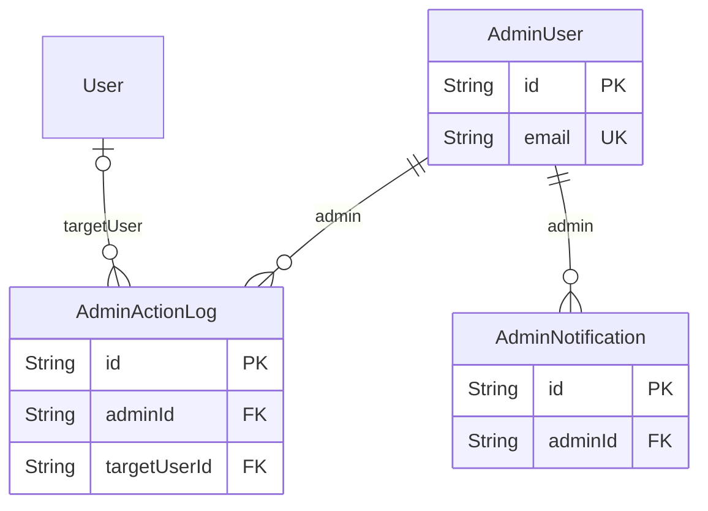

### AdminUser

**Table:** `admin_users` · **Purpose:** Back-office staff account (OWNER / ADMIN / MODERATOR). Kept fully separate from member accounts; signs in with its own cookie.

| Field | Type | Required | Unique | Default | Description |
|---|---|---|---|---|---|
| `id` | `String` | yes | PK | `cuid()` |  |
| `email` | `String` | yes | yes |  |  |
| `passwordHash` | `String` | yes |  |  |  |
| `displayName` | `String` | yes |  |  |  |
| `role` | `AdminRole` | yes |  | `ADMIN` |  |
| `isActive` | `Boolean` | yes |  | `true` |  |
| `lastLoginAt` | `DateTime` | no |  |  |  |
| `createdAt` | `DateTime` | yes |  | `now()` |  |
| `updatedAt` | `DateTime` | yes |  | auto (@updatedAt) |  |

**Relations:** 
- `adminActions` ← many **AdminActionLog** (relation "AdminActor")
- `notifications` ← many **AdminNotification**
- `reportsResolved` ← many **PostReport** (relation "ReportResolver")

**Indexes / constraints:** 
- `@unique(email)`

### AdminActionLog

**Table:** `admin_action_logs` · **Purpose:** Audit trail of admin mutations on members, posts, reports and money (who did what, when, why).

| Field | Type | Required | Unique | Default | Description |
|---|---|---|---|---|---|
| `id` | `String` | yes | PK | `cuid()` |  |
| `adminId` | `String` | yes |  |  | FK (see relations). |
| `action` | `AdminAction` | yes |  |  | What was acted on. Every field except `action` and `createdAt` is optional so the log stays useful once we add non-user targets. |
| `targetUserId` | `String` | no |  |  | FK (see relations). |
| `meta` | `Json` | no |  |  | Free-form JSON snapshot of the change (before/after values, reason strings, etc.). |
| `reason` | `String` (Text) | no |  |  |  |
| `createdAt` | `DateTime` | yes |  | `now()` |  |

**Relations:** 
- `admin` → **AdminUser** via `adminId` (required, onDelete: Cascade, name "AdminActor")
- `targetUser` → **User** via `targetUserId` (optional, onDelete: SetNull, name "AdminActionTarget")

**Indexes / constraints:** 
- `@@index([adminId, createdAt])`
- `@@index([targetUserId, createdAt])`
- `@@index([action])`

### AdminNotification

**Table:** `admin_notifications` · **Purpose:** Per-admin inbox row (fan-out: one row per active admin) for events needing staff attention.

| Field | Type | Required | Unique | Default | Description |
|---|---|---|---|---|---|
| `id` | `String` | yes | PK | `cuid()` |  |
| `adminId` | `String` | yes |  |  | FK (see relations). |
| `type` | `AdminNotifType` | yes |  |  |  |
| `title` | `String` | yes |  |  |  |
| `message` | `String` (Text) | no |  |  |  |
| `actionUrl` | `String` | no |  |  | Optional deep-link that opens when the admin clicks the notif. |
| `readAt` | `DateTime` | no |  |  |  |
| `createdAt` | `DateTime` | yes |  | `now()` |  |

**Relations:** 
- `admin` → **AdminUser** via `adminId` (required, onDelete: Cascade)

**Indexes / constraints:** 
- `@@index([adminId, readAt, createdAt])` — Composite index optimised for the two hot queries: "how many unread do I have?" and "give me my last 20".

---

## Members & account

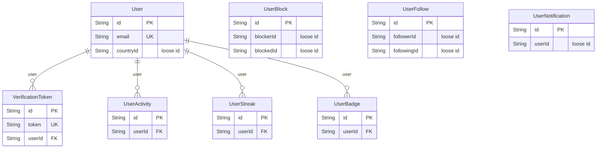

### User

**Table:** `users` · **Purpose:** A member account: profile, moderation state, appearance, digest preferences and session revocation cut-off.

| Field | Type | Required | Unique | Default | Description |
|---|---|---|---|---|---|
| `id` | `String` | yes | PK | `cuid()` |  |
| `email` | `String` | yes | yes |  |  |
| `passwordHash` | `String` | yes |  |  |  |
| `displayName` | `String` | yes |  |  |  |
| `avatarUrl` | `String` | no |  |  |  |
| `coverUrl` | `String` | no |  |  |  |
| `bio` | `String` (Text) | no |  |  |  |
| `location` | `String` | no |  |  |  |
| `anonymousByDefault` | `Boolean` | yes |  | `false` | Anonymous-mode toggle — per-post overrides, this is the default. |
| `isActive` | `Boolean` | yes |  | `true` | Moderation state. • isActive false → soft-deactivated (account frozen, user can no longer sign in, admin can flip back). • bannedAt set → hard-banned; login endpoint rejects with a specific error surfaced to the user. |
| `bannedAt` | `DateTime` | no |  |  |  |
| `followerCount` | `Int` | yes |  | `0` | Denormalised count of UserFollow rows pointing AT this user. |
| `banReason` | `String` (Text) | no |  |  |  |
| `emailVerifiedAt` | `DateTime` | no |  |  | Email verification. Signup can complete without verifying, but some features (posting to Support-tier rooms, etc.) will gate on this later. |
| `lastLoginAt` | `DateTime` | no |  |  |  |
| `countryId` | `String` | no |  |  | Chosen at signup. Loose FK, same as everywhere else — deleting a country must not take its members with it. **Loose id — no relation/FK constraint.** |
| `termsAcceptedAt` | `DateTime` | no |  |  | When they ticked the box, not whether. A boolean answers "did they agree"; a timestamp answers "when, and so to which version" — the only form of the question anyone asks later. |
| `canStream` | `Boolean` | yes |  | `true` | Anyone can go live. This is the off switch for ONE person, used by a moderator — not a permission anybody has to earn. |
| `colorThemeId` | `String` (VarChar(32)) | no |  |  | Appearance. Both nullable, and null is the answer for "never chose", not a broken row — a member who has touched neither gets the default palette and follows their OS for light/dark. |
| `appearanceMode` | `String` (VarChar(8)) | no |  |  | "light" \| "dark" \| "system" \| null. All three choices are stored as themselves. |
| `brandTone` | `Int` | yes |  | `2` | How deep the chosen theme's brand colour runs — 0 lightest, 4 darkest, 2 the default. |
| `pendingEmail` | `String` | no |  |  | An address the member has asked to move to, not yet confirmed. |
| `sessionsValidFrom` | `DateTime` | no |  |  | Session cut-off. Any cookie issued before this instant is dead. |
| `createdAt` | `DateTime` | yes |  | `now()` |  |
| `updatedAt` | `DateTime` | yes |  | auto (@updatedAt) |  |
| `digestEnabled` | `Boolean` | yes |  | `false` | The daily digest. Opt-in, per the plan — an email nobody asked for is not a kindness. |
| `digestHour` | `Int` | yes |  | `8` | Local hour, 0-23, in `timezone`. |
| `timezone` | `String` (VarChar(64)) | no |  |  | IANA name, e.g. "Europe/Dublin". |
| `digestLastSentOn` | `DateTime` (Date) | no |  |  | The last LOCAL date a digest went out, so a runner that fires every hour cannot send twice in one day. |

**Relations:** 
- `streaks` ← many **UserStreak**
- `badges` ← many **UserBadge**
- `activities` ← many **UserActivity**
- `adminActions` ← many **AdminActionLog** (relation "AdminActionTarget")
- `verificationTokens` ← many **VerificationToken**
- `posts` ← many **Post** (relation "PostAuthor")
- `comments` ← many **PostComment** (relation "CommentAuthor")
- `likes` ← many **PostLike**
- `saves` ← many **PostSave**
- `reportsFiled` ← many **PostReport** (relation "Reporter")
- `dailyReflections` ← many **DailyReflection**
- `payoutMethods` ← many **PayoutMethod** (relation "UserPayoutMethods")

**Indexes / constraints:** 
- `@unique(email)`
- `@@index([isActive, bannedAt])`
- `@@index([email])`
- `@@index([countryId])`
- `@@index([isActive, bannedAt, followerCount])` — The members directory's sort key. Leading column matches the WHERE, trailing column the ORDER BY, so a page is one range scan.

**Loose user/row ids (no relation):** `countryId`

### VerificationToken

**Table:** `verification_tokens` · **Purpose:** Single-use token for email confirmation, email change, or password reset (purpose-scoped, expiring).

| Field | Type | Required | Unique | Default | Description |
|---|---|---|---|---|---|
| `id` | `String` | yes | PK | `cuid()` |  |
| `token` | `String` | yes | yes |  |  |
| `userId` | `String` | yes |  |  | FK (see relations). |
| `purpose` | `VerificationPurpose` | yes |  |  |  |
| `expiresAt` | `DateTime` | yes |  |  |  |
| `usedAt` | `DateTime` | no |  |  |  |
| `createdAt` | `DateTime` | yes |  | `now()` |  |

**Relations:** 
- `user` → **User** via `userId` (required, onDelete: Cascade)

**Indexes / constraints:** 
- `@unique(token)`
- `@@index([userId, purpose])` — Look-up index used every request the /verify page handles.
- `@@index([expiresAt])` — For a periodic cleanup job to prune expired-and-used rows.

### UserActivity

**Table:** `user_activities` · **Purpose:** A member's own account event trail (signed up, signed in, password changed...) shown on the admin user page.

| Field | Type | Required | Unique | Default | Description |
|---|---|---|---|---|---|
| `id` | `String` | yes | PK | `cuid()` |  |
| `userId` | `String` | yes |  |  | FK (see relations). |
| `type` | `UserActivityType` | yes |  |  |  |
| `message` | `String` | yes |  |  | Short human-readable summary shown in the activity feed. |
| `meta` | `Json` | no |  |  | Optional structured metadata (e.g. { "from": "old@x.com", "to": "new@x.com" }). |
| `createdAt` | `DateTime` | yes |  | `now()` |  |

**Relations:** 
- `user` → **User** via `userId` (required, onDelete: Cascade)

**Indexes / constraints:** 
- `@@index([userId, createdAt])`
- `@@index([type])`

### UserBlock

**Table:** `user_blocks` · **Purpose:** One member blocking another. Blocking also severs follow edges in both directions (src/lib/blocks.ts).

| Field | Type | Required | Unique | Default | Description |
|---|---|---|---|---|---|
| `id` | `String` | yes | PK | `cuid()` |  |
| `blockerId` | `String` | yes |  |  | **Loose id — no relation/FK constraint.** |
| `blockedId` | `String` | yes |  |  | **Loose id — no relation/FK constraint.** |
| `createdAt` | `DateTime` | yes |  | `now()` |  |

**Relations:** none (no Prisma relations).

**Indexes / constraints:** 
- `@@unique([blockerId, blockedId])`
- `@@index([blockerId])`

**Loose user/row ids (no relation):** `blockerId`, `blockedId`

### UserFollow

**Table:** `user_follows` · **Purpose:** Directional follow edge follower -> following.

| Field | Type | Required | Unique | Default | Description |
|---|---|---|---|---|---|
| `id` | `String` | yes | PK | `cuid()` |  |
| `followerId` | `String` | yes |  |  | **Loose id — no relation/FK constraint.** |
| `followingId` | `String` | yes |  |  | **Loose id — no relation/FK constraint.** |
| `createdAt` | `DateTime` | yes |  | `now()` |  |

**Relations:** none (no Prisma relations).

**Indexes / constraints:** 
- `@@unique([followerId, followingId])`
- `@@index([followerId])`
- `@@index([followingId])`

**Loose user/row ids (no relation):** `followerId`, `followingId`

### UserNotification

**Table:** `user_notifications` · **Purpose:** In-app notification for a member (bell / notifications page). Polled; no push.

| Field | Type | Required | Unique | Default | Description |
|---|---|---|---|---|---|
| `id` | `String` | yes | PK | `cuid()` |  |
| `userId` | `String` | yes |  |  | **Loose id — no relation/FK constraint.** |
| `type` | `UserNotifType` | yes |  |  |  |
| `title` | `String` | yes |  |  |  |
| `body` | `String` (Text) | no |  |  |  |
| `actionUrl` | `String` | no |  |  |  |
| `isRead` | `Boolean` | yes |  | `false` |  |
| `createdAt` | `DateTime` | yes |  | `now()` |  |

**Relations:** none (no Prisma relations).

**Indexes / constraints:** 
- `@@index([userId, isRead, createdAt])`

**Loose user/row ids (no relation):** `userId`

### UserStreak

**Table:** `user_streaks` · **Purpose:** A member-declared day count since a start date (sober, meditation, custom...). Resets are manual; best run kept.

| Field | Type | Required | Unique | Default | Description |
|---|---|---|---|---|---|
| `id` | `String` | yes | PK | `cuid()` |  |
| `userId` | `String` | yes |  |  | FK (see relations). |
| `kind` | `StreakKind` | yes |  |  |  |
| `label` | `String` (VarChar(80)) | no |  |  | Required when kind is CUSTOM, ignored otherwise. |
| `startedOn` | `DateTime` (Date) | yes |  |  | A DATE, not a timestamp — "3 March", not "3 March 00:00 UTC". |
| `isPublic` | `Boolean` | yes |  | `true` | ON by default for anything created from now on — see `startStreak`, where the composer shows the tick before saving. |
| `bestDays` | `Int` | yes |  | `0` | The longest run so far, kept across resets. |
| `resetCount` | `Int` | yes |  | `0` |  |
| `archivedAt` | `DateTime` | no |  |  | Stopped tracking. Kept rather than deleted so the history is not lost the moment somebody tidies up. |
| `createdAt` | `DateTime` | yes |  | `now()` |  |
| `updatedAt` | `DateTime` | yes |  | auto (@updatedAt) |  |

**Relations:** 
- `user` → **User** via `userId` (required, onDelete: Cascade)

**Indexes / constraints:** 
- `@@index([userId, archivedAt])`

### UserBadge

**Table:** `user_badges` · **Purpose:** Record that a member earned a badge; badge rules live in src/lib/badges.ts.

| Field | Type | Required | Unique | Default | Description |
|---|---|---|---|---|---|
| `id` | `String` | yes | PK | `cuid()` |  |
| `userId` | `String` | yes |  |  | FK (see relations). |
| `slug` | `String` (VarChar(60)) | yes |  |  | Matches a slug in the code registry. Kept as a string so an unknown or retired badge degrades to "not shown" rather than breaking a profile. |
| `earnedAt` | `DateTime` | yes |  | `now()` |  |

**Relations:** 
- `user` → **User** via `userId` (required, onDelete: Cascade)

**Indexes / constraints:** 
- `@@unique([userId, slug])`
- `@@index([userId, earnedAt])`

---

## Community wall (posts)

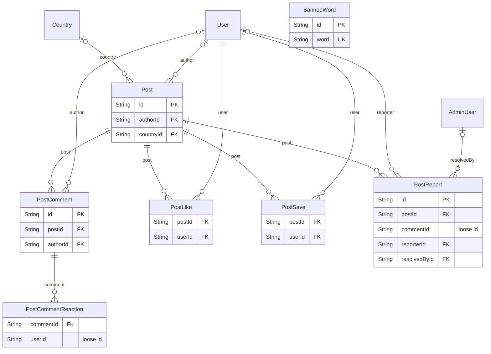

### Post

**Table:** `posts` · **Purpose:** Community wall entry: text, optional images or one converted video, optional anonymity and country scope.

| Field | Type | Required | Unique | Default | Description |
|---|---|---|---|---|---|
| `id` | `String` | yes | PK | `cuid()` |  |
| `authorId` | `String` | no |  |  | nullable so hard-deleting the user doesn't nuke posts FK (see relations). |
| `authorNameSnapshot` | `String` | yes |  |  | "Sarah" — shown when the author row is gone |
| `authorAvatarSnapshot` | `String` | no |  |  |  |
| `body` | `String` (Text) | yes |  |  |  |
| `images` | `Json` | no |  |  | [{ url, alt?, width?, height? }] |
| `video` | `Json` | no |  |  | One converted video per post: { assetId, url, posterUrl, width, height, durationSec }. |
| `isAnonymous` | `Boolean` | yes |  | `false` |  |
| `status` | `PostStatus` | yes |  | `PUBLISHED` |  |
| `removedReason` | `String` (Text) | no |  |  |  |
| `likeCount` | `Int` | yes |  | `0` | Denorm counters — cheap for the feed, refreshed on write. |
| `commentCount` | `Int` | yes |  | `0` |  |
| `saveCount` | `Int` | yes |  | `0` |  |
| `reportCount` | `Int` | yes |  | `0` |  |
| `isFeatured` | `Boolean` | yes |  | `false` | isFeatured surfaces a post on the homepage even when it's older than the feed cutoff. |
| `featuredAt` | `DateTime` | no |  |  |  |
| `countryId` | `String` | no |  |  | Optional country scope so a post can be filtered to someone's local feed. FK (see relations). |
| `createdAt` | `DateTime` | yes |  | `now()` |  |
| `updatedAt` | `DateTime` | yes |  | auto (@updatedAt) |  |

**Relations:** 
- `country` → **Country** via `countryId` (optional, onDelete: SetNull)
- `author` → **User** via `authorId` (optional, onDelete: SetNull, name "PostAuthor")
- `comments` ← many **PostComment**
- `likes` ← many **PostLike**
- `saves` ← many **PostSave**
- `reports` ← many **PostReport**

**Indexes / constraints:** 
- `@@index([status, createdAt])`
- `@@index([authorId, createdAt])`
- `@@index([countryId, status, createdAt])`
- `@@index([isFeatured, featuredAt])`

### PostComment

**Table:** `post_comments` · **Purpose:** Comment on a wall post (flat), with author snapshots and moderation status.

| Field | Type | Required | Unique | Default | Description |
|---|---|---|---|---|---|
| `id` | `String` | yes | PK | `cuid()` |  |
| `postId` | `String` | yes |  |  | FK (see relations). |
| `authorId` | `String` | no |  |  | FK (see relations). |
| `authorNameSnapshot` | `String` | yes |  |  |  |
| `authorAvatarSnapshot` | `String` | no |  |  |  |
| `body` | `String` (Text) | yes |  |  |  |
| `isAnonymous` | `Boolean` | yes |  | `false` |  |
| `status` | `PostStatus` | yes |  | `PUBLISHED` |  |
| `removedReason` | `String` (Text) | no |  |  |  |
| `likeCount` | `Int` | yes |  | `0` | Was declared long before anything wrote it. Reactions are what finally fill it in — recounted from the rows, never incremented. |
| `reportCount` | `Int` | yes |  | `0` |  |
| `createdAt` | `DateTime` | yes |  | `now()` |  |
| `updatedAt` | `DateTime` | yes |  | auto (@updatedAt) |  |

**Relations:** 
- `reactions` ← many **PostCommentReaction**
- `post` → **Post** via `postId` (required, onDelete: Cascade)
- `author` → **User** via `authorId` (optional, onDelete: SetNull, name "CommentAuthor")

**Indexes / constraints:** 
- `@@index([postId, createdAt])`
- `@@index([status])`

### PostLike

**Table:** `post_likes` · **Purpose:** One reaction per member per post (table name kept as post_likes; holds any Reaction type).

| Field | Type | Required | Unique | Default | Description |
|---|---|---|---|---|---|
| `postId` | `String` | yes |  |  | FK (see relations). |
| `userId` | `String` | yes |  |  | FK (see relations). |
| `type` | `Reaction` | yes |  | `LIKE` |  |
| `createdAt` | `DateTime` | yes |  | `now()` |  |

**Relations:** 
- `post` → **Post** via `postId` (required, onDelete: Cascade)
- `user` → **User** via `userId` (required, onDelete: Cascade)

**Indexes / constraints:** 
- `@@id([postId, userId])`
- `@@index([userId, createdAt])`

### PostSave

**Table:** `post_saves` · **Purpose:** Member bookmark of a wall post.

| Field | Type | Required | Unique | Default | Description |
|---|---|---|---|---|---|
| `postId` | `String` | yes |  |  | FK (see relations). |
| `userId` | `String` | yes |  |  | FK (see relations). |
| `createdAt` | `DateTime` | yes |  | `now()` |  |

**Relations:** 
- `post` → **Post** via `postId` (required, onDelete: Cascade)
- `user` → **User** via `userId` (required, onDelete: Cascade)

**Indexes / constraints:** 
- `@@id([postId, userId])`
- `@@index([userId, createdAt])`

### PostReport

**Table:** `post_reports` · **Purpose:** Member report on a post or a comment; drives the moderation queue.

| Field | Type | Required | Unique | Default | Description |
|---|---|---|---|---|---|
| `id` | `String` | yes | PK | `cuid()` |  |
| `targetType` | `ReportTargetType` | yes |  |  |  |
| `postId` | `String` | yes |  |  | always set (comments carry their post too for the join) FK (see relations). |
| `commentId` | `String` | no |  |  | **Loose id — no relation/FK constraint.** |
| `reporterId` | `String` | no |  |  | nullable so deleting the reporter keeps the report row FK (see relations). |
| `reason` | `ReportReason` | yes |  |  |  |
| `notes` | `String` (Text) | no |  |  |  |
| `status` | `ReportStatus` | yes |  | `OPEN` |  |
| `resolvedById` | `String` | no |  |  | FK (see relations). |
| `resolvedAt` | `DateTime` | no |  |  |  |
| `resolution` | `String` (Text) | no |  |  |  |
| `createdAt` | `DateTime` | yes |  | `now()` |  |
| `openKey` | `String` | no |  |  | "POST:<postId>" or "COMMENT:<commentId>" WHILE THE REPORT IS OPEN, and null once it is resolved or dismissed. |

**Relations:** 
- `post` → **Post** via `postId` (required, onDelete: Cascade)
- `reporter` → **User** via `reporterId` (optional, onDelete: SetNull, name "Reporter")
- `resolvedBy` → **AdminUser** via `resolvedById` (optional, onDelete: SetNull, name "ReportResolver")

**Indexes / constraints:** 
- `@@unique([reporterId, openKey])`
- `@@index([status, createdAt])`
- `@@index([postId])`
- `@@index([targetType, status, createdAt])`
- `@@index([reporterId, createdAt])`

**Loose user/row ids (no relation):** `commentId`

### PostCommentReaction

**Table:** `post_comment_reactions` · **Purpose:** One reaction per member per wall-post comment.

| Field | Type | Required | Unique | Default | Description |
|---|---|---|---|---|---|
| `commentId` | `String` | yes |  |  | FK (see relations). |
| `userId` | `String` | yes |  |  | **Loose id — no relation/FK constraint.** |
| `type` | `Reaction` | yes |  | `LIKE` |  |
| `createdAt` | `DateTime` | yes |  | `now()` |  |

**Relations:** 
- `comment` → **PostComment** via `commentId` (required, onDelete: Cascade)

**Indexes / constraints:** 
- `@@id([commentId, userId])`
- `@@index([userId, createdAt])`

**Loose user/row ids (no relation):** `userId`

### BannedWord

**Table:** `banned_words` · **Purpose:** Lower-cased word masked in user-generated text.

| Field | Type | Required | Unique | Default | Description |
|---|---|---|---|---|---|
| `id` | `String` | yes | PK | `cuid()` |  |
| `word` | `String` | yes | yes |  | stored lowercase |
| `createdAt` | `DateTime` | yes |  | `now()` |  |

**Relations:** none (no Prisma relations).

**Indexes / constraints:** 
- `@unique(word)`

---

## Geography

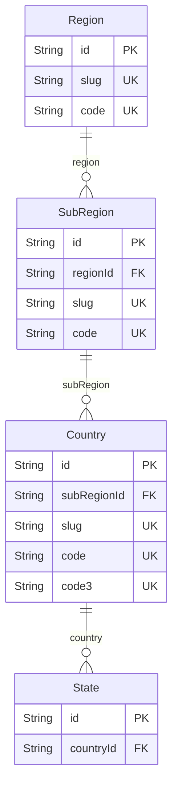

### Region

**Table:** `regions` · **Purpose:** UN M49 region (top of the geography hierarchy).

| Field | Type | Required | Unique | Default | Description |
|---|---|---|---|---|---|
| `id` | `String` | yes | PK | `cuid()` |  |
| `slug` | `String` | yes | yes |  | "africa" |
| `name` | `String` | yes |  |  | "Africa" |
| `code` | `String` | yes | yes |  | UN M49, e.g. "002" |
| `sortOrder` | `Int` | yes |  | `0` |  |
| `isActive` | `Boolean` | yes |  | `true` |  |
| `createdAt` | `DateTime` | yes |  | `now()` |  |
| `updatedAt` | `DateTime` | yes |  | auto (@updatedAt) |  |

**Relations:** 
- `subRegions` ← many **SubRegion**

**Indexes / constraints:** 
- `@unique(slug)`
- `@unique(code)`
- `@@index([isActive, sortOrder])`

### SubRegion

**Table:** `sub_regions` · **Purpose:** UN M49 sub-region under a Region.

| Field | Type | Required | Unique | Default | Description |
|---|---|---|---|---|---|
| `id` | `String` | yes | PK | `cuid()` |  |
| `regionId` | `String` | yes |  |  | FK (see relations). |
| `slug` | `String` | yes | yes |  | "northern-africa" |
| `name` | `String` | yes |  |  | "Northern Africa" |
| `code` | `String` | yes | yes |  | UN M49, e.g. "015" |
| `sortOrder` | `Int` | yes |  | `0` |  |
| `isActive` | `Boolean` | yes |  | `true` |  |
| `createdAt` | `DateTime` | yes |  | `now()` |  |
| `updatedAt` | `DateTime` | yes |  | auto (@updatedAt) |  |

**Relations:** 
- `region` → **Region** via `regionId` (required, onDelete: Cascade)
- `countries` ← many **Country**

**Indexes / constraints:** 
- `@unique(slug)`
- `@unique(code)`
- `@@index([regionId, sortOrder])`
- `@@index([isActive])`

### Country

**Table:** `countries` · **Purpose:** ISO 3166 country; used to scope posts, rooms, events, places, petitions, campaigns.

| Field | Type | Required | Unique | Default | Description |
|---|---|---|---|---|---|
| `id` | `String` | yes | PK | `cuid()` |  |
| `subRegionId` | `String` | yes |  |  | FK (see relations). |
| `slug` | `String` | yes | yes |  | "united-states" |
| `name` | `String` | yes |  |  | "United States" |
| `code` | `String` | yes | yes |  | ISO 3166-1 alpha-2, e.g. "US" |
| `code3` | `String` | no | yes |  | ISO 3166-1 alpha-3, e.g. "USA" |
| `numericCode` | `String` | no |  |  | ISO 3166-1 numeric, e.g. "840" |
| `flagUrl` | `String` (Text) | no |  |  |  |
| `emojiFlag` | `String` | no |  |  | "🇺🇸" for cheap chip rendering |
| `phoneCode` | `String` | no |  |  | "+1" |
| `currency` | `String` | no |  |  | "USD" |
| `language` | `String` | no |  |  | primary language name |
| `sortOrder` | `Int` | yes |  | `0` |  |
| `isActive` | `Boolean` | yes |  | `true` |  |
| `createdAt` | `DateTime` | yes |  | `now()` |  |
| `updatedAt` | `DateTime` | yes |  | auto (@updatedAt) |  |

**Relations:** 
- `subRegion` → **SubRegion** via `subRegionId` (required, onDelete: Cascade)
- `states` ← many **State**
- `posts` ← many **Post**

**Indexes / constraints:** 
- `@unique(slug)`
- `@unique(code)`
- `@unique(code3)`
- `@@index([subRegionId, name])`
- `@@index([isActive])`

### State

**Table:** `states` · **Purpose:** US state (only the US has states, enforced in lib).

| Field | Type | Required | Unique | Default | Description |
|---|---|---|---|---|---|
| `id` | `String` | yes | PK | `cuid()` |  |
| `countryId` | `String` | yes |  |  | FK (see relations). |
| `slug` | `String` | yes |  |  | unique per country, not globally |
| `name` | `String` | yes |  |  | "California" |
| `code` | `String` | yes |  |  | USPS two-letter, e.g. "CA" |
| `capital` | `String` | no |  |  |  |
| `sortOrder` | `Int` | yes |  | `0` |  |
| `isActive` | `Boolean` | yes |  | `true` |  |
| `createdAt` | `DateTime` | yes |  | `now()` |  |
| `updatedAt` | `DateTime` | yes |  | auto (@updatedAt) |  |

**Relations:** 
- `country` → **Country** via `countryId` (required, onDelete: Cascade)

**Indexes / constraints:** 
- `@@unique([countryId, slug])`
- `@@unique([countryId, code])`
- `@@index([countryId, name])`
- `@@index([isActive])`

---

## i18n, settings & page banners

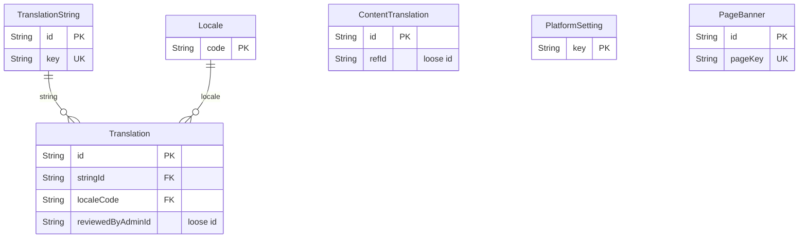

### Locale

**Table:** `locales` · **Purpose:** A language the UI can be shown in; isEnabled controls the picker.

| Field | Type | Required | Unique | Default | Description |
|---|---|---|---|---|---|
| `code` | `String` (VarChar(16)) | yes | PK |  | BCP-47, as Google returns it: "es", "hi", "pt-BR". |
| `name` | `String` (VarChar(80)) | yes |  |  | English name, for the admin list. |
| `nativeName` | `String` (VarChar(80)) | yes |  |  | The language's name in itself — "Espanol", "Hindi" in Devanagari. |
| `direction` | `TextDirection` | yes |  | `LTR` |  |
| `isEnabled` | `Boolean` | yes |  | `false` | Off until somebody turns it on. English is the source and is always enabled; everything else starts dark. |
| `sortOrder` | `Int` | yes |  | `0` |  |
| `createdAt` | `DateTime` | yes |  | `now()` |  |
| `updatedAt` | `DateTime` | yes |  | auto (@updatedAt) |  |

**Relations:** 
- `translations` ← many **Translation**

**Indexes / constraints:** 
- `@@index([isEnabled, sortOrder])`

### TranslationString

**Table:** `translation_strings` · **Purpose:** One English UI string keyed by a stable dotted key (the source catalogue).

| Field | Type | Required | Unique | Default | Description |
|---|---|---|---|---|---|
| `id` | `String` | yes | PK | `cuid()` |  |
| `key` | `String` (VarChar(200)) | yes | yes |  | Dotted and stable: "campaigns.browseBySection". The code asks for this, so renaming one is a code change, not a data edit. |
| `english` | `String` (Text) | yes |  |  | The source text. Changing it should un-review every translation of it — see `sourceHash`. |
| `sourceHash` | `String` (VarChar(64)) | yes |  |  | A hash of `english` at the time each translation was made. When the English changes this stops matching and the admin list can show "the original moved" rather than silently serving a translation of a sentence that no… |
| `context` | `String` (VarChar(300)) | no |  |  | Where it appears, so whoever is translating "Open" knows whether it is a door or a petition. |
| `createdAt` | `DateTime` | yes |  | `now()` |  |
| `updatedAt` | `DateTime` | yes |  | auto (@updatedAt) |  |

**Relations:** 
- `translations` ← many **Translation**

**Indexes / constraints:** 
- `@unique(key)`
- `@@index([key])`

### Translation

**Table:** `translations` · **Purpose:** A UI string translated into one locale (machine or human, with review stamp).

| Field | Type | Required | Unique | Default | Description |
|---|---|---|---|---|---|
| `id` | `String` | yes | PK | `cuid()` |  |
| `stringId` | `String` | yes |  |  | FK (see relations). |
| `localeCode` | `String` | yes |  |  | FK (see relations). |
| `value` | `String` (Text) | yes |  |  |  |
| `source` | `TranslationSource` | yes |  | `GOOGLE` |  |
| `sourceHash` | `String` (VarChar(64)) | yes |  |  | The English this was translated FROM. Compared against the string's current `sourceHash` to spot a translation that has been left behind by an edit to the original. |
| `reviewedAt` | `DateTime` | no |  |  | Set when a person has read it and is happy. Machine output with no review is still shown — a rough translation beats an English sentence somebody cannot read — but the admin list says which. |
| `reviewedByAdminId` | `String` | no |  |  | **Loose id — no relation/FK constraint.** |
| `createdAt` | `DateTime` | yes |  | `now()` |  |
| `updatedAt` | `DateTime` | yes |  | auto (@updatedAt) |  |

**Relations:** 
- `string` → **TranslationString** via `stringId` (required, onDelete: Cascade)
- `locale` → **Locale** via `localeCode` (required, onDelete: Cascade)

**Indexes / constraints:** 
- `@@unique([stringId, localeCode])`
- `@@index([localeCode, source])`

**Loose user/row ids (no relation):** `reviewedByAdminId`

### ContentTranslation

**Table:** `content_translations` · **Purpose:** Cache of on-demand machine translations of member content, keyed by (kind, refId, field, locale).

| Field | Type | Required | Unique | Default | Description |
|---|---|---|---|---|---|
| `id` | `String` | yes | PK | `cuid()` |  |
| `kind` | `String` (VarChar(24)) | yes |  |  | What it points at: "post", "comment", "confession", "room". |
| `refId` | `String` (VarChar(64)) | yes |  |  | **Loose id — no relation/FK constraint.** |
| `field` | `String` (VarChar(24)) | yes |  |  | Which field of it: "body", "title", "name". |
| `localeCode` | `String` (VarChar(16)) | yes |  |  |  |
| `sourceHash` | `String` (VarChar(64)) | yes |  |  | The text this was translated FROM. |
| `value` | `String` (Text) | yes |  |  |  |
| `detected` | `String` (VarChar(16)) | no |  |  | What the translator thought the original was, when it said. Shown nowhere; kept because "translated from Polish" is the first thing anybody asks when a translation reads oddly. |
| `createdAt` | `DateTime` | yes |  | `now()` |  |
| `updatedAt` | `DateTime` | yes |  | auto (@updatedAt) |  |

**Relations:** none (no Prisma relations).

**Indexes / constraints:** 
- `@@unique([kind, refId, field, localeCode])`
- `@@index([localeCode])`

**Loose user/row ids (no relation):** `refId`

### PlatformSetting

**Table:** `platform_settings` · **Purpose:** Key/value JSON configuration row edited from admin settings pages (see platform.md A.2).

| Field | Type | Required | Unique | Default | Description |
|---|---|---|---|---|---|
| `key` | `String` | yes | PK |  |  |
| `group` | `String` | yes |  |  |  |
| `value` | `Json` | yes |  |  |  |
| `updatedAt` | `DateTime` | yes |  | auto (@updatedAt) |  |

**Relations:** none (no Prisma relations).

**Indexes / constraints:** 
- `@@index([group])`

### PageBanner

**Table:** `page_banners` · **Purpose:** Admin override of a page header image/headline/intro, keyed by a page key from src/lib/page-banners.ts.

| Field | Type | Required | Unique | Default | Description |
|---|---|---|---|---|---|
| `id` | `String` | yes | PK | `cuid()` |  |
| `pageKey` | `String` (VarChar(60)) | yes | yes |  |  |
| `imageUrl` | `String` (VarChar(500)) | no |  |  |  |
| `imageAlt` | `String` (VarChar(200)) | no |  |  | Describes the photo for a screen reader. Empty is allowed and correct when the image is pure decoration. |
| `headline` | `String` (VarChar(120)) | no |  |  | Override the page's title. Null keeps the built-in one. |
| `intro` | `String` (Text) | no |  |  | Override the sentence under it. Null keeps the built-in one. `{country}` is substituted with the viewer's country, so the pages whose copy already varied ("Ask for something to change in Ireland") keep doing that afte… |
| `enabled` | `Boolean` | yes |  | `true` | Off hides the IMAGE, not the page. The words still render. |
| `createdAt` | `DateTime` | yes |  | `now()` |  |
| `updatedAt` | `DateTime` | yes |  | auto (@updatedAt) |  |

**Relations:** none (no Prisma relations).

**Indexes / constraints:** 
- `@unique(pageKey)`

---

## Daily reflection & journal

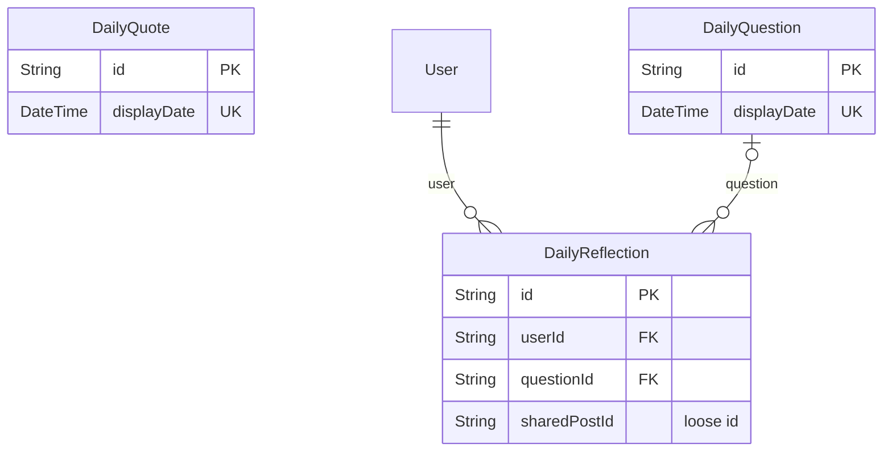

### DailyQuote

**Table:** `daily_quotes` · **Purpose:** The quote shown for a given date (scheduled ahead by admins).

| Field | Type | Required | Unique | Default | Description |
|---|---|---|---|---|---|
| `id` | `String` | yes | PK | `cuid()` |  |
| `body` | `String` (Text) | yes |  |  |  |
| `attribution` | `String` (Text) | no |  |  |  |
| `displayDate` | `DateTime` (Date) | yes | yes |  |  |
| `isActive` | `Boolean` | yes |  | `true` |  |
| `createdAt` | `DateTime` | yes |  | `now()` |  |
| `updatedAt` | `DateTime` | yes |  | auto (@updatedAt) |  |

**Relations:** none (no Prisma relations).

**Indexes / constraints:** 
- `@unique(displayDate)`
- `@@index([isActive, displayDate])`

### DailyQuestion

**Table:** `daily_questions` · **Purpose:** The reflection question for a given date.

| Field | Type | Required | Unique | Default | Description |
|---|---|---|---|---|---|
| `id` | `String` | yes | PK | `cuid()` |  |
| `body` | `String` (Text) | yes |  |  |  |
| `displayDate` | `DateTime` (Date) | yes | yes |  |  |
| `isActive` | `Boolean` | yes |  | `true` |  |
| `createdAt` | `DateTime` | yes |  | `now()` |  |
| `updatedAt` | `DateTime` | yes |  | auto (@updatedAt) |  |

**Relations:** 
- `reflections` ← many **DailyReflection**

**Indexes / constraints:** 
- `@unique(displayDate)`
- `@@index([isActive, displayDate])`

### DailyReflection

**Table:** `daily_reflections` · **Purpose:** Private journal entry, optionally answering that day's question; can be explicitly shared as a post.

| Field | Type | Required | Unique | Default | Description |
|---|---|---|---|---|---|
| `id` | `String` | yes | PK | `cuid()` |  |
| `userId` | `String` | yes |  |  | FK (see relations). |
| `questionId` | `String` | no |  |  | Optional now. Set when the entry answers that day's question, null when the member just wrote something. FK (see relations). |
| `body` | `String` (Text) | yes |  |  |  |
| `sharedPostId` | `String` | no |  |  | The post created when the member chose to share this entry. Non-null means those words are public; it is never set by anything but an explicit share. **Loose id — no relation/FK constraint.** |
| `sharedAt` | `DateTime` | no |  |  |  |
| `createdAt` | `DateTime` | yes |  | `now()` |  |
| `updatedAt` | `DateTime` | yes |  | auto (@updatedAt) |  |

**Relations:** 
- `user` → **User** via `userId` (required, onDelete: Cascade)
- `question` → **DailyQuestion** via `questionId` (optional, onDelete: SetNull)

**Indexes / constraints:** 
- `@@unique([userId, questionId])` — Still one answer per question. MySQL allows many NULLs in a unique index, so free-form entries do not collide.
- `@@index([questionId])`
- `@@index([userId, createdAt])` — The journal itself: a member's entries, newest first.

**Loose user/row ids (no relation):** `sharedPostId`

---

## Email

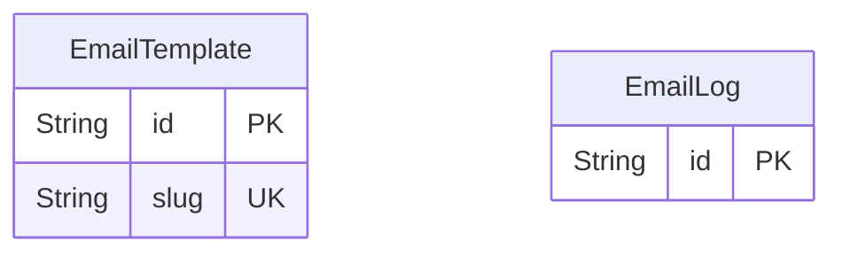

### EmailTemplate

**Table:** `email_templates` · **Purpose:** Admin-editable email template with {{var}} placeholders, addressed by slug.

| Field | Type | Required | Unique | Default | Description |
|---|---|---|---|---|---|
| `id` | `String` | yes | PK | `cuid()` |  |
| `slug` | `String` | yes | yes |  |  |
| `name` | `String` | yes |  |  |  |
| `description` | `String` (Text) | no |  |  |  |
| `subject` | `String` | yes |  |  |  |
| `previewText` | `String` | no |  |  |  |
| `htmlBody` | `String` (LongText) | yes |  |  |  |
| `textBody` | `String` (Text) | no |  |  |  |
| `variables` | `Json` | no |  |  |  |
| `enabled` | `Boolean` | yes |  | `true` |  |
| `createdAt` | `DateTime` | yes |  | `now()` |  |
| `updatedAt` | `DateTime` | yes |  | auto (@updatedAt) |  |

**Relations:** none (no Prisma relations).

**Indexes / constraints:** 
- `@unique(slug)`

### EmailLog

**Table:** `email_logs` · **Purpose:** One row per attempted email send with outcome.

| Field | Type | Required | Unique | Default | Description |
|---|---|---|---|---|---|
| `id` | `String` | yes | PK | `cuid()` |  |
| `templateSlug` | `String` | no |  |  |  |
| `toEmail` | `String` | yes |  |  |  |
| `fromEmail` | `String` | yes |  |  |  |
| `subject` | `String` | yes |  |  |  |
| `status` | `EmailStatus` | yes |  | `QUEUED` |  |
| `providerId` | `String` | no |  |  |  |
| `errorMessage` | `String` (Text) | no |  |  |  |
| `sentAt` | `DateTime` | no |  |  |  |
| `createdAt` | `DateTime` | yes |  | `now()` |  |

**Relations:** none (no Prisma relations).

**Indexes / constraints:** 
- `@@index([status, createdAt])`
- `@@index([toEmail])`
- `@@index([templateSlug])`

---

## Petitions

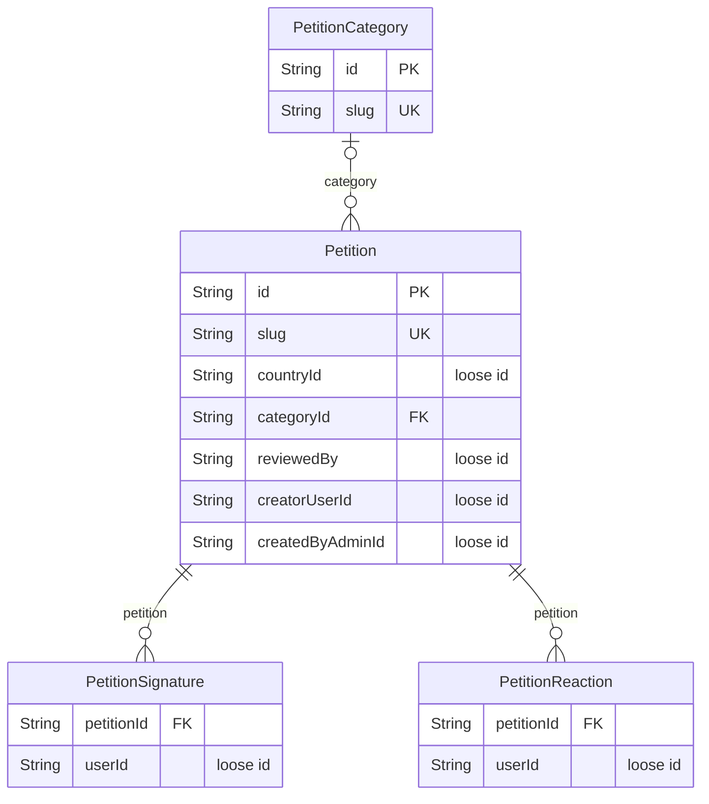

### PetitionCategory

**Table:** `petition_categories` · **Purpose:** Admin-managed petition topic taxonomy.

| Field | Type | Required | Unique | Default | Description |
|---|---|---|---|---|---|
| `id` | `String` | yes | PK | `cuid()` |  |
| `name` | `String` (VarChar(80)) | yes |  |  |  |
| `slug` | `String` (VarChar(80)) | yes | yes |  |  |
| `description` | `String` (VarChar(300)) | no |  |  |  |
| `emoji` | `String` (VarChar(8)) | no |  |  |  |
| `color` | `String` (VarChar(9)) | no |  |  | Hex accent for the tile's icon disc, e.g. "#0ea5e9". |
| `sortOrder` | `Int` | yes |  | `0` |  |
| `isActive` | `Boolean` | yes |  | `true` | Hidden rather than deleted, so the petitions under it keep their category while it stops being offered on new ones. |
| `createdAt` | `DateTime` | yes |  | `now()` |  |
| `updatedAt` | `DateTime` | yes |  | auto (@updatedAt) |  |

**Relations:** 
- `petitions` ← many **Petition**

**Indexes / constraints:** 
- `@unique(slug)`
- `@@index([isActive, sortOrder])`

### Petition

**Table:** `petitions` · **Purpose:** Member- or admin-created petition aimed at a target body; moderated (PENDING -> APPROVED) and signed.

| Field | Type | Required | Unique | Default | Description |
|---|---|---|---|---|---|
| `id` | `String` | yes | PK | `cuid()` |  |
| `slug` | `String` | yes | yes |  |  |
| `title` | `String` (VarChar(200)) | yes |  |  |  |
| `summary` | `String` (VarChar(400)) | no |  |  |  |
| `body` | `String` (Text) | yes |  |  | Markdown, rendered with the same safe renderer as articles. |
| `coverUrl` | `String` | no |  |  |  |
| `photos` | `Json` | no |  |  | Extra photos beyond the cover: [{ url, alt? }]. Same shape and same meaning as Event.photos — the FIRST photo the creator picks becomes coverUrl and the rest land here, so the card has something to show and the page h… |
| `video` | `Json` | no |  |  | One converted video: { assetId, url, posterUrl, width, height, durationSec }. |
| `target` | `String` (VarChar(200)) | yes |  |  | Who it is addressed to — "Springfield City Council". Required: a petition with no addressee is a complaint, and the plan's own example is a specific ask of a specific body. |
| `goal` | `Int` | no |  |  | Signature goal. Null means no goal and no progress bar — a bar stuck near zero discourages the next signature, so a creator who does not set a target does not get one. |
| `countryId` | `String` | no |  |  | **Loose id — no relation/FK constraint.** |
| `categoryId` | `String` | no |  |  | What area this is about. REQUIRED at the edge, NULLABLE in the column — the same split events use: making it non-null would mean a migration that has to invent a category for every petition that already exists, while … FK (see relations). |
| `status` | `PetitionStatus` | yes |  | `PENDING` |  |
| `rejectionReason` | `String` (Text) | no |  |  |  |
| `reviewedAt` | `DateTime` | no |  |  |  |
| `reviewedBy` | `String` | no |  |  | AdminUser.id (loose FK) **Loose id — no relation/FK constraint.** |
| `closesAt` | `DateTime` | no |  |  | Stops taking signatures at this point, without anyone acting. |
| `creatorUserId` | `String` | no |  |  | Creator: a member for community submissions, an admin when the team raises one. **Loose id — no relation/FK constraint.** |
| `creatorNameSnapshot` | `String` (VarChar(120)) | yes |  |  |  |
| `creatorAvatarSnapshot` | `String` | no |  |  |  |
| `createdByAdminId` | `String` | no |  |  | **Loose id — no relation/FK constraint.** |
| `signatureCount` | `Int` | yes |  | `0` | Denormalised for list pages. Corrected from the rows on write. |
| `createdAt` | `DateTime` | yes |  | `now()` |  |
| `updatedAt` | `DateTime` | yes |  | auto (@updatedAt) |  |
| `reactionCount` | `Int` | yes |  | `0` | Reactions are counted separately from signatures and must never be confused with them. |

**Relations:** 
- `category` → **PetitionCategory** via `categoryId` (optional, onDelete: SetNull)
- `signatures` ← many **PetitionSignature**
- `reactions` ← many **PetitionReaction**

**Indexes / constraints:** 
- `@unique(slug)`
- `@@index([status, createdAt])`
- `@@index([countryId, status, createdAt])`
- `@@index([categoryId, status, createdAt])` — The category page's query: one category, newest first.
- `@@index([creatorUserId])`

**Loose user/row ids (no relation):** `countryId`, `reviewedBy`, `creatorUserId`, `createdByAdminId`

### PetitionSignature

**Table:** `petition_signatures` · **Purpose:** One signature per member per petition (composite PK), optional public reason / anonymity.

| Field | Type | Required | Unique | Default | Description |
|---|---|---|---|---|---|
| `petitionId` | `String` | yes |  |  | FK (see relations). |
| `userId` | `String` | yes |  |  | **Loose id — no relation/FK constraint.** |
| `nameSnapshot` | `String` (VarChar(120)) | yes |  |  | Display snapshots so the signer list renders without joining User. |
| `avatarSnapshot` | `String` | no |  |  |  |
| `comment` | `String` (VarChar(400)) | no |  |  | Optional public reason for signing. Often the most persuasive part of a petition — a list of names says how many, a handful of reasons says why. |
| `isAnonymous` | `Boolean` | yes |  | `false` | Counted, but the name is withheld from the public list. Someone signing a petition about family abuse or addiction services may need the count without the exposure. |
| `createdAt` | `DateTime` | yes |  | `now()` |  |

**Relations:** 
- `petition` → **Petition** via `petitionId` (required, onDelete: Cascade)

**Indexes / constraints:** 
- `@@id([petitionId, userId])`
- `@@index([petitionId, createdAt])`
- `@@index([userId, createdAt])`

**Loose user/row ids (no relation):** `userId`

### PetitionReaction

**Table:** `petition_reactions` · **Purpose:** One reaction per member per petition, counted separately from signatures.

| Field | Type | Required | Unique | Default | Description |
|---|---|---|---|---|---|
| `petitionId` | `String` | yes |  |  | FK (see relations). |
| `userId` | `String` | yes |  |  | **Loose id — no relation/FK constraint.** |
| `type` | `Reaction` | yes |  | `LIKE` |  |
| `createdAt` | `DateTime` | yes |  | `now()` |  |

**Relations:** 
- `petition` → **Petition** via `petitionId` (required, onDelete: Cascade)

**Indexes / constraints:** 
- `@@id([petitionId, userId])`
- `@@index([userId, createdAt])`

**Loose user/row ids (no relation):** `userId`

---

## Chat rooms

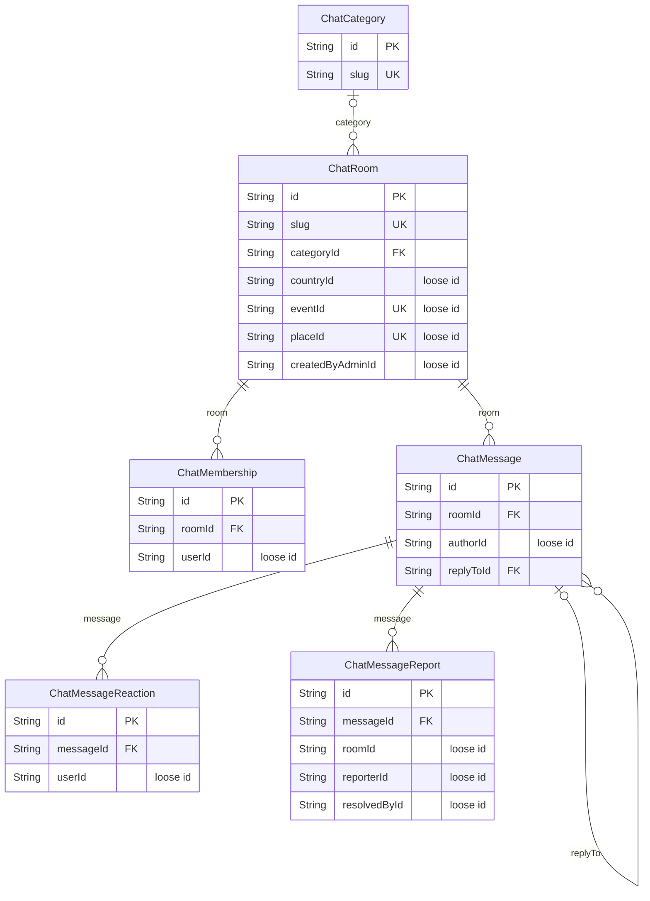

### ChatCategory

**Table:** `chat_categories` · **Purpose:** Grouping for chat rooms.

| Field | Type | Required | Unique | Default | Description |
|---|---|---|---|---|---|
| `id` | `String` | yes | PK | `cuid()` |  |
| `name` | `String` | yes |  |  |  |
| `slug` | `String` | yes | yes |  |  |
| `sortOrder` | `Int` | yes |  | `0` |  |
| `createdAt` | `DateTime` | yes |  | `now()` |  |
| `updatedAt` | `DateTime` | yes |  | auto (@updatedAt) |  |

**Relations:** 
- `rooms` ← many **ChatRoom**

**Indexes / constraints:** 
- `@unique(slug)`
- `@@index([sortOrder])`

### ChatRoom

**Table:** `chat_rooms` · **Purpose:** A persistent chat room (PUBLIC/SUPPORT/CRISIS/CAVALRY tier); also auto-created per approved event/place.

| Field | Type | Required | Unique | Default | Description |
|---|---|---|---|---|---|
| `id` | `String` | yes | PK | `cuid()` |  |
| `slug` | `String` | yes | yes |  |  |
| `name` | `String` | yes |  |  |  |
| `description` | `String` (Text) | no |  |  |  |
| `tier` | `ChatTier` | yes |  | `PUBLIC` |  |
| `status` | `ChatRoomStatus` | yes |  | `ACTIVE` |  |
| `categoryId` | `String` | no |  |  | FK (see relations). |
| `countryId` | `String` | no |  |  | Optional country scope (null = global). Scalar — no relation. **Loose id — no relation/FK constraint.** |
| `emoji` | `String` | no |  |  |  |
| `color` | `String` | no |  |  | hex accent for the room card |
| `allowAnonymous` | `Boolean` | yes |  | `true` |  |
| `isFeatured` | `Boolean` | yes |  | `false` |  |
| `sortOrder` | `Int` | yes |  | `0` |  |
| `slowModeSeconds` | `Int` | yes |  | `0` | Room controls |
| `rulesText` | `String` (Text) | no |  |  |  |
| `memberCount` | `Int` | yes |  | `0` |  |
| `messageCount` | `Int` | yes |  | `0` |  |
| `eventId` | `String` | no | yes |  | Set when this room was created for an event (Delivery 2). Unique so an event can never end up with two rooms. **Loose id — no relation/FK constraint.** |
| `placeId` | `String` | no | yes |  | Same idea for places: one room per place, created on approval. **Loose id — no relation/FK constraint.** |
| `createdByAdminId` | `String` | no |  |  | **Loose id — no relation/FK constraint.** |
| `createdAt` | `DateTime` | yes |  | `now()` |  |
| `updatedAt` | `DateTime` | yes |  | auto (@updatedAt) |  |

**Relations:** 
- `category` → **ChatCategory** via `categoryId` (optional, onDelete: SetNull)
- `memberships` ← many **ChatMembership**
- `messages` ← many **ChatMessage**

**Indexes / constraints:** 
- `@unique(slug)`
- `@unique(eventId)`
- `@unique(placeId)`
- `@@index([status, tier])`
- `@@index([categoryId, sortOrder])`
- `@@index([countryId])`

**Loose user/row ids (no relation):** `countryId`, `eventId`, `placeId`, `createdByAdminId`

### ChatMembership

**Table:** `chat_memberships` · **Purpose:** A member's membership in a room with role, status and read pointer.

| Field | Type | Required | Unique | Default | Description |
|---|---|---|---|---|---|
| `id` | `String` | yes | PK | `cuid()` |  |
| `roomId` | `String` | yes |  |  | FK (see relations). |
| `userId` | `String` | yes |  |  | **Loose id — no relation/FK constraint.** |
| `userName` | `String` | yes |  |  | snapshot for admin member lists |
| `userAvatar` | `String` | no |  |  |  |
| `role` | `ChatMemberRole` | yes |  | `MEMBER` |  |
| `status` | `ChatMemberStatus` | yes |  | `ACTIVE` |  |
| `firstPostApproved` | `Boolean` | yes |  | `false` |  |
| `bannedReason` | `String` (Text) | no |  |  |  |
| `lastReadAt` | `DateTime` | no |  |  |  |
| `lastPostAt` | `DateTime` | no |  |  |  |
| `joinedAt` | `DateTime` | yes |  | `now()` |  |

**Relations:** 
- `room` → **ChatRoom** via `roomId` (required, onDelete: Cascade)

**Indexes / constraints:** 
- `@@unique([roomId, userId])`
- `@@index([userId])`
- `@@index([roomId, status])`

**Loose user/row ids (no relation):** `userId`

### ChatMessage

**Table:** `chat_messages` · **Purpose:** A message in a room, with replies, pinning, attachments and moderation status.

| Field | Type | Required | Unique | Default | Description |
|---|---|---|---|---|---|
| `id` | `String` | yes | PK | `cuid()` |  |
| `roomId` | `String` | yes |  |  | FK (see relations). |
| `authorId` | `String` | no |  |  | **Loose id — no relation/FK constraint.** |
| `authorNameSnapshot` | `String` | yes |  |  |  |
| `authorAvatarSnapshot` | `String` | no |  |  |  |
| `body` | `String` (Text) | yes |  |  |  |
| `isAnonymous` | `Boolean` | yes |  | `false` |  |
| `status` | `ChatMessageStatus` | yes |  | `PUBLISHED` |  |
| `removedReason` | `String` (Text) | no |  |  |  |
| `isPinned` | `Boolean` | yes |  | `false` |  |
| `editedAt` | `DateTime` | no |  |  |  |
| `reportCount` | `Int` | yes |  | `0` |  |
| `attachments` | `Json` | no |  |  |  |
| `replyToId` | `String` | no |  |  | FK (see relations). |
| `createdAt` | `DateTime` | yes |  | `now()` |  |

**Relations:** 
- `room` → **ChatRoom** via `roomId` (required, onDelete: Cascade)
- `replyTo` → **ChatMessage** via `replyToId` (optional, onDelete: SetNull, name "ChatReply")
- `replies` ← many **ChatMessage** (relation "ChatReply")
- `reactions` ← many **ChatMessageReaction**
- `reports` ← many **ChatMessageReport**

**Indexes / constraints:** 
- `@@index([roomId, status, createdAt])`
- `@@index([roomId, isPinned])`
- `@@index([roomId, authorId, createdAt])`

**Loose user/row ids (no relation):** `authorId`

### ChatMessageReaction

**Table:** `chat_message_reactions` · **Purpose:** Emoji reaction on a chat message (one row per member per emoji).

| Field | Type | Required | Unique | Default | Description |
|---|---|---|---|---|---|
| `id` | `String` | yes | PK | `cuid()` |  |
| `messageId` | `String` | yes |  |  | FK (see relations). |
| `userId` | `String` | yes |  |  | **Loose id — no relation/FK constraint.** |
| `emoji` | `String` | yes |  |  |  |
| `createdAt` | `DateTime` | yes |  | `now()` |  |

**Relations:** 
- `message` → **ChatMessage** via `messageId` (required, onDelete: Cascade)

**Indexes / constraints:** 
- `@@unique([messageId, userId, emoji])`
- `@@index([messageId])`

**Loose user/row ids (no relation):** `userId`

### ChatMessageReport

**Table:** `chat_message_reports` · **Purpose:** Member report on a chat message.

| Field | Type | Required | Unique | Default | Description |
|---|---|---|---|---|---|
| `id` | `String` | yes | PK | `cuid()` |  |
| `messageId` | `String` | yes |  |  | FK (see relations). |
| `roomId` | `String` | yes |  |  | **Loose id — no relation/FK constraint.** |
| `reporterId` | `String` | no |  |  | **Loose id — no relation/FK constraint.** |
| `reason` | `ReportReason` | yes |  |  |  |
| `notes` | `String` (Text) | no |  |  |  |
| `status` | `ReportStatus` | yes |  | `OPEN` |  |
| `resolvedById` | `String` | no |  |  | **Loose id — no relation/FK constraint.** |
| `resolvedAt` | `DateTime` | no |  |  |  |
| `createdAt` | `DateTime` | yes |  | `now()` |  |
| `openMessageId` | `String` | no |  |  | The message id while this report is OPEN, null afterwards. Same null-is-distinct trick as PostReport.openKey — see the note there. |

**Relations:** 
- `message` → **ChatMessage** via `messageId` (required, onDelete: Cascade)

**Indexes / constraints:** 
- `@@unique([reporterId, openMessageId])`
- `@@index([status, createdAt])`
- `@@index([roomId, status])`

**Loose user/row ids (no relation):** `roomId`, `reporterId`, `resolvedById`

---

## Confessions

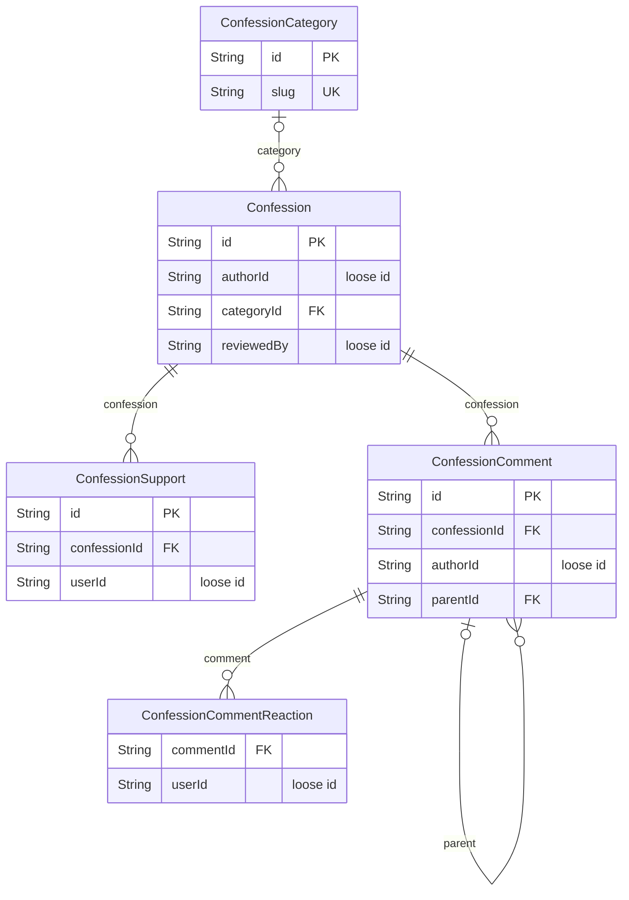

### ConfessionCategory

**Table:** `confession_categories` · **Purpose:** Admin-managed confession category.

| Field | Type | Required | Unique | Default | Description |
|---|---|---|---|---|---|
| `id` | `String` | yes | PK | `cuid()` |  |
| `name` | `String` (VarChar(60)) | yes |  |  |  |
| `slug` | `String` | yes | yes |  |  |
| `description` | `String` (Text) | no |  |  |  |
| `emoji` | `String` (VarChar(8)) | no |  |  | Shown on the filter chip. One character, or none. |
| `sortOrder` | `Int` | yes |  | `0` |  |
| `isActive` | `Boolean` | yes |  | `true` | Hidden rather than deleted, so the posts under it keep their category while it stops being offered on new ones. |
| `createdAt` | `DateTime` | yes |  | `now()` |  |
| `updatedAt` | `DateTime` | yes |  | auto (@updatedAt) |  |

**Relations:** 
- `confessions` ← many **Confession**

**Indexes / constraints:** 
- `@unique(slug)`
- `@@index([isActive, sortOrder])`

### Confession

**Table:** `confessions` · **Purpose:** Anonymous-first sensitive post; always moderated before public display.

| Field | Type | Required | Unique | Default | Description |
|---|---|---|---|---|---|
| `id` | `String` | yes | PK | `cuid()` |  |
| `authorId` | `String` | yes |  |  | **Loose id — no relation/FK constraint.** |
| `authorNameSnapshot` | `String` | yes |  |  |  |
| `authorAvatarSnapshot` | `String` | no |  |  |  |
| `body` | `String` (Text) | yes |  |  |  |
| `imageUrl` | `String` | no |  |  |  |
| `isAnonymous` | `Boolean` | yes |  | `true` |  |
| `video` | `Json` | no |  |  | One converted video: { assetId, url, posterUrl, width, height, durationSec }. |
| `categoryId` | `String` | no |  |  | What it is about. Optional on purpose: someone writing this at 3am should not have to satisfy a dropdown before they can say the difficult thing. FK (see relations). |
| `status` | `ConfessionStatus` | yes |  | `PENDING` |  |
| `rejectionReason` | `String` (Text) | no |  |  |  |
| `reviewedAt` | `DateTime` | no |  |  |  |
| `reviewedBy` | `String` | no |  |  | AdminUser.id (loose FK) **Loose id — no relation/FK constraint.** |
| `supportCount` | `Int` | yes |  | `0` |  |
| `commentCount` | `Int` | yes |  | `0` |  |
| `createdAt` | `DateTime` | yes |  | `now()` |  |

**Relations:** 
- `category` → **ConfessionCategory** via `categoryId` (optional, onDelete: SetNull)
- `supports` ← many **ConfessionSupport**
- `comments` ← many **ConfessionComment**

**Indexes / constraints:** 
- `@@index([status, createdAt])`
- `@@index([createdAt, id])`
- `@@index([authorId])`
- `@@index([status, categoryId, createdAt])` — The browse query: approved, in this category, newest first.

**Loose user/row ids (no relation):** `authorId`, `reviewedBy`

### ConfessionSupport

**Table:** `confession_supports` · **Purpose:** One reaction per member per confession (supportCount counts people).

| Field | Type | Required | Unique | Default | Description |
|---|---|---|---|---|---|
| `id` | `String` | yes | PK | `cuid()` |  |
| `confessionId` | `String` | yes |  |  | FK (see relations). |
| `userId` | `String` | yes |  |  | **Loose id — no relation/FK constraint.** |
| `type` | `Reaction` | yes |  | `LIKE` | Which reaction. The table keeps its name — it is still one row per person per confession, and `supportCount` still counts people, not reactions. |
| `createdAt` | `DateTime` | yes |  | `now()` |  |

**Relations:** 
- `confession` → **Confession** via `confessionId` (required, onDelete: Cascade)

**Indexes / constraints:** 
- `@@unique([confessionId, userId])`
- `@@index([userId])`

**Loose user/row ids (no relation):** `userId`

### ConfessionComment

**Table:** `confession_comments` · **Purpose:** Comment on a confession (one level of replies), posts instantly with banned-word masking.

| Field | Type | Required | Unique | Default | Description |
|---|---|---|---|---|---|
| `id` | `String` | yes | PK | `cuid()` |  |
| `confessionId` | `String` | yes |  |  | FK (see relations). |
| `authorId` | `String` | yes |  |  | **Loose id — no relation/FK constraint.** |
| `authorNameSnapshot` | `String` | yes |  |  |  |
| `authorAvatarSnapshot` | `String` | no |  |  |  |
| `body` | `String` (Text) | yes |  |  |  |
| `isAnonymous` | `Boolean` | yes |  | `false` |  |
| `likeCount` | `Int` | yes |  | `0` |  |
| `parentId` | `String` | no |  |  | Threading, one level deep — a reply to a reply is re-parented to the top-level comment. FK (see relations). |
| `createdAt` | `DateTime` | yes |  | `now()` |  |

**Relations:** 
- `parent` → **ConfessionComment** via `parentId` (optional, onDelete: Cascade, name "ConfessionCommentReplies")
- `replies` ← many **ConfessionComment** (relation "ConfessionCommentReplies")
- `reactions` ← many **ConfessionCommentReaction**
- `confession` → **Confession** via `confessionId` (required, onDelete: Cascade)

**Indexes / constraints:** 
- `@@index([confessionId, createdAt])`
- `@@index([parentId, createdAt])`
- `@@index([authorId])`

**Loose user/row ids (no relation):** `authorId`

### ConfessionCommentReaction

**Table:** `confession_comment_reactions` · **Purpose:** One reaction per member per confession comment.

| Field | Type | Required | Unique | Default | Description |
|---|---|---|---|---|---|
| `commentId` | `String` | yes |  |  | FK (see relations). |
| `userId` | `String` | yes |  |  | **Loose id — no relation/FK constraint.** |
| `type` | `Reaction` | yes |  | `LIKE` |  |
| `createdAt` | `DateTime` | yes |  | `now()` |  |

**Relations:** 
- `comment` → **ConfessionComment** via `commentId` (required, onDelete: Cascade)

**Indexes / constraints:** 
- `@@id([commentId, userId])`
- `@@index([userId, createdAt])`

**Loose user/row ids (no relation):** `userId`

---

## Gratitude wall

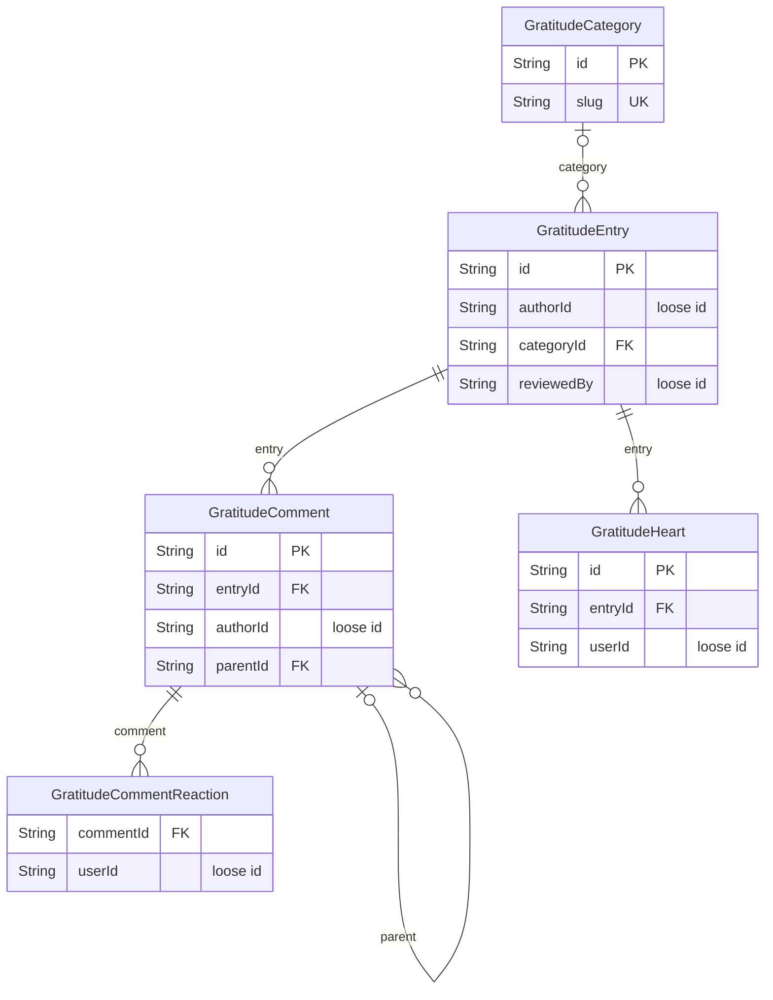

### GratitudeCategory

**Table:** `gratitude_categories` · **Purpose:** Admin-managed gratitude wall category.

| Field | Type | Required | Unique | Default | Description |
|---|---|---|---|---|---|
| `id` | `String` | yes | PK | `cuid()` |  |
| `name` | `String` (VarChar(60)) | yes |  |  |  |
| `slug` | `String` | yes | yes |  |  |
| `description` | `String` (Text) | no |  |  |  |
| `emoji` | `String` (VarChar(8)) | no |  |  |  |
| `sortOrder` | `Int` | yes |  | `0` |  |
| `isActive` | `Boolean` | yes |  | `true` |  |
| `createdAt` | `DateTime` | yes |  | `now()` |  |
| `updatedAt` | `DateTime` | yes |  | auto (@updatedAt) |  |

**Relations:** 
- `entries` ← many **GratitudeEntry**

**Indexes / constraints:** 
- `@unique(slug)`
- `@@index([isActive, sortOrder])`

### GratitudeEntry

**Table:** `gratitude_entries` · **Purpose:** Gratitude wall post (text + optional photo or video), moderated before appearing.

| Field | Type | Required | Unique | Default | Description |
|---|---|---|---|---|---|
| `id` | `String` | yes | PK | `cuid()` |  |
| `authorId` | `String` | yes |  |  | **Loose id — no relation/FK constraint.** |
| `authorNameSnapshot` | `String` | yes |  |  |  |
| `authorAvatarSnapshot` | `String` | no |  |  |  |
| `body` | `String` (Text) | yes |  |  |  |
| `imageUrl` | `String` | no |  |  |  |
| `isAnonymous` | `Boolean` | yes |  | `false` |  |
| `video` | `Json` | no |  |  | One converted video: { assetId, url, posterUrl, width, height, durationSec }. |
| `categoryId` | `String` | no |  |  | Optional, same reasoning as confessions. FK (see relations). |
| `heartCount` | `Int` | yes |  | `0` |  |
| `commentCount` | `Int` | yes |  | `0` | Recounted from the rows on every write, never incremented — the same rule the rest of this codebase follows. |
| `status` | `GratitudeStatus` | yes |  | `PENDING` | Moderation: new entries wait for admin approval before appearing on the public wall. |
| `rejectionReason` | `String` (Text) | no |  |  |  |
| `reviewedAt` | `DateTime` | no |  |  |  |
| `reviewedBy` | `String` | no |  |  | AdminUser.id (loose FK) **Loose id — no relation/FK constraint.** |
| `createdAt` | `DateTime` | yes |  | `now()` |  |

**Relations:** 
- `category` → **GratitudeCategory** via `categoryId` (optional, onDelete: SetNull)
- `hearts` ← many **GratitudeHeart**
- `comments` ← many **GratitudeComment**

**Indexes / constraints:** 
- `@@index([status, createdAt])`
- `@@index([createdAt, id])`
- `@@index([authorId])`
- `@@index([status, categoryId, createdAt])`

**Loose user/row ids (no relation):** `authorId`, `reviewedBy`

### GratitudeComment

**Table:** `gratitude_comments` · **Purpose:** Reply on a gratitude entry (one level deep).

| Field | Type | Required | Unique | Default | Description |
|---|---|---|---|---|---|
| `id` | `String` | yes | PK | `cuid()` |  |
| `entryId` | `String` | yes |  |  | FK (see relations). |
| `authorId` | `String` | yes |  |  | **Loose id — no relation/FK constraint.** |
| `authorNameSnapshot` | `String` | yes |  |  |  |
| `authorAvatarSnapshot` | `String` | no |  |  |  |
| `body` | `String` (Text) | yes |  |  |  |
| `isAnonymous` | `Boolean` | yes |  | `false` |  |
| `parentId` | `String` | no |  |  | FK (see relations). |
| `likeCount` | `Int` | yes |  | `0` |  |
| `createdAt` | `DateTime` | yes |  | `now()` |  |
| `updatedAt` | `DateTime` | yes |  | auto (@updatedAt) |  |

**Relations:** 
- `parent` → **GratitudeComment** via `parentId` (optional, onDelete: Cascade, name "GratitudeCommentReplies")
- `replies` ← many **GratitudeComment** (relation "GratitudeCommentReplies")
- `reactions` ← many **GratitudeCommentReaction**
- `entry` → **GratitudeEntry** via `entryId` (required, onDelete: Cascade)

**Indexes / constraints:** 
- `@@index([entryId, createdAt])` — The thread query: one entry, oldest first.
- `@@index([parentId, createdAt])`
- `@@index([authorId])`

**Loose user/row ids (no relation):** `authorId`

### GratitudeHeart

**Table:** `gratitude_hearts` · **Purpose:** One reaction per member per gratitude entry.

| Field | Type | Required | Unique | Default | Description |
|---|---|---|---|---|---|
| `id` | `String` | yes | PK | `cuid()` |  |
| `entryId` | `String` | yes |  |  | FK (see relations). |
| `userId` | `String` | yes |  |  | **Loose id — no relation/FK constraint.** |
| `type` | `Reaction` | yes |  | `LIKE` |  |
| `createdAt` | `DateTime` | yes |  | `now()` |  |

**Relations:** 
- `entry` → **GratitudeEntry** via `entryId` (required, onDelete: Cascade)

**Indexes / constraints:** 
- `@@unique([entryId, userId])`
- `@@index([userId])`

**Loose user/row ids (no relation):** `userId`

### GratitudeCommentReaction

**Table:** `gratitude_comment_reactions` · **Purpose:** One reaction per member per gratitude comment.

| Field | Type | Required | Unique | Default | Description |
|---|---|---|---|---|---|
| `commentId` | `String` | yes |  |  | FK (see relations). |
| `userId` | `String` | yes |  |  | **Loose id — no relation/FK constraint.** |
| `type` | `Reaction` | yes |  | `LIKE` |  |
| `createdAt` | `DateTime` | yes |  | `now()` |  |

**Relations:** 
- `comment` → **GratitudeComment** via `commentId` (required, onDelete: Cascade)

**Indexes / constraints:** 
- `@@id([commentId, userId])`
- `@@index([userId, createdAt])`

**Loose user/row ids (no relation):** `userId`

---

## Direct messages

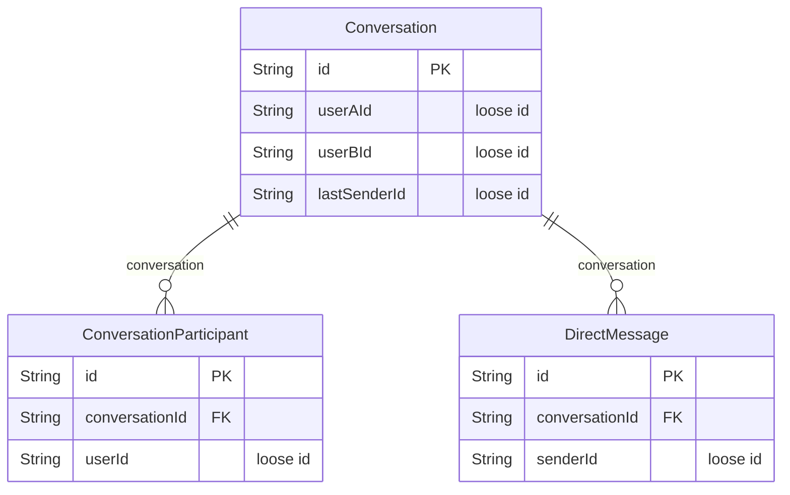

### Conversation

**Table:** `conversations` · **Purpose:** A 1:1 direct-message thread; the user pair is stored sorted and unique.

| Field | Type | Required | Unique | Default | Description |
|---|---|---|---|---|---|
| `id` | `String` | yes | PK | `cuid()` |  |
| `userAId` | `String` | yes |  |  | **Loose id — no relation/FK constraint.** |
| `userBId` | `String` | yes |  |  | **Loose id — no relation/FK constraint.** |
| `lastMessageAt` | `DateTime` | yes |  | `now()` |  |
| `lastMessageText` | `String` (Text) | no |  |  |  |
| `lastSenderId` | `String` | no |  |  | **Loose id — no relation/FK constraint.** |
| `createdAt` | `DateTime` | yes |  | `now()` |  |

**Relations:** 
- `participants` ← many **ConversationParticipant**
- `messages` ← many **DirectMessage**

**Indexes / constraints:** 
- `@@unique([userAId, userBId])`
- `@@index([userAId])`
- `@@index([userBId])`

**Loose user/row ids (no relation):** `userAId`, `userBId`, `lastSenderId`

### ConversationParticipant

**Table:** `conversation_participants` · **Purpose:** Per-member state in a conversation (accepted request, read, typing, archived, muted).

| Field | Type | Required | Unique | Default | Description |
|---|---|---|---|---|---|
| `id` | `String` | yes | PK | `cuid()` |  |
| `conversationId` | `String` | yes |  |  | FK (see relations). |
| `userId` | `String` | yes |  |  | **Loose id — no relation/FK constraint.** |
| `isAccepted` | `Boolean` | yes |  | `true` | false = this thread is a pending request for this user (sender is someone they don't follow). |
| `lastReadAt` | `DateTime` | no |  |  |  |
| `typingAt` | `DateTime` | no |  |  |  |
| `archivedAt` | `DateTime` | no |  |  |  |
| `mutedAt` | `DateTime` | no |  |  |  |
| `createdAt` | `DateTime` | yes |  | `now()` |  |

**Relations:** 
- `conversation` → **Conversation** via `conversationId` (required, onDelete: Cascade)

**Indexes / constraints:** 
- `@@unique([conversationId, userId])`
- `@@index([userId, isAccepted])`

**Loose user/row ids (no relation):** `userId`

### DirectMessage

**Table:** `direct_messages` · **Purpose:** One message in a DM conversation (text and/or image, soft-deletable).

| Field | Type | Required | Unique | Default | Description |
|---|---|---|---|---|---|
| `id` | `String` | yes | PK | `cuid()` |  |
| `conversationId` | `String` | yes |  |  | FK (see relations). |
| `senderId` | `String` | yes |  |  | **Loose id — no relation/FK constraint.** |
| `body` | `String` (Text) | yes |  |  |  |
| `imageUrl` | `String` | no |  |  |  |
| `deletedAt` | `DateTime` | no |  |  |  |
| `createdAt` | `DateTime` | yes |  | `now()` |  |

**Relations:** 
- `conversation` → **Conversation** via `conversationId` (required, onDelete: Cascade)

**Indexes / constraints:** 
- `@@index([conversationId, createdAt])`

**Loose user/row ids (no relation):** `senderId`

---

## Articles (magazine)

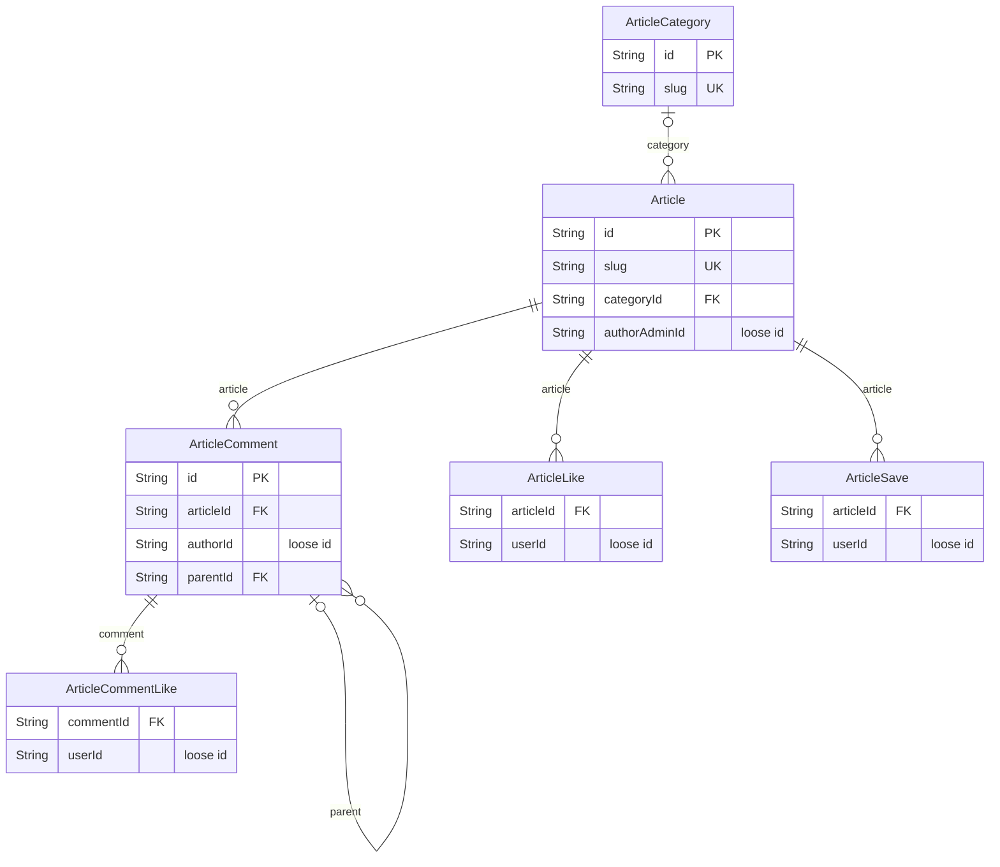

### ArticleCategory

**Table:** `article_categories` · **Purpose:** Magazine category tile.

| Field | Type | Required | Unique | Default | Description |
|---|---|---|---|---|---|
| `id` | `String` | yes | PK | `cuid()` |  |
| `name` | `String` | yes |  |  |  |
| `slug` | `String` | yes | yes |  |  |
| `description` | `String` (Text) | no |  |  |  |
| `emoji` | `String` (VarChar(8)) | no |  |  | Shown on the category tile. Same pair as LiveCategory and EventCategory — a grid of tiles with no emoji and no accent is a list of links wearing a box. |
| `color` | `String` (VarChar(9)) | no |  |  | Hex accent, e.g. "#0ea5e9". |
| `sortOrder` | `Int` | yes |  | `0` |  |
| `createdAt` | `DateTime` | yes |  | `now()` |  |
| `updatedAt` | `DateTime` | yes |  | auto (@updatedAt) |  |

**Relations:** 
- `articles` ← many **Article**

**Indexes / constraints:** 
- `@unique(slug)`
- `@@index([sortOrder])`

### Article

**Table:** `articles` · **Purpose:** Admin-authored long-form magazine article (Markdown body).

| Field | Type | Required | Unique | Default | Description |
|---|---|---|---|---|---|
| `id` | `String` | yes | PK | `cuid()` |  |
| `slug` | `String` | yes | yes |  |  |
| `title` | `String` (VarChar(200)) | yes |  |  |  |
| `excerpt` | `String` (VarChar(400)) | no |  |  |  |
| `body` | `String` (Text) | yes |  |  |  |
| `coverUrl` | `String` | no |  |  | Cover art for the index card + reader header. Inline images live inside `body` as Markdown image syntax. |
| `coverAlt` | `String` | no |  |  |  |
| `photos` | `Json` | no |  |  | Extra photos beyond the cover: [{ url, alt? }]. Same shape and same meaning as Campaign.photos, Place.photos, Event.photos and Petition.photos — one component renders all five. |
| `videoUrl` | `String` | no |  |  | Optional YouTube / Vimeo URL rendered as an embed in the reader. |
| `categoryId` | `String` | no |  |  | FK (see relations). |
| `status` | `ArticleStatus` | yes |  | `DRAFT` |  |
| `isFeatured` | `Boolean` | yes |  | `false` |  |
| `featuredAt` | `DateTime` | no |  |  |  |
| `publishedAt` | `DateTime` | no |  |  |  |
| `readMinutes` | `Int` | yes |  | `1` | Estimated reading time in minutes, computed from body length on save. |
| `authorAdminId` | `String` | no |  |  | Author is an admin (loose FK) plus snapshots so the byline survives the admin row being removed. **Loose id — no relation/FK constraint.** |
| `authorNameSnapshot` | `String` | yes |  |  |  |
| `authorAvatarSnapshot` | `String` | no |  |  |  |
| `viewCount` | `Int` | yes |  | `0` | Denormalised counters — cheap for index cards, refreshed on write. |
| `likeCount` | `Int` | yes |  | `0` |  |
| `saveCount` | `Int` | yes |  | `0` |  |
| `commentCount` | `Int` | yes |  | `0` |  |
| `createdAt` | `DateTime` | yes |  | `now()` |  |
| `updatedAt` | `DateTime` | yes |  | auto (@updatedAt) |  |

**Relations:** 
- `category` → **ArticleCategory** via `categoryId` (optional, onDelete: SetNull)
- `comments` ← many **ArticleComment**
- `likes` ← many **ArticleLike**
- `saves` ← many **ArticleSave**
- `campaigns` ← many **CampaignArticle**

**Indexes / constraints:** 
- `@unique(slug)`
- `@@index([status, publishedAt])`
- `@@index([categoryId, status, publishedAt])`
- `@@index([isFeatured, featuredAt])`

**Loose user/row ids (no relation):** `authorAdminId`

### ArticleComment

**Table:** `article_comments` · **Purpose:** Member comment on an article (one level of replies).

| Field | Type | Required | Unique | Default | Description |
|---|---|---|---|---|---|
| `id` | `String` | yes | PK | `cuid()` |  |
| `articleId` | `String` | yes |  |  | FK (see relations). |
| `authorId` | `String` | yes |  |  | **Loose id — no relation/FK constraint.** |
| `authorNameSnapshot` | `String` | yes |  |  |  |
| `authorAvatarSnapshot` | `String` | no |  |  |  |
| `body` | `String` (Text) | yes |  |  |  |
| `isAnonymous` | `Boolean` | yes |  | `false` |  |
| `status` | `ArticleCommentStatus` | yes |  | `PUBLISHED` |  |
| `removedReason` | `String` (Text) | no |  |  |  |
| `parentId` | `String` | no |  |  | Threading. Deliberately capped at ONE level of replies: a reply to a reply is re-parented to the top-level comment (see addArticleComment). FK (see relations). |
| `likeCount` | `Int` | yes |  | `0` |  |
| `createdAt` | `DateTime` | yes |  | `now()` |  |
| `updatedAt` | `DateTime` | yes |  | auto (@updatedAt) |  |

**Relations:** 
- `parent` → **ArticleComment** via `parentId` (optional, onDelete: Cascade, name "ArticleCommentReplies")
- `replies` ← many **ArticleComment** (relation "ArticleCommentReplies")
- `likes` ← many **ArticleCommentLike**
- `article` → **Article** via `articleId` (required, onDelete: Cascade)

**Indexes / constraints:** 
- `@@index([articleId, status, createdAt])`
- `@@index([parentId, createdAt])`
- `@@index([authorId])`

**Loose user/row ids (no relation):** `authorId`

### ArticleCommentLike

**Table:** `article_comment_likes` · **Purpose:** One reaction per member per article comment.

| Field | Type | Required | Unique | Default | Description |
|---|---|---|---|---|---|
| `commentId` | `String` | yes |  |  | FK (see relations). |
| `userId` | `String` | yes |  |  | **Loose id — no relation/FK constraint.** |
| `type` | `Reaction` | yes |  | `LIKE` |  |
| `createdAt` | `DateTime` | yes |  | `now()` |  |

**Relations:** 
- `comment` → **ArticleComment** via `commentId` (required, onDelete: Cascade)

**Indexes / constraints:** 
- `@@id([commentId, userId])`
- `@@index([userId, createdAt])`

**Loose user/row ids (no relation):** `userId`

### ArticleLike

**Table:** `article_likes` · **Purpose:** One reaction per member per article.

| Field | Type | Required | Unique | Default | Description |
|---|---|---|---|---|---|
| `articleId` | `String` | yes |  |  | FK (see relations). |
| `userId` | `String` | yes |  |  | **Loose id — no relation/FK constraint.** |
| `type` | `Reaction` | yes |  | `LIKE` |  |
| `createdAt` | `DateTime` | yes |  | `now()` |  |

**Relations:** 
- `article` → **Article** via `articleId` (required, onDelete: Cascade)

**Indexes / constraints:** 
- `@@id([articleId, userId])`
- `@@index([userId, createdAt])`

**Loose user/row ids (no relation):** `userId`

### ArticleSave

**Table:** `article_saves` · **Purpose:** Member bookmark of an article.

| Field | Type | Required | Unique | Default | Description |
|---|---|---|---|---|---|
| `articleId` | `String` | yes |  |  | FK (see relations). |
| `userId` | `String` | yes |  |  | **Loose id — no relation/FK constraint.** |
| `createdAt` | `DateTime` | yes |  | `now()` |  |

**Relations:** 
- `article` → **Article** via `articleId` (required, onDelete: Cascade)

**Indexes / constraints:** 
- `@@id([articleId, userId])`
- `@@index([userId, createdAt])`

**Loose user/row ids (no relation):** `userId`

---

## Events

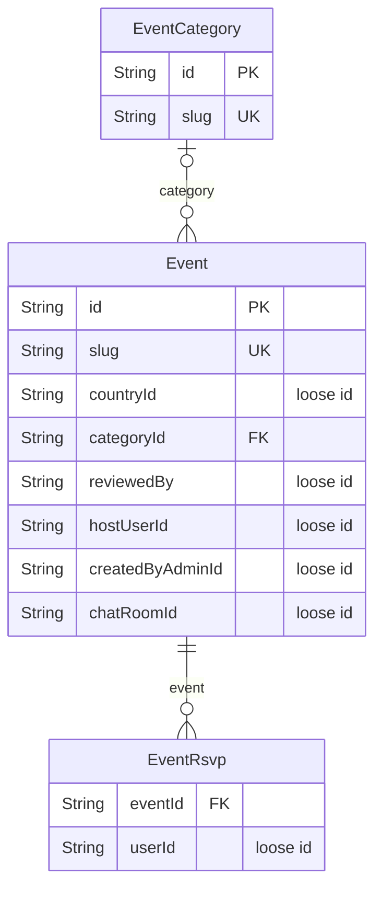

### EventCategory

**Table:** `event_categories` · **Purpose:** Admin-managed event category (required on submit).

| Field | Type | Required | Unique | Default | Description |
|---|---|---|---|---|---|
| `id` | `String` | yes | PK | `cuid()` |  |
| `name` | `String` (VarChar(80)) | yes |  |  |  |
| `slug` | `String` (VarChar(80)) | yes | yes |  |  |
| `description` | `String` (VarChar(300)) | no |  |  |  |
| `emoji` | `String` (VarChar(8)) | no |  |  |  |
| `color` | `String` (VarChar(9)) | no |  |  | Hex accent for the chip, e.g. "#0ea5e9". |
| `sortOrder` | `Int` | yes |  | `0` |  |
| `isActive` | `Boolean` | yes |  | `true` |  |
| `createdAt` | `DateTime` | yes |  | `now()` |  |
| `updatedAt` | `DateTime` | yes |  | auto (@updatedAt) |  |

**Relations:** 
- `events` ← many **Event**

**Indexes / constraints:** 
- `@unique(slug)`
- `@@index([isActive, sortOrder])`

### Event

**Table:** `events` · **Purpose:** Real-world or online gathering; member submissions are moderated; approved events get a chat room.

| Field | Type | Required | Unique | Default | Description |
|---|---|---|---|---|---|
| `id` | `String` | yes | PK | `cuid()` |  |
| `slug` | `String` | yes | yes |  |  |
| `title` | `String` (VarChar(200)) | yes |  |  |  |
| `summary` | `String` (VarChar(400)) | no |  |  |  |
| `description` | `String` (Text) | yes |  |  | Markdown, rendered with the same safe renderer as articles. |
| `coverUrl` | `String` | no |  |  |  |
| `photos` | `Json` | no |  |  | Extra photos beyond the cover: [{ url, alt? }]. A flyer, shots from last time, the meeting point — the things that make someone confident enough to actually turn up. |
| `startsAt` | `DateTime` | yes |  |  | When. `startsAt`/`endsAt` are UTC instants; `timezone` is the IANA zone (e.g. |
| `endsAt` | `DateTime` | no |  |  |  |
| `timezone` | `String` | yes |  | `"UTC"` |  |
| `isOnline` | `Boolean` | yes |  | `false` | Where. Online events carry a joinUrl instead of a venue. |
| `joinUrl` | `String` | no |  |  |  |
| `venueName` | `String` | no |  |  |  |
| `addressLine` | `String` | no |  |  |  |
| `city` | `String` | no |  |  |  |
| `countryId` | `String` | no |  |  | Scalar country scope, matching ChatRoom — the country picker filters the calendar. **Loose id — no relation/FK constraint.** |
| `categoryId` | `String` | no |  |  | What kind of thing this is. Nullable in the SCHEMA so the migration lands on existing rows, and required by the API — the same split used for LiveStream.categoryId. FK (see relations). |
| `capacity` | `Int` | no |  |  | Optional cap. Null = unlimited. |
| `status` | `EventStatus` | yes |  | `PENDING` |  |
| `rejectionReason` | `String` (Text) | no |  |  |  |
| `reviewedAt` | `DateTime` | no |  |  |  |
| `reviewedBy` | `String` | no |  |  | AdminUser.id (loose FK) **Loose id — no relation/FK constraint.** |
| `hostUserId` | `String` | no |  |  | Organiser: a member for community submissions, or an admin when the team creates it directly. **Loose id — no relation/FK constraint.** |
| `hostNameSnapshot` | `String` | yes |  |  |  |
| `hostAvatarSnapshot` | `String` | no |  |  |  |
| `createdByAdminId` | `String` | no |  |  | **Loose id — no relation/FK constraint.** |
| `chatRoomId` | `String` | no |  |  | Every approved event gets a chatroom so attendees can coordinate beforehand and keep talking afterwards. **Loose id — no relation/FK constraint.** |
| `rsvpCount` | `Int` | yes |  | `0` |  |
| `createdAt` | `DateTime` | yes |  | `now()` |  |
| `updatedAt` | `DateTime` | yes |  | auto (@updatedAt) |  |

**Relations:** 
- `category` → **EventCategory** via `categoryId` (optional, onDelete: SetNull)
- `rsvps` ← many **EventRsvp**
- `campaigns` ← many **CampaignEvent**

**Indexes / constraints:** 
- `@unique(slug)`
- `@@index([status, startsAt])`
- `@@index([countryId, status, startsAt])`
- `@@index([hostUserId])`
- `@@index([categoryId, status, startsAt])` — Backs the category chips on the calendar.

**Loose user/row ids (no relation):** `countryId`, `reviewedBy`, `hostUserId`, `createdByAdminId`, `chatRoomId`

### EventRsvp

**Table:** `event_rsvps` · **Purpose:** A member's RSVP to an event.

| Field | Type | Required | Unique | Default | Description |
|---|---|---|---|---|---|
| `eventId` | `String` | yes |  |  | FK (see relations). |
| `userId` | `String` | yes |  |  | **Loose id — no relation/FK constraint.** |
| `nameSnapshot` | `String` | yes |  |  | Display snapshots so the attendee list renders without joining User. |
| `avatarSnapshot` | `String` | no |  |  |  |
| `createdAt` | `DateTime` | yes |  | `now()` |  |

**Relations:** 
- `event` → **Event** via `eventId` (required, onDelete: Cascade)

**Indexes / constraints:** 
- `@@id([eventId, userId])`
- `@@index([userId, createdAt])`

**Loose user/row ids (no relation):** `userId`

---

## Library (themes & clips)

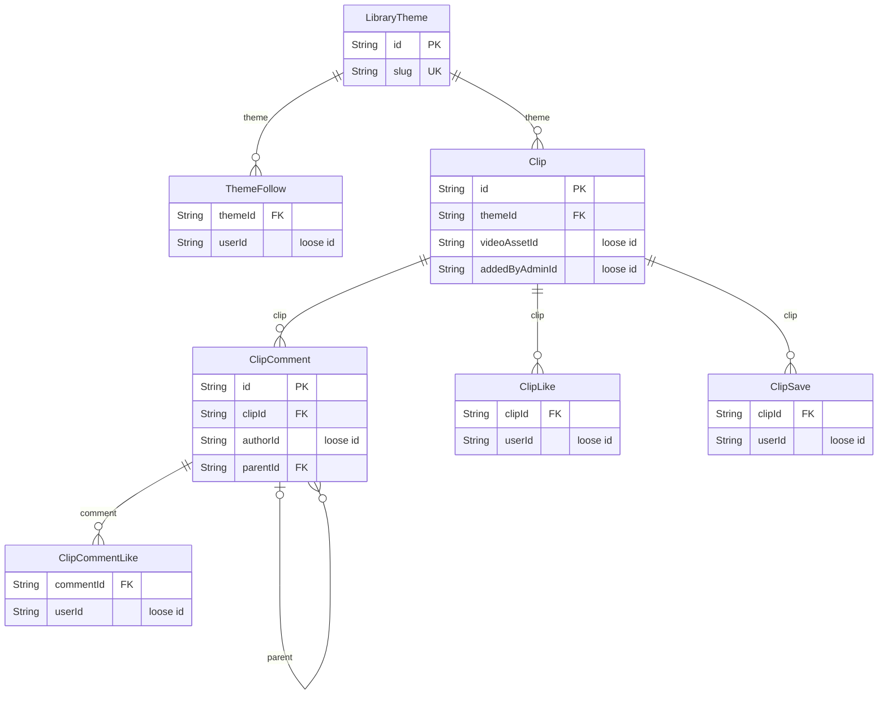

### LibraryTheme

**Table:** `library_themes` · **Purpose:** A Library theme (formerly Fanbase) grouping short clips.

| Field | Type | Required | Unique | Default | Description |
|---|---|---|---|---|---|
| `id` | `String` | yes | PK | `cuid()` |  |
| `slug` | `String` | yes | yes |  |  |
| `name` | `String` (VarChar(120)) | yes |  |  |  |
| `tagline` | `String` (VarChar(240)) | no |  |  |  |
| `about` | `String` (Text) | no |  |  | Longer copy for the theme page header. Markdown. |
| `coverUrl` | `String` | no |  |  |  |
| `emoji` | `String` (VarChar(8)) | no |  |  | Emoji shown where there is no cover — cheap, and it survives a missing image better than a grey box. |
| `isActive` | `Boolean` | yes |  | `true` |  |
| `sortOrder` | `Int` | yes |  | `0` |  |
| `followerCount` | `Int` | yes |  | `0` | Denormalised counters, same convention as Article. |
| `clipCount` | `Int` | yes |  | `0` |  |
| `createdAt` | `DateTime` | yes |  | `now()` |  |
| `updatedAt` | `DateTime` | yes |  | auto (@updatedAt) |  |

**Relations:** 
- `clips` ← many **Clip**
- `follows` ← many **ThemeFollow**

**Indexes / constraints:** 
- `@unique(slug)`
- `@@index([isActive, sortOrder])`

### ThemeFollow

**Table:** `theme_follows` · **Purpose:** Member following a Library theme.

| Field | Type | Required | Unique | Default | Description |
|---|---|---|---|---|---|
| `themeId` | `String` | yes |  |  | FK (see relations). |
| `userId` | `String` | yes |  |  | **Loose id — no relation/FK constraint.** |
| `createdAt` | `DateTime` | yes |  | `now()` |  |

**Relations:** 
- `theme` → **LibraryTheme** via `themeId` (required, onDelete: Cascade)

**Indexes / constraints:** 
- `@@id([themeId, userId])`
- `@@index([userId, createdAt])`

**Loose user/row ids (no relation):** `userId`

### Clip

**Table:** `clips` · **Purpose:** A Library clip: either an embed URL or an uploaded, converted video.

| Field | Type | Required | Unique | Default | Description |
|---|---|---|---|---|---|
| `id` | `String` | yes | PK | `cuid()` |  |
| `themeId` | `String` | yes |  |  | FK (see relations). |
| `title` | `String` (VarChar(200)) | yes |  |  |  |
| `caption` | `String` (Text) | no |  |  |  |
| `kind` | `ClipKind` | yes |  | `EMBED` |  |
| `embedUrl` | `String` (VarChar(500)) | no |  |  | EMBED — the original URL as pasted. Resolved to a safe iframe src at render time by src/lib/embeds.ts; never stored pre-resolved, so a fix to the whitelist applies retroactively. |
| `videoAssetId` | `String` | no |  |  | UPLOAD — populated from a converted VideoAsset. The URL is copied rather than joined so a clip keeps working if the asset row is ever pruned. **Loose id — no relation/FK constraint.** |
| `videoUrl` | `String` (VarChar(500)) | no |  |  |  |
| `posterUrl` | `String` (VarChar(500)) | no |  |  |  |
| `width` | `Int` | no |  |  |  |
| `height` | `Int` | no |  |  |  |
| `durationSec` | `Float` | no |  |  |  |
| `isPublished` | `Boolean` | yes |  | `true` |  |
| `publishedAt` | `DateTime` | no |  |  |  |
| `sortOrder` | `Int` | yes |  | `0` |  |
| `likeCount` | `Int` | yes |  | `0` |  |
| `saveCount` | `Int` | yes |  | `0` |  |
| `viewCount` | `Int` | yes |  | `0` |  |
| `commentCount` | `Int` | yes |  | `0` | Recounted on every write rather than incremented — a counter that drifts is worse than one that costs a COUNT. |
| `addedByAdminId` | `String` | no |  |  | **Loose id — no relation/FK constraint.** |
| `createdAt` | `DateTime` | yes |  | `now()` |  |
| `updatedAt` | `DateTime` | yes |  | auto (@updatedAt) |  |

**Relations:** 
- `theme` → **LibraryTheme** via `themeId` (required, onDelete: Cascade)
- `likes` ← many **ClipLike**
- `saves` ← many **ClipSave**
- `comments` ← many **ClipComment**

**Indexes / constraints:** 
- `@@index([themeId, isPublished, sortOrder])`
- `@@index([isPublished, publishedAt])`

**Loose user/row ids (no relation):** `videoAssetId`, `addedByAdminId`

### ClipComment

**Table:** `clip_comments` · **Purpose:** Comment on a clip (one level of replies).

| Field | Type | Required | Unique | Default | Description |
|---|---|---|---|---|---|
| `id` | `String` | yes | PK | `cuid()` |  |
| `clipId` | `String` | yes |  |  | FK (see relations). |
| `authorId` | `String` | yes |  |  | **Loose id — no relation/FK constraint.** |
| `authorNameSnapshot` | `String` | yes |  |  |  |
| `authorAvatarSnapshot` | `String` | no |  |  |  |
| `body` | `String` (Text) | yes |  |  |  |
| `isAnonymous` | `Boolean` | yes |  | `false` |  |
| `status` | `ClipCommentStatus` | yes |  | `PUBLISHED` |  |
| `removedReason` | `String` (Text) | no |  |  |  |
| `parentId` | `String` | no |  |  | FK (see relations). |
| `likeCount` | `Int` | yes |  | `0` |  |
| `createdAt` | `DateTime` | yes |  | `now()` |  |
| `updatedAt` | `DateTime` | yes |  | auto (@updatedAt) |  |

**Relations:** 
- `parent` → **ClipComment** via `parentId` (optional, onDelete: Cascade, name "ClipCommentReplies")
- `replies` ← many **ClipComment** (relation "ClipCommentReplies")
- `likes` ← many **ClipCommentLike**
- `clip` → **Clip** via `clipId` (required, onDelete: Cascade)

**Indexes / constraints:** 
- `@@index([clipId, status, createdAt])` — The thread query: one clip, published, oldest first.
- `@@index([parentId, createdAt])`
- `@@index([authorId])`

**Loose user/row ids (no relation):** `authorId`

### ClipCommentLike

**Table:** `clip_comment_likes` · **Purpose:** One reaction per member per clip comment.

| Field | Type | Required | Unique | Default | Description |
|---|---|---|---|---|---|
| `commentId` | `String` | yes |  |  | FK (see relations). |
| `userId` | `String` | yes |  |  | **Loose id — no relation/FK constraint.** |
| `type` | `Reaction` | yes |  | `LIKE` |  |
| `createdAt` | `DateTime` | yes |  | `now()` |  |

**Relations:** 
- `comment` → **ClipComment** via `commentId` (required, onDelete: Cascade)

**Indexes / constraints:** 
- `@@id([commentId, userId])`
- `@@index([userId, createdAt])`

**Loose user/row ids (no relation):** `userId`

### ClipLike

**Table:** `clip_likes` · **Purpose:** One reaction per member per clip.

| Field | Type | Required | Unique | Default | Description |
|---|---|---|---|---|---|
| `clipId` | `String` | yes |  |  | FK (see relations). |
| `userId` | `String` | yes |  |  | **Loose id — no relation/FK constraint.** |
| `type` | `Reaction` | yes |  | `LIKE` |  |
| `createdAt` | `DateTime` | yes |  | `now()` |  |

**Relations:** 
- `clip` → **Clip** via `clipId` (required, onDelete: Cascade)

**Indexes / constraints:** 
- `@@id([clipId, userId])`
- `@@index([userId, createdAt])`

**Loose user/row ids (no relation):** `userId`

### ClipSave

**Table:** `clip_saves` · **Purpose:** Member bookmark of a clip.

| Field | Type | Required | Unique | Default | Description |
|---|---|---|---|---|---|
| `clipId` | `String` | yes |  |  | FK (see relations). |
| `userId` | `String` | yes |  |  | **Loose id — no relation/FK constraint.** |
| `createdAt` | `DateTime` | yes |  | `now()` |  |

**Relations:** 
- `clip` → **Clip** via `clipId` (required, onDelete: Cascade)

**Indexes / constraints:** 
- `@@id([clipId, userId])`
- `@@index([userId, createdAt])`

**Loose user/row ids (no relation):** `userId`

---

## Media (uploads & video)

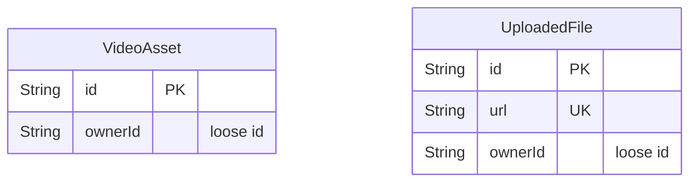

### VideoAsset

**Table:** `video_assets` · **Purpose:** An uploaded video and its conversion progress; source of every video URL in content.

| Field | Type | Required | Unique | Default | Description |
|---|---|---|---|---|---|
| `id` | `String` | yes | PK | `cuid()` |  |
| `status` | `VideoStatus` | yes |  | `UPLOADING` |  |
| `ownerId` | `String` | no |  |  | Who uploaded it. Loose FK on purpose, matching the rest of the schema: a deleted account must not cascade away a post's video. **Loose id — no relation/FK constraint.** |
| `ownerKind` | `String` | yes |  | `"USER"` | USER \| ADMIN |
| `category` | `String` | yes |  | `"clips"` |  |
| `originalName` | `String` (VarChar(300)) | yes |  |  |  |
| `originalMime` | `String` (VarChar(120)) | no |  |  |  |
| `originalSize` | `Int` (UnsignedInt) | no |  |  |  |
| `url` | `String` (VarChar(500)) | no |  |  | Populated once conversion succeeds. |
| `posterUrl` | `String` (VarChar(500)) | no |  |  |  |
| `width` | `Int` | no |  |  |  |
| `height` | `Int` | no |  |  |  |
| `durationSec` | `Float` | no |  |  |  |
| `outputSize` | `Int` (UnsignedInt) | no |  |  |  |
| `percent` | `Int` | yes |  | `0` | Progress, written by the converter and read by the poller. |
| `etaSeconds` | `Int` | no |  |  |  |
| `stage` | `String` (VarChar(60)) | yes |  | `""` |  |
| `heartbeatAt` | `DateTime` | no |  |  |  |
| `error` | `String` (Text) | no |  |  |  |
| `createdAt` | `DateTime` | yes |  | `now()` |  |
| `updatedAt` | `DateTime` | yes |  | auto (@updatedAt) |  |

**Relations:** none (no Prisma relations).

**Indexes / constraints:** 
- `@@index([ownerId, createdAt])`
- `@@index([status, createdAt])`

**Loose user/row ids (no relation):** `ownerId`

### UploadedFile

**Table:** `uploaded_files` · **Purpose:** Ownership record for every file written to public/uploads; deletion works only from these rows.

| Field | Type | Required | Unique | Default | Description |
|---|---|---|---|---|---|
| `id` | `String` | yes | PK | `cuid()` |  |
| `url` | `String` (VarChar(500)) | yes | yes |  | The public URL exactly as it is stored on referencing rows, e.g. |
| `relPath` | `String` (VarChar(500)) | yes |  |  | Path relative to public/, which is what actually gets unlinked. |
| `category` | `String` (VarChar(40)) | yes |  |  |  |
| `bytes` | `Int` (UnsignedInt) | yes |  |  |  |
| `mime` | `String` (VarChar(120)) | no |  |  |  |
| `ownerId` | `String` | no |  |  | Loose FK, like the rest of the schema. USER \| ADMIN \| SYSTEM. **Loose id — no relation/FK constraint.** |
| `ownerKind` | `String` (VarChar(10)) | yes |  | `"USER"` |  |
| `createdAt` | `DateTime` | yes |  | `now()` |  |

**Relations:** none (no Prisma relations).

**Indexes / constraints:** 
- `@unique(url)`
- `@@index([ownerId, createdAt])`
- `@@index([category, createdAt])`

**Loose user/row ids (no relation):** `ownerId`

---

## Campaigns

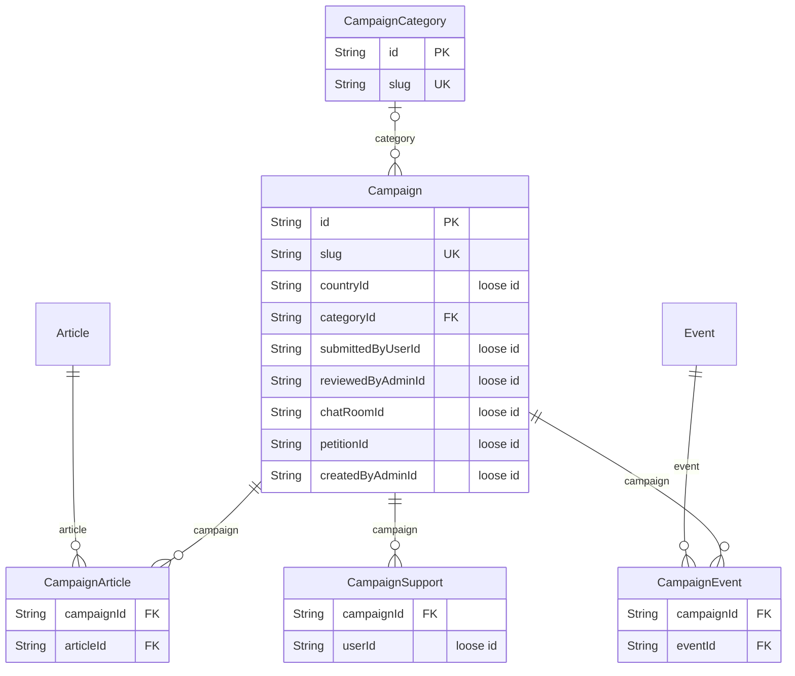

### CampaignCategory

**Table:** `campaign_categories` · **Purpose:** Admin-managed campaign category (required on submit).

| Field | Type | Required | Unique | Default | Description |
|---|---|---|---|---|---|
| `id` | `String` | yes | PK | `cuid()` |  |
| `name` | `String` (VarChar(80)) | yes |  |  |  |
| `slug` | `String` (VarChar(80)) | yes | yes |  |  |
| `description` | `String` (VarChar(300)) | no |  |  |  |
| `emoji` | `String` (VarChar(8)) | no |  |  |  |
| `color` | `String` (VarChar(9)) | no |  |  | Hex accent for the tile's icon disc, e.g. "#0ea5e9". |
| `sortOrder` | `Int` | yes |  | `0` |  |
| `isActive` | `Boolean` | yes |  | `true` | Hidden rather than deleted, so the campaigns under it keep their category while it stops being offered on new ones. |
| `createdAt` | `DateTime` | yes |  | `now()` |  |
| `updatedAt` | `DateTime` | yes |  | auto (@updatedAt) |  |

**Relations:** 
- `campaigns` ← many **Campaign**

**Indexes / constraints:** 
- `@unique(slug)`
- `@@index([isActive, sortOrder])`

### Campaign

**Table:** `campaigns` · **Purpose:** Awareness campaign page aggregating existing articles, events, a room and a petition.

| Field | Type | Required | Unique | Default | Description |
|---|---|---|---|---|---|
| `id` | `String` | yes | PK | `cuid()` |  |
| `slug` | `String` | yes | yes |  |  |
| `title` | `String` (VarChar(200)) | yes |  |  |  |
| `summary` | `String` (VarChar(400)) | no |  |  | One line for the index card. |
| `body` | `String` (Text) | no |  |  | The case for the cause. Markdown, rendered by the shared renderer. |
| `coverUrl` | `String` | no |  |  |  |
| `photos` | `Json` | no |  |  | Extra photos beyond the cover: [{ url, alt? }]. Same shape and same meaning as Event.photos and Petition.photos — the FIRST photo the creator picks becomes coverUrl and the rest land here, so the card has something to… |
| `emoji` | `String` (VarChar(8)) | no |  |  |  |
| `callToAction` | `String` (VarChar(120)) | no |  |  | What someone is being asked to do — "Sign the pledge", "Come to the march". |
| `ctaUrl` | `String` (VarChar(500)) | no |  |  |  |
| `status` | `CampaignStatus` | yes |  | `DRAFT` |  |
| `publishedAt` | `DateTime` | no |  |  |  |
| `startsAt` | `DateTime` | no |  |  | Optional window, so a campaign can read as finished without being deleted. |
| `endsAt` | `DateTime` | no |  |  |  |
| `countryId` | `String` | no |  |  | Country scoping, the same way posts and events do it. **Loose id — no relation/FK constraint.** |
| `categoryId` | `String` | no |  |  | What this is organised around. REQUIRED at the edge, NULLABLE in the column — the same split petitions and events use. FK (see relations). |
| `submittedByUserId` | `String` | no |  |  | Loose FK plus a snapshot, exactly as places and petitions do it: the byline has to survive the account being deleted. **Loose id — no relation/FK constraint.** |
| `submitterNameSnapshot` | `String` (VarChar(120)) | no |  |  |  |
| `submitterAvatarSnapshot` | `String` | no |  |  |  |
| `reviewNote` | `String` (Text) | no |  |  | Why it was turned down, or a note from whoever approved it. |
| `reviewedAt` | `DateTime` | no |  |  |  |
| `reviewedByAdminId` | `String` | no |  |  | **Loose id — no relation/FK constraint.** |
| `chatRoomId` | `String` | no |  |  | Loose FKs on purpose: deleting the chatroom or the petition must not cascade the whole campaign away. **Loose id — no relation/FK constraint.** |
| `petitionId` | `String` | no |  |  | Resolved by the campaign reader against the petitions table. **Loose id — no relation/FK constraint.** |
| `supporterCount` | `Int` | yes |  | `0` |  |
| `createdByAdminId` | `String` | no |  |  | **Loose id — no relation/FK constraint.** |
| `createdAt` | `DateTime` | yes |  | `now()` |  |
| `updatedAt` | `DateTime` | yes |  | auto (@updatedAt) |  |

**Relations:** 
- `category` → **CampaignCategory** via `categoryId` (optional, onDelete: SetNull)
- `articles` ← many **CampaignArticle**
- `events` ← many **CampaignEvent**
- `supports` ← many **CampaignSupport**

**Indexes / constraints:** 
- `@unique(slug)`
- `@@index([status, publishedAt])`
- `@@index([countryId, status])`
- `@@index([categoryId, status, publishedAt])` — The category page's query: one category, newest published first.
- `@@index([submittedByUserId])` — "What have I sent in?", and the admin queue's submitter column.

**Loose user/row ids (no relation):** `countryId`, `submittedByUserId`, `reviewedByAdminId`, `chatRoomId`, `petitionId`, `createdByAdminId`

### CampaignArticle

**Table:** `campaign_articles` · **Purpose:** Join: article linked to a campaign (ordered).

| Field | Type | Required | Unique | Default | Description |
|---|---|---|---|---|---|
| `campaignId` | `String` | yes |  |  | FK (see relations). |
| `articleId` | `String` | yes |  |  | FK (see relations). |
| `sortOrder` | `Int` | yes |  | `0` |  |

**Relations:** 
- `campaign` → **Campaign** via `campaignId` (required, onDelete: Cascade)
- `article` → **Article** via `articleId` (required, onDelete: Cascade)

**Indexes / constraints:** 
- `@@id([campaignId, articleId])`
- `@@index([articleId])`

### CampaignEvent

**Table:** `campaign_events` · **Purpose:** Join: event linked to a campaign (ordered).

| Field | Type | Required | Unique | Default | Description |
|---|---|---|---|---|---|
| `campaignId` | `String` | yes |  |  | FK (see relations). |
| `eventId` | `String` | yes |  |  | FK (see relations). |
| `sortOrder` | `Int` | yes |  | `0` |  |

**Relations:** 
- `campaign` → **Campaign** via `campaignId` (required, onDelete: Cascade)
- `event` → **Event** via `eventId` (required, onDelete: Cascade)

**Indexes / constraints:** 
- `@@id([campaignId, eventId])`
- `@@index([eventId])`

### CampaignSupport

**Table:** `campaign_supports` · **Purpose:** A member supporting a campaign.

| Field | Type | Required | Unique | Default | Description |
|---|---|---|---|---|---|
| `campaignId` | `String` | yes |  |  | FK (see relations). |
| `userId` | `String` | yes |  |  | **Loose id — no relation/FK constraint.** |
| `createdAt` | `DateTime` | yes |  | `now()` |  |

**Relations:** 
- `campaign` → **Campaign** via `campaignId` (required, onDelete: Cascade)

**Indexes / constraints:** 
- `@@id([campaignId, userId])`
- `@@index([userId, createdAt])`

**Loose user/row ids (no relation):** `userId`

---

## Places (map & directory)

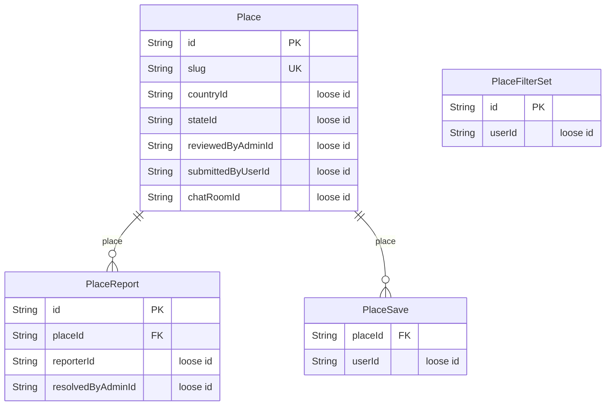

### Place

**Table:** `places` · **Purpose:** Directory/map listing of a real place (clinic, food bank...), geocoded on save, moderated.

| Field | Type | Required | Unique | Default | Description |
|---|---|---|---|---|---|
| `id` | `String` | yes | PK | `cuid()` |  |
| `slug` | `String` | yes | yes |  |  |
| `name` | `String` (VarChar(200)) | yes |  |  |  |
| `type` | `PlaceType` | yes |  | `OTHER` |  |
| `summary` | `String` (VarChar(400)) | no |  |  |  |
| `about` | `String` (Text) | no |  |  | Longer description. Markdown. |
| `addressLine` | `String` (VarChar(300)) | no |  |  |  |
| `city` | `String` (VarChar(120)) | no |  |  |  |
| `postcode` | `String` (VarChar(30)) | no |  |  |  |
| `countryId` | `String` | no |  |  | **Loose id — no relation/FK constraint.** |
| `stateId` | `String` | no |  |  | **Loose id — no relation/FK constraint.** |
| `latitude` | `Float` | no |  |  | Set by the geocoder, or typed by an admin who knows better. |
| `longitude` | `Float` | no |  |  |  |
| `geocodedAt` | `DateTime` | no |  |  |  |
| `geocodeError` | `String` (VarChar(300)) | no |  |  | Why the last geocode failed, so a missing pin is explainable. |
| `phone` | `String` (VarChar(40)) | no |  |  |  |
| `email` | `String` (VarChar(200)) | no |  |  |  |
| `website` | `String` (VarChar(500)) | no |  |  |  |
| `hours` | `Json` | no |  |  | [{ day: 0-6, opens: "09:00", closes: "17:00", closed?: true }] |
| `needs` | `String` (Text) | no |  |  | Free text — "Drivers on Saturdays", "Tinned fish, nappies". |
| `coverUrl` | `String` | no |  |  |  |
| `photos` | `Json` | no |  |  | Extra photos beyond the cover: [{ url, alt? }]. Same shape and same meaning as Event.photos and Petition.photos — the FIRST photo the creator picks becomes coverUrl and the rest land here, so the card has something to… |
| `isDonor` | `Boolean` | yes |  | `false` | Local shops that donate get a badge rather than a separate type. |
| `status` | `PlaceStatus` | yes |  | `PENDING` |  |
| `reviewNote` | `String` (Text) | no |  |  |  |
| `reviewedAt` | `DateTime` | no |  |  |  |
| `reviewedByAdminId` | `String` | no |  |  | **Loose id — no relation/FK constraint.** |
| `submittedByUserId` | `String` | no |  |  | Submitter, loose FK plus a snapshot, same as events. **Loose id — no relation/FK constraint.** |
| `submitterSnapshot` | `String` (VarChar(120)) | no |  |  |  |
| `chatRoomId` | `String` | no |  |  | One chatroom per place, created on approval — ask a question before showing up. **Loose id — no relation/FK constraint.** |
| `saveCount` | `Int` | yes |  | `0` |  |
| `viewCount` | `Int` | yes |  | `0` |  |
| `createdAt` | `DateTime` | yes |  | `now()` |  |
| `updatedAt` | `DateTime` | yes |  | auto (@updatedAt) |  |

**Relations:** 
- `saves` ← many **PlaceSave**
- `reports` ← many **PlaceReport**

**Indexes / constraints:** 
- `@unique(slug)`
- `@@index([status, type])`
- `@@index([countryId, status])`
- `@@index([status, latitude, longitude])` — The map queries a bounding box; without this every pan is a scan.
- `@@index([submittedByUserId])`

**Loose user/row ids (no relation):** `countryId`, `stateId`, `reviewedByAdminId`, `submittedByUserId`, `chatRoomId`

### PlaceReport

**Table:** `place_reports` · **Purpose:** Member report that a listing is wrong/stale.

| Field | Type | Required | Unique | Default | Description |
|---|---|---|---|---|---|
| `id` | `String` | yes | PK | `cuid()` |  |
| `placeId` | `String` | yes |  |  | FK (see relations). |
| `kind` | `PlaceReportKind` | yes |  |  |  |
| `notes` | `String` (Text) | no |  |  | What they say is wrong, or what it should say instead. |
| `reporterId` | `String` | no |  |  | Loose FK plus a snapshot, same convention as events and places: deleting the member leaves the report readable. **Loose id — no relation/FK constraint.** |
| `reporterSnapshot` | `String` (VarChar(120)) | no |  |  |  |
| `status` | `ReportStatus` | yes |  | `OPEN` |  |
| `resolvedByAdminId` | `String` | no |  |  | **Loose id — no relation/FK constraint.** |
| `resolvedAt` | `DateTime` | no |  |  |  |
| `resolution` | `String` (Text) | no |  |  |  |
| `createdAt` | `DateTime` | yes |  | `now()` |  |

**Relations:** 
- `place` → **Place** via `placeId` (required, onDelete: Cascade)

**Indexes / constraints:** 
- `@@index([status, createdAt])` — "What's open?" and "what has been said about this place?"
- `@@index([placeId, createdAt])`
- `@@index([reporterId])`

**Loose user/row ids (no relation):** `reporterId`, `resolvedByAdminId`

### PlaceSave

**Table:** `place_saves` · **Purpose:** Member bookmark of a place.

| Field | Type | Required | Unique | Default | Description |
|---|---|---|---|---|---|
| `placeId` | `String` | yes |  |  | FK (see relations). |
| `userId` | `String` | yes |  |  | **Loose id — no relation/FK constraint.** |
| `createdAt` | `DateTime` | yes |  | `now()` |  |

**Relations:** 
- `place` → **Place** via `placeId` (required, onDelete: Cascade)

**Indexes / constraints:** 
- `@@id([placeId, userId])`
- `@@index([userId, createdAt])`

**Loose user/row ids (no relation):** `userId`

### PlaceFilterSet

**Table:** `place_filter_sets` · **Purpose:** A member's saved map filter set.

| Field | Type | Required | Unique | Default | Description |
|---|---|---|---|---|---|
| `id` | `String` | yes | PK | `cuid()` |  |
| `userId` | `String` | yes |  |  | **Loose id — no relation/FK constraint.** |
| `name` | `String` (VarChar(80)) | yes |  |  |  |
| `filters` | `Json` | yes |  |  | { types: PlaceType[], donorOnly?: boolean, countryId?: string, q?: string } |
| `createdAt` | `DateTime` | yes |  | `now()` |  |

**Relations:** none (no Prisma relations).

**Indexes / constraints:** 
- `@@index([userId, createdAt])`

**Loose user/row ids (no relation):** `userId`

---

## Live broadcasts

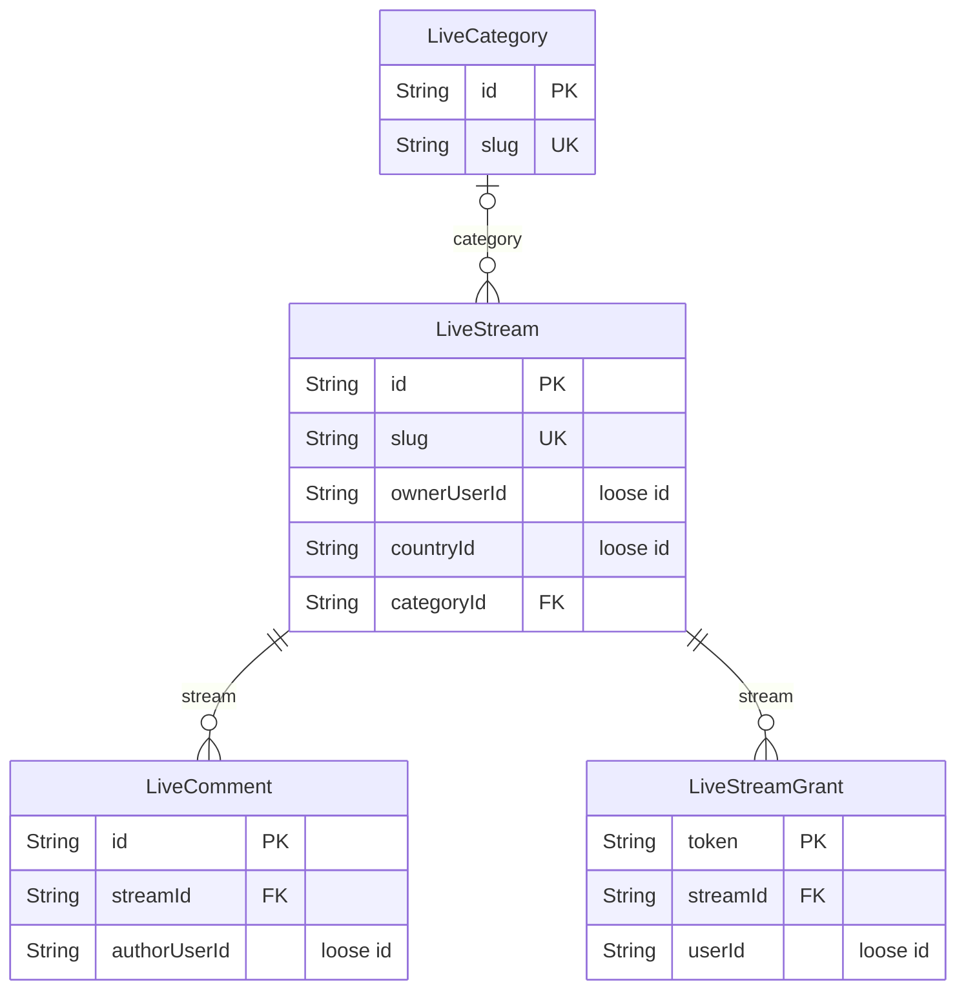

### LiveCategory

**Table:** `live_categories` · **Purpose:** Admin-managed live broadcast category (required to go live).

| Field | Type | Required | Unique | Default | Description |
|---|---|---|---|---|---|
| `id` | `String` | yes | PK | `cuid()` |  |
| `name` | `String` (VarChar(80)) | yes |  |  |  |
| `slug` | `String` (VarChar(80)) | yes | yes |  |  |
| `description` | `String` (VarChar(300)) | no |  |  |  |
| `emoji` | `String` (VarChar(8)) | no |  |  | Rendered on the filter chip. One character; not validated beyond length, because emoji are several code units and counting them properly is not worth a schema rule. |
| `color` | `String` (VarChar(9)) | no |  |  | Hex accent for the card badge, e.g. "#0ea5e9". |
| `sortOrder` | `Int` | yes |  | `0` |  |
| `isActive` | `Boolean` | yes |  | `true` |  |
| `createdAt` | `DateTime` | yes |  | `now()` |  |
| `updatedAt` | `DateTime` | yes |  | auto (@updatedAt) |  |

**Relations:** 
- `streams` ← many **LiveStream**

**Indexes / constraints:** 
- `@unique(slug)`
- `@@index([isActive, sortOrder])`

### LiveStream

**Table:** `live_streams` · **Purpose:** A live broadcast (WHIP publish, HLS playback via MediaMTX) with limits and viewer stats.

| Field | Type | Required | Unique | Default | Description |
|---|---|---|---|---|---|
| `id` | `String` | yes | PK | `cuid()` |  |
| `slug` | `String` (VarChar(40)) | yes | yes |  | The address, and only the address — see the note above. |
| `title` | `String` (VarChar(200)) | yes |  |  |  |
| `summary` | `String` (VarChar(400)) | no |  |  |  |
| `status` | `LiveStreamStatus` | yes |  | `IDLE` |  |
| `visibility` | `LiveStreamVisibility` | yes |  | `PUBLIC` |  |
| `ownerUserId` | `String` | no |  |  | Loose FK plus snapshots, same as everywhere else: a deleted account must not take the broadcast record with it. **Loose id — no relation/FK constraint.** |
| `ownerNameSnapshot` | `String` (VarChar(120)) | yes |  |  |  |
| `ownerAvatarSnapshot` | `String` | no |  |  |  |
| `countryId` | `String` | no |  |  | **Loose id — no relation/FK constraint.** |
| `categoryId` | `String` | no |  |  | REQUIRED when a member creates a stream — enforced in createStream(), not by the column. FK (see relations). |
| `startedAt` | `DateTime` | no |  |  |  |
| `endedAt` | `DateTime` | no |  |  |  |
| `endedBy` | `String` (VarChar(24)) | no |  |  | OWNER \| ADMIN \| LIMIT \| STALE |
| `endReason` | `String` (Text) | no |  |  |  |
| `maxDurationMin` | `Int` | yes |  | `120` | Caps copied from settings when the stream is created, so an admin changing the limits never cuts off a broadcast already in progress. |
| `viewerCount` | `Int` | yes |  | `0` |  |
| `viewerPeak` | `Int` | yes |  | `0` |  |
| `viewCount` | `Int` | yes |  | `0` |  |
| `recordingEnabled` | `Boolean` | yes |  | `false` |  |
| `recordingStartedAt` | `DateTime` | no |  |  |  |
| `recordingStoppedAt` | `DateTime` | no |  |  |  |
| `recordingDeletedAt` | `DateTime` | no |  |  | Set by the retention sweep so the row survives the media. |
| `createdAt` | `DateTime` | yes |  | `now()` |  |
| `updatedAt` | `DateTime` | yes |  | auto (@updatedAt) |  |

**Relations:** 
- `category` → **LiveCategory** via `categoryId` (optional, onDelete: SetNull)
- `grants` ← many **LiveStreamGrant**
- `comments` ← many **LiveComment**

**Indexes / constraints:** 
- `@unique(slug)`
- `@@index([status, startedAt])`
- `@@index([visibility, status, startedAt])`
- `@@index([ownerUserId, createdAt])`
- `@@index([countryId, status])`
- `@@index([categoryId, status, startedAt])` — The browse query: this category, live now, newest first.

**Loose user/row ids (no relation):** `ownerUserId`, `countryId`

### LiveComment

**Table:** `live_comments` · **Purpose:** Live chat comment during a broadcast.

| Field | Type | Required | Unique | Default | Description |
|---|---|---|---|---|---|
| `id` | `String` | yes | PK | `cuid()` |  |
| `streamId` | `String` | yes |  |  | FK (see relations). |
| `authorUserId` | `String` | no |  |  | **Loose id — no relation/FK constraint.** |
| `authorNameSnapshot` | `String` (VarChar(120)) | yes |  |  |  |
| `authorAvatarSnapshot` | `String` | no |  |  |  |
| `body` | `String` (VarChar(500)) | yes |  |  |  |
| `removedAt` | `DateTime` | no |  |  | Set when the author, the broadcaster or an admin removes it. |
| `removedBy` | `String` (VarChar(24)) | no |  |  | AUTHOR \| OWNER \| ADMIN |
| `removedReason` | `String` (Text) | no |  |  |  |
| `createdAt` | `DateTime` | yes |  | `now()` |  |

**Relations:** 
- `stream` → **LiveStream** via `streamId` (required, onDelete: Cascade)

**Indexes / constraints:** 
- `@@index([streamId, createdAt])` — The read path is always "this stream, newest first, not removed", and the SSE tail is "this stream, newer than a cursor".
- `@@index([authorUserId, createdAt])`

**Loose user/row ids (no relation):** `authorUserId`

### LiveStreamGrant

**Table:** `live_stream_grants` · **Purpose:** Revocable publish token for a stream's owner, checked by the MediaMTX auth hook.

| Field | Type | Required | Unique | Default | Description |
|---|---|---|---|---|---|
| `token` | `String` (VarChar(64)) | yes | PK |  |  |
| `streamId` | `String` | yes |  |  | FK (see relations). |
| `userId` | `String` | yes |  |  | **Loose id — no relation/FK constraint.** |
| `expiresAt` | `DateTime` | yes |  |  |  |
| `revokedAt` | `DateTime` | no |  |  |  |
| `lastUsedAt` | `DateTime` | no |  |  |  |
| `useCount` | `Int` | yes |  | `0` |  |
| `lastIp` | `String` (VarChar(64)) | no |  |  |  |
| `createdAt` | `DateTime` | yes |  | `now()` |  |

**Relations:** 
- `stream` → **LiveStream** via `streamId` (required, onDelete: Cascade)

**Indexes / constraints:** 
- `@@unique([streamId, userId])`
- `@@index([streamId])`
- `@@index([expiresAt])`

**Loose user/row ids (no relation):** `userId`

---

## Donations & payouts

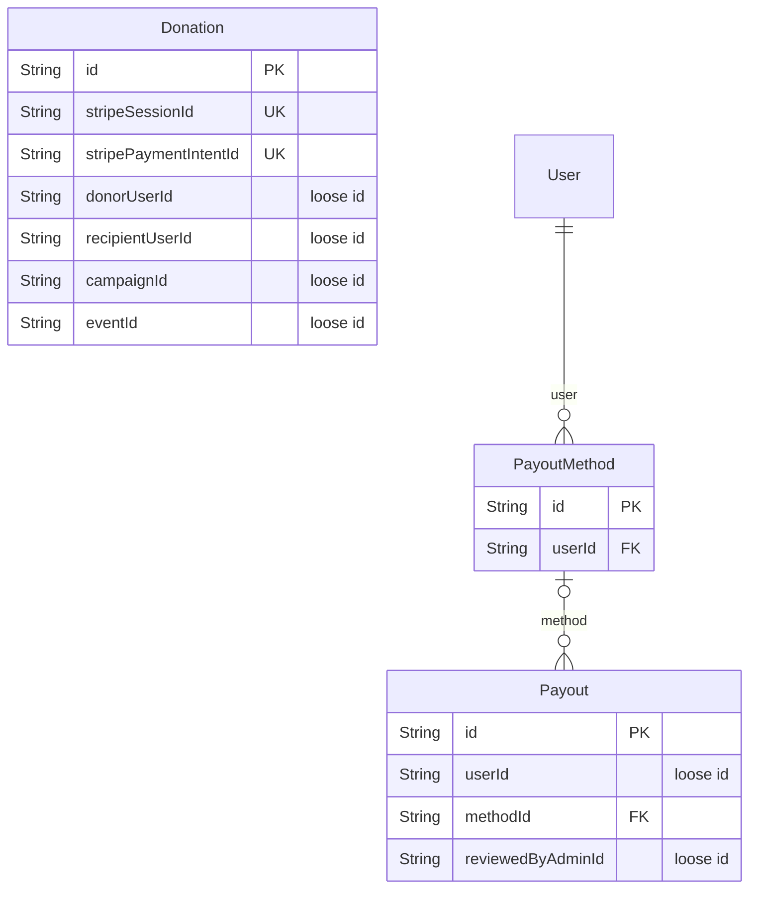

### Donation

**Table:** `donations` · **Purpose:** A Stripe Checkout donation, in integer cents, earmarked to a member/campaign/event.

| Field | Type | Required | Unique | Default | Description |
|---|---|---|---|---|---|
| `id` | `String` | yes | PK | `cuid()` |  |
| `stripeSessionId` | `String` (VarChar(255)) | no | yes |  | Both unique: the webhook can be delivered more than once, and uniqueness is what makes recording idempotent at the database level rather than relying on the handler getting it right. |
| `stripePaymentIntentId` | `String` (VarChar(255)) | no | yes |  |  |
| `stripeChargeId` | `String` (VarChar(255)) | no |  |  |  |
| `grossCents` | `Int` | yes |  |  | What the donor was charged. |
| `stripeFeeCents` | `Int` | yes |  | `0` | Stripe's processing fee, read from the balance transaction — the REAL number, not 2.9% + 30¢ recomputed here and quietly wrong for international cards, Amex, or a negotiated rate. |
| `platformFeeCents` | `Int` | yes |  | `0` | Taken by the platform at donation time. Usually 0 — the standing arrangement takes the platform's cut at payout instead — but the column exists so that policy can change without a migration. |
| `netCents` | `Int` | yes |  |  | What actually credits the recipient's balance. |
| `refundedCents` | `Int` | yes |  | `0` | Refunded so far. Subtracted from the recipient's balance. |
| `currency` | `String` (VarChar(3)) | yes |  | `"usd"` |  |
| `donorUserId` | `String` | no |  |  | Null for a signed-out donor. Loose FK: deleting an account must not delete the financial record of a payment that really happened. **Loose id — no relation/FK constraint.** |
| `donorNameSnapshot` | `String` (VarChar(120)) | no |  |  |  |
| `donorEmail` | `String` (VarChar(320)) | no |  |  | For the receipt. Stripe has it too; kept here so the admin can answer "who was this from" without opening the dashboard. |
| `isAnonymous` | `Boolean` | yes |  | `false` |  |
| `message` | `String` (VarChar(500)) | no |  |  | A note from the donor, shown to the recipient. |
| `recipientUserId` | `String` | no |  |  | The member the donation was earmarked to. Null means it was given to WorldWeCare itself and credits nobody's balance. **Loose id — no relation/FK constraint.** |
| `recipientNameSnapshot` | `String` (VarChar(120)) | no |  |  |  |
| `campaignId` | `String` | no |  |  | Optional campaign the donation was made against. **Loose id — no relation/FK constraint.** |
| `eventId` | `String` | no |  |  | Optional event the donation was made against. The recipient is the event's host, so this is about WHY the money was given rather than who got it. **Loose id — no relation/FK constraint.** |
| `causeTitleSnapshot` | `String` (VarChar(200)) | no |  |  | The campaign or event title, frozen. "You gave $25" is a much worse history line than "You gave $25 to Beach Cleanup", and a join to fetch it would break the moment the event is deleted. |
| `status` | `DonationStatus` | yes |  | `PENDING` |  |
| `availableAt` | `DateTime` | no |  |  | When this money becomes withdrawable — set to now + the hold period on success. |
| `succeededAt` | `DateTime` | no |  |  |  |
| `refundedAt` | `DateTime` | no |  |  |  |
| `failedAt` | `DateTime` | no |  |  |  |
| `feeUnknown` | `Boolean` | yes |  | `false` | True when Stripe's real processing fee could not be read at the time of crediting. |
| `disputedAt` | `DateTime` | no |  |  | When a chargeback was opened. Kept after a won dispute, so the history of a contested donation survives the status going back to SUCCEEDED. |
| `createdAt` | `DateTime` | yes |  | `now()` |  |
| `updatedAt` | `DateTime` | yes |  | auto (@updatedAt) |  |

**Relations:** none (no Prisma relations).

**Indexes / constraints:** 
- `@unique(stripeSessionId)`
- `@unique(stripePaymentIntentId)`
- `@@index([recipientUserId, status, availableAt])` — The balance query: this recipient, succeeded, past its hold.
- `@@index([donorUserId, createdAt])` — The donor's own history page.
- `@@index([status, createdAt])` — Admin listing and campaign totals.
- `@@index([stripeChargeId])` — Dispute events identify a charge, not a payment intent — this is the first thing that reads stripeChargeId at all.
- `@@index([campaignId, status])`
- `@@index([eventId, status])`

**Loose user/row ids (no relation):** `donorUserId`, `recipientUserId`, `campaignId`, `eventId`

### PayoutMethod

**Table:** `payout_methods` · **Purpose:** Where a member wants to be paid; details are encrypted, displayHint is safe to show.

| Field | Type | Required | Unique | Default | Description |
|---|---|---|---|---|---|
| `id` | `String` | yes | PK | `cuid()` |  |
| `userId` | `String` | yes |  |  | FK (see relations). |
| `type` | `PayoutMethodType` | yes |  |  |  |
| `label` | `String` (VarChar(80)) | no |  |  | Member's own name for it — "My PayPal", "Joint account". |
| `details` | `String` (Text) | yes |  |  | Sealed JSON. Shape depends on `type`; validated at the API edge. |
| `displayHint` | `String` (VarChar(120)) | yes |  |  | Never sensitive. Safe to show anywhere. |
| `isDefault` | `Boolean` | yes |  | `false` |  |
| `createdAt` | `DateTime` | yes |  | `now()` |  |
| `updatedAt` | `DateTime` | yes |  | auto (@updatedAt) |  |

**Relations:** 
- `user` → **User** via `userId` (required, onDelete: Cascade, name "UserPayoutMethods")
- `payouts` ← many **Payout**

**Indexes / constraints:** 
- `@@index([userId, isDefault])`

### Payout

**Table:** `payouts` · **Purpose:** A member withdrawal request with fee frozen at request time.

| Field | Type | Required | Unique | Default | Description |
|---|---|---|---|---|---|
| `id` | `String` | yes | PK | `cuid()` |  |
| `userId` | `String` | yes |  |  | Loose FK, like Donation: a payment record outlives the account. **Loose id — no relation/FK constraint.** |
| `userNameSnapshot` | `String` (VarChar(120)) | yes |  |  |  |
| `userEmailSnapshot` | `String` (VarChar(320)) | no |  |  |  |
| `amountCents` | `Int` | yes |  |  | Gross taken off the member's balance. |
| `feeBasisPoints` | `Int` | yes |  |  | Fee rate applied, in BASIS POINTS — 100 = 1%. An integer, so the stored rate is exact; a float percentage would reintroduce the rounding problem this whole schema avoids. |
| `feeCents` | `Int` | yes |  |  | Fee in cents, computed once at request time and stored. |
| `netCents` | `Int` | yes |  |  | What the member actually receives. amountCents - feeCents. |
| `currency` | `String` (VarChar(3)) | yes |  | `"usd"` |  |
| `methodId` | `String` | no |  |  | Nullable so deleting a payout method never deletes payout history. FK (see relations). |
| `methodSnapshot` | `Json` | yes |  |  | Frozen copy of the method — type, label, displayHint — so a paid payout still says where the money went after the member has deleted or changed the account. |
| `status` | `PayoutStatus` | yes |  | `REQUESTED` |  |
| `requestedAt` | `DateTime` | yes |  | `now()` |  |
| `reviewedAt` | `DateTime` | no |  |  |  |
| `paidAt` | `DateTime` | no |  |  |  |
| `reviewedByAdminId` | `String` | no |  |  | **Loose id — no relation/FK constraint.** |
| `adminNote` | `String` (Text) | no |  |  | Admin-only working note. |
| `rejectionReason` | `String` (Text) | no |  |  | Shown to the member when declined. Required by the API on reject. |
| `externalRef` | `String` (VarChar(160)) | no |  |  | PayPal transaction id, bank reference, cheque number — whatever the admin has to point at afterwards. |
| `createdAt` | `DateTime` | yes |  | `now()` |  |
| `updatedAt` | `DateTime` | yes |  | auto (@updatedAt) |  |

**Relations:** 
- `method` → **PayoutMethod** via `methodId` (optional, onDelete: SetNull)

**Indexes / constraints:** 
- `@@index([userId, status])` — The reservation query — everything not yet terminal for this member.
- `@@index([status, requestedAt])` — The admin queue, oldest request first.

**Loose user/row ids (no relation):** `userId`, `reviewedByAdminId`

---

## Town heroes

```mermaid
erDiagram
  TownHeroCategory {
    String id PK
    String slug UK
  }
  TownHeroCategory ||--}o TownHero : "category"
  TownHero {
    String id PK
    String slug UK
    String countryId "loose id"
    String categoryId FK
    String nominatedByUserId "loose id"
    String reviewedByAdminId "loose id"
  }
  TownHero ||--}o TownHeroHeart : "hero"
  TownHeroHeart {
    String heroId FK
    String userId "loose id"
  }
```

### TownHeroCategory

**Table:** `town_hero_categories` · **Purpose:** Admin-managed town hero category (required).

| Field | Type | Required | Unique | Default | Description |
|---|---|---|---|---|---|
| `id` | `String` | yes | PK | `cuid()` |  |
| `name` | `String` (VarChar(80)) | yes |  |  |  |
| `slug` | `String` (VarChar(80)) | yes | yes |  |  |
| `description` | `String` (VarChar(300)) | no |  |  |  |
| `emoji` | `String` (VarChar(8)) | no |  |  |  |
| `color` | `String` (VarChar(9)) | no |  |  | Hex accent for the tile, e.g. "#f59e0b". |
| `sortOrder` | `Int` | yes |  | `0` |  |
| `isActive` | `Boolean` | yes |  | `true` | Retire rather than delete: heroes already filed under it keep their label, and the tile simply stops being offered. |
| `createdAt` | `DateTime` | yes |  | `now()` |  |
| `updatedAt` | `DateTime` | yes |  | auto (@updatedAt) |  |

**Relations:** 
- `heroes` ← many **TownHero**

**Indexes / constraints:** 
- `@unique(slug)`
- `@@index([isActive, sortOrder])`

### TownHero

**Table:** `town_heroes` · **Purpose:** A nominated local hero (not a User), moderated before publishing.

| Field | Type | Required | Unique | Default | Description |
|---|---|---|---|---|---|
| `id` | `String` | yes | PK | `cuid()` |  |
| `slug` | `String` | yes | yes |  |  |
| `heroName` | `String` (VarChar(120)) | yes |  |  | The nominee's name as the nominator wrote it. NOT a User. |
| `town` | `String` (VarChar(120)) | no |  |  | Free text, deliberately. "Cork", "Blackpool", "the north side" — a nominator should not have to find their town in a dropdown before they can say thank you. |
| `countryId` | `String` | no |  |  | Optional scope so /town-heroes can narrow like events and petitions do. **Loose id — no relation/FK constraint.** |
| `categoryId` | `String` | yes |  |  | REQUIRED. Every hero is filed under something. FK (see relations). |
| `photoUrl` | `String` | no |  |  |  |
| `photoAlt` | `String` (VarChar(300)) | no |  |  |  |
| `summary` | `String` (VarChar(400)) | no |  |  | One line for the tile: "Runs the Tuesday soup run." |
| `body` | `String` (Text) | yes |  |  | Why they are a hero. Markdown, same as articles. |
| `nominatedByUserId` | `String` | no |  |  | Loose FK plus a snapshot, the house pattern: the nomination has to keep reading correctly after the nominator deletes their account, and it must not become a broken join. **Loose id — no relation/FK constraint.** |
| `nominatorSnapshot` | `String` (VarChar(120)) | no |  |  |  |
| `isAnonymous` | `Boolean` | yes |  | `false` | The nominator can stay out of it. Redacted on the way out, never at rest — a moderator still has to be able to see who sent it. |
| `status` | `TownHeroStatus` | yes |  | `PENDING` |  |
| `rejectionReason` | `String` (Text) | no |  |  |  |
| `reviewedAt` | `DateTime` | no |  |  |  |
| `reviewedByAdminId` | `String` | no |  |  | **Loose id — no relation/FK constraint.** |
| `approvedAt` | `DateTime` | no |  |  | Stamped on the first APPROVED transition and never moved after, like Article.publishedAt — re-approving an edited hero must not shove it back to the top of the list. |
| `isFeatured` | `Boolean` | yes |  | `false` |  |
| `featuredAt` | `DateTime` | no |  |  |  |
| `heartCount` | `Int` | yes |  | `0` |  |
| `createdAt` | `DateTime` | yes |  | `now()` |  |
| `updatedAt` | `DateTime` | yes |  | auto (@updatedAt) |  |

**Relations:** 
- `category` → **TownHeroCategory** via `categoryId` (required, onDelete: Restrict)
- `hearts` ← many **TownHeroHeart**

**Indexes / constraints:** 
- `@unique(slug)`
- `@@index([status, approvedAt])` — The public list, newest approved first.
- `@@index([countryId, status, approvedAt])` — The same list narrowed to a country.
- `@@index([categoryId, status, approvedAt])` — And to a category.
- `@@index([nominatedByUserId])` — The admin queue, and "my nominations".
- `@@index([isFeatured, featuredAt])`

**Loose user/row ids (no relation):** `countryId`, `nominatedByUserId`, `reviewedByAdminId`

### TownHeroHeart

**Table:** `town_hero_hearts` · **Purpose:** A member hearting a town hero.

| Field | Type | Required | Unique | Default | Description |
|---|---|---|---|---|---|
| `heroId` | `String` | yes |  |  | FK (see relations). |
| `userId` | `String` | yes |  |  | **Loose id — no relation/FK constraint.** |
| `createdAt` | `DateTime` | yes |  | `now()` |  |

**Relations:** 
- `hero` → **TownHero** via `heroId` (required, onDelete: Cascade)

**Indexes / constraints:** 
- `@@id([heroId, userId])`
- `@@index([userId])`

**Loose user/row ids (no relation):** `userId`

---

## Enums

### AdminRole

Used by: `AdminUser.role`

| Value | Meaning |
|---|---|
| `OWNER` |  |
| `ADMIN` |  |
| `MODERATOR` |  |

### VerificationPurpose

Used by: `VerificationToken.purpose`

| Value | Meaning |
|---|---|
| `EMAIL_CHANGE` | A requested new address, waiting to be confirmed from that address before it replaces the old one. |
| `EMAIL_CONFIRM` |  |
| `PASSWORD_RESET` |  |

### UserActivityType

Used by: `UserActivity.type`

| Value | Meaning |
|---|---|
| `SIGNED_UP` |  |
| `SIGNED_IN` |  |
| `SIGN_IN_FAILED` |  |
| `EMAIL_VERIFIED` |  |
| `PASSWORD_CHANGED` |  |
| `PROFILE_UPDATED` |  |
| `ADMIN_ACTION` | umbrella for anything an admin did (deactivate, ban…) |

### AdminAction

Used by: `AdminActionLog.action`

| Value | Meaning |
|---|---|
| `USER_UPDATED` |  |
| `USER_ACTIVATED` |  |
| `USER_DEACTIVATED` |  |
| `USER_BANNED` |  |
| `USER_UNBANNED` |  |
| `USER_DELETED` |  |
| `USER_PASSWORD_RESET_SENT` |  |
| `USER_EMAIL_SENT` |  |
| `USER_CREATED` |  |
| `POST_REMOVED` |  |
| `POST_RESTORED` |  |
| `POST_FEATURED` |  |
| `POST_UNFEATURED` |  |
| `COMMENT_REMOVED` |  |
| `COMMENT_RESTORED` |  |
| `REPORT_RESOLVED` |  |
| `REPORT_DISMISSED` |  |
| `PAYOUT_APPROVED` | Reading a member's bank details is logged as deliberately as moving the money is: it is the one action here that exposes personal data rather than changing a status. |
| `PAYOUT_PAID` |  |
| `PAYOUT_REJECTED` |  |
| `PAYOUT_REVERSED` | A payout marked PAID in error, or one the bank sent back. |
| `PAYOUT_DETAILS_VIEWED` |  |
| `PAYMENT_SETTINGS_UPDATED` |  |

### AdminNotifType

Used by: `AdminNotification.type`

| Value | Meaning |
|---|---|
| `USER_SIGNED_UP` |  |
| `USER_EMAIL_VERIFIED` |  |
| `USER_BANNED` |  |
| `USER_DELETED` |  |
| `POST_REPORTED` |  |
| `POST_REMOVED` |  |
| `CONFESSION_PENDING` |  |
| `EVENT_PENDING` |  |
| `PLACE_PENDING` |  |
| `PLACE_REPORTED` |  |
| `PETITION_PENDING` |  |
| `CAMPAIGN_PENDING` |  |

### PostStatus

Used by: `Post.status`, `PostComment.status`

| Value | Meaning |
|---|---|
| `PUBLISHED` |  |
| `PENDING` | held for moderator review (support-tier rooms later) |
| `REMOVED` | hidden by a moderator; author sees a "removed" chip |
| `DRAFT` | author saved but hasn't posted yet |

### Reaction

Used by: `PostLike.type`, `PetitionReaction.type`, `ConfessionSupport.type`, `GratitudeHeart.type`, `ArticleCommentLike.type`, `ArticleLike.type`, `ClipCommentLike.type`, `PostCommentReaction.type`, `ConfessionCommentReaction.type`, `GratitudeCommentReaction.type`, `ClipLike.type`

| Value | Meaning |
|---|---|
| `LIKE` |  |
| `HEART` |  |
| `CARE` |  |
| `STRENGTH` |  |
| `PROUD` |  |
| `SAME` |  |

### ReportTargetType

Used by: `PostReport.targetType`

| Value | Meaning |
|---|---|
| `POST` |  |
| `COMMENT` |  |

### ReportStatus

Used by: `PostReport.status`, `ChatMessageReport.status`, `PlaceReport.status`

| Value | Meaning |
|---|---|
| `OPEN` |  |
| `RESOLVED` |  |
| `DISMISSED` |  |

### ReportReason

Used by: `PostReport.reason`, `ChatMessageReport.reason`

| Value | Meaning |
|---|---|
| `SPAM` |  |
| `HARASSMENT` |  |
| `HATE_SPEECH` |  |
| `SELF_HARM` | triage separately — crisis flow later |
| `ADULT_CONTENT` |  |
| `MISINFORMATION` |  |
| `OFF_TOPIC` |  |
| `OTHER` |  |

### TextDirection

Used by: `Locale.direction`

| Value | Meaning |
|---|---|
| `LTR` |  |
| `RTL` |  |

### TranslationSource

Used by: `Translation.source`

| Value | Meaning |
|---|---|
| `GOOGLE` | Machine output, unreviewed. Fine for a button, risky for anything a person in distress reads. |
| `HUMAN` | Typed or corrected by a person. |

### StreakKind

Used by: `UserStreak.kind`

| Value | Meaning |
|---|---|
| `SOBER` |  |
| `MEDITATION` |  |
| `VOLUNTEERING` |  |
| `JOURNALING` |  |
| `CUSTOM` | The member names it themselves — "days since I called my mum". |

### EmailStatus

Used by: `EmailLog.status`

| Value | Meaning |
|---|---|
| `QUEUED` |  |
| `SENT` |  |
| `FAILED` |  |

### PetitionStatus

Used by: `Petition.status`

| Value | Meaning |
|---|---|
| `PENDING` |  |
| `APPROVED` |  |
| `REJECTED` |  |
| `CLOSED` | Reached its deadline or was closed by its creator. Still readable, still counted — it just takes no new signatures. |

### ChatTier

Used by: `ChatRoom.tier`

| Value | Meaning |
|---|---|
| `PUBLIC` |  |
| `SUPPORT` |  |
| `CRISIS` |  |
| `CAVALRY` |  |

### ChatRoomStatus

Used by: `ChatRoom.status`

| Value | Meaning |
|---|---|
| `ACTIVE` |  |
| `ARCHIVED` |  |

### ChatMemberRole

Used by: `ChatMembership.role`

| Value | Meaning |
|---|---|
| `MEMBER` |  |
| `MODERATOR` |  |

### ChatMemberStatus

Used by: `ChatMembership.status`

| Value | Meaning |
|---|---|
| `PENDING` |  |
| `ACTIVE` |  |
| `BANNED` |  |

### ChatMessageStatus

Used by: `ChatMessage.status`

| Value | Meaning |
|---|---|
| `PUBLISHED` |  |
| `PENDING` |  |
| `REMOVED` |  |

### UserNotifType

Used by: `UserNotification.type`

| Value | Meaning |
|---|---|
| `CHAT_REPLY` |  |
| `CHAT_MENTION` |  |
| `CHAT_REACTION` |  |
| `CRISIS_ALERT` |  |
| `POST_LIKE` |  |
| `POST_COMMENT` |  |
| `FOLLOW` |  |
| `DIRECT_MESSAGE` |  |
| `EVENT_APPROVED` |  |
| `EVENT_REJECTED` |  |
| `EVENT_CANCELLED` |  |
| `PLACE_APPROVED` |  |
| `PLACE_REJECTED` |  |
| `PETITION_APPROVED` |  |
| `PETITION_REJECTED` |  |
| `CAMPAIGN_APPROVED` |  |
| `CAMPAIGN_REJECTED` |  |
| `DONATION_RECEIVED` |  |
| `PAYOUT_APPROVED` |  |
| `PAYOUT_PAID` |  |
| `PAYOUT_REJECTED` |  |
| `TOWN_HERO_APPROVED` |  |
| `TOWN_HERO_REJECTED` |  |
| `SYSTEM` |  |

### ConfessionStatus

Used by: `Confession.status`

| Value | Meaning |
|---|---|
| `PENDING` |  |
| `APPROVED` |  |
| `REJECTED` |  |

### GratitudeStatus

Used by: `GratitudeEntry.status`

| Value | Meaning |
|---|---|
| `PENDING` |  |
| `APPROVED` |  |
| `REJECTED` |  |

### ArticleStatus

Used by: `Article.status`

| Value | Meaning |
|---|---|
| `DRAFT` |  |
| `PUBLISHED` |  |
| `ARCHIVED` |  |

### ArticleCommentStatus

Used by: `ArticleComment.status`

| Value | Meaning |
|---|---|
| `PUBLISHED` |  |
| `REMOVED` |  |

### EventStatus

Used by: `Event.status`

| Value | Meaning |
|---|---|
| `PENDING` |  |
| `APPROVED` |  |
| `REJECTED` |  |
| `CANCELLED` |  |

### VideoStatus

Used by: `VideoAsset.status`

| Value | Meaning |
|---|---|
| `UPLOADING` |  |
| `QUEUED` |  |
| `PROCESSING` |  |
| `READY` |  |
| `FAILED` |  |

### ClipCommentStatus

Used by: `ClipComment.status`

| Value | Meaning |
|---|---|
| `PUBLISHED` |  |
| `REMOVED` |  |

### ClipKind

Used by: `Clip.kind`

| Value | Meaning |
|---|---|
| `EMBED` |  |
| `UPLOAD` |  |

### CampaignStatus

Used by: `Campaign.status`

| Value | Meaning |
|---|---|
| `PENDING` | Waiting for review. ONLY member submissions land here; a campaign the team starts goes to DRAFT, which is a different thing: DRAFT is unfinished, PENDING is finished and waiting on us. |
| `DRAFT` |  |
| `PUBLISHED` |  |
| `REJECTED` | Turned down at review, with the reason in `reviewNote`. Kept rather than deleted so the submitter can be told why and the same thing is not re-submitted into a queue that has already seen it. |
| `ARCHIVED` |  |

### PlaceType

Used by: `Place.type`

| Value | Meaning |
|---|---|
| `RECOVERY_PROGRAM` |  |
| `CLINIC` |  |
| `COUNSELLING` |  |
| `CHURCH` |  |
| `FOOD_BANK` |  |
| `ANIMAL_SHELTER` |  |
| `SHELTER` |  |
| `COMMUNITY_CENTRE` |  |
| `DONATING_BUSINESS` |  |
| `OTHER` |  |

### PlaceStatus

Used by: `Place.status`

| Value | Meaning |
|---|---|
| `PENDING` |  |
| `APPROVED` |  |
| `REJECTED` |  |
| `CLOSED` |  |

### PlaceReportKind

Used by: `PlaceReport.kind`

| Value | Meaning |
|---|---|
| `CLOSED_DOWN` |  |
| `MOVED` |  |
| `WRONG_DETAILS` |  |
| `DUPLICATE` |  |
| `NOT_APPROPRIATE` |  |
| `OTHER` |  |

### LiveStreamStatus

Used by: `LiveStream.status`

| Value | Meaning |
|---|---|
| `IDLE` | Created, not broadcasting. The owner may still be setting up. |
| `LIVE` |  |
| `ENDED` |  |

### LiveStreamVisibility

Used by: `LiveStream.visibility`

| Value | Meaning |
|---|---|
| `PUBLIC` | Listed on /live and readable by anyone, signed in or not. |
| `UNLISTED` | Reachable only by someone who has the link. |

### DonationStatus

Used by: `Donation.status`

| Value | Meaning |
|---|---|
| `PENDING` | Checkout started, money not confirmed. Never counts toward a balance. |
| `SUCCEEDED` |  |
| `REFUNDED` | Refunded in full or in part; see refundedCents. |
| `FAILED` |  |
| `DISPUTED` | The donor's bank has disputed the charge (a chargeback). Stripe removes the money from the platform's balance the moment a dispute opens, so this status must NEVER count toward anyone's balance — otherwise a member ca… |

### PayoutMethodType

Used by: `PayoutMethod.type`

| Value | Meaning |
|---|---|
| `PAYPAL` |  |
| `BANK` |  |
| `WISE` |  |
| `CHECK` | Posted cheque — some members have no account to pay into. |

### PayoutStatus

Used by: `Payout.status`

| Value | Meaning |
|---|---|
| `REQUESTED` | Member asked; the money is reserved against their balance. |
| `APPROVED` | Admin accepted it but hasn't sent the money yet. |
| `PAID` | Money sent. Terminal. |
| `REJECTED` | Admin declined; the reservation is released. Terminal. |
| `CANCELLED` | Member withdrew the request before it was actioned. Terminal. |

### TownHeroStatus

Used by: `TownHero.status`

| Value | Meaning |
|---|---|
| `PENDING` |  |
| `APPROVED` |  |
| `REJECTED` |  |

## Appendix: loose id columns (no Prisma relation / no FK)

These columns hold another row's id but have no relation or FK constraint. The referenced row may be gone, so treat them as "maybe null on lookup". The target is inferred from the column name and schema comments.

| Model | Column | Likely target |
|---|---|---|
| User | `countryId` | Country.id |
| UserBlock | `blockerId` | User.id |
| UserBlock | `blockedId` | User.id |
| UserFollow | `followerId` | User.id |
| UserFollow | `followingId` | User.id |
| UserNotification | `userId` | User.id |
| PostReport | `commentId` | PostComment.id |
| PostCommentReaction | `userId` | User.id |
| Translation | `reviewedByAdminId` | AdminUser.id |
| ContentTranslation | `refId` | id of the row named by `kind` (post, comment, confession, room, …) |
| DailyReflection | `sharedPostId` | Post.id |
| Petition | `countryId` | Country.id |
| Petition | `reviewedBy` | AdminUser.id |
| Petition | `creatorUserId` | User.id |
| Petition | `createdByAdminId` | AdminUser.id |
| PetitionSignature | `userId` | User.id |
| PetitionReaction | `userId` | User.id |
| ChatRoom | `countryId` | Country.id |
| ChatRoom | `eventId` | Event.id |
| ChatRoom | `placeId` | Place.id |
| ChatRoom | `createdByAdminId` | AdminUser.id |
| ChatMembership | `userId` | User.id |
| ChatMessage | `authorId` | User.id |
| ChatMessageReaction | `userId` | User.id |
| ChatMessageReport | `roomId` | ChatRoom.id |
| ChatMessageReport | `reporterId` | User.id |
| ChatMessageReport | `resolvedById` | AdminUser.id |
| Confession | `authorId` | User.id |
| Confession | `reviewedBy` | AdminUser.id |
| ConfessionSupport | `userId` | User.id |
| ConfessionComment | `authorId` | User.id |
| ConfessionCommentReaction | `userId` | User.id |
| GratitudeEntry | `authorId` | User.id |
| GratitudeEntry | `reviewedBy` | AdminUser.id |
| GratitudeComment | `authorId` | User.id |
| GratitudeHeart | `userId` | User.id |
| GratitudeCommentReaction | `userId` | User.id |
| Conversation | `userAId` | User.id |
| Conversation | `userBId` | User.id |
| Conversation | `lastSenderId` | User.id |
| ConversationParticipant | `userId` | User.id |
| DirectMessage | `senderId` | User.id |
| Article | `authorAdminId` | AdminUser.id |
| ArticleComment | `authorId` | User.id |
| ArticleCommentLike | `userId` | User.id |
| ArticleLike | `userId` | User.id |
| ArticleSave | `userId` | User.id |
| Event | `countryId` | Country.id |
| Event | `reviewedBy` | AdminUser.id |
| Event | `hostUserId` | User.id |
| Event | `createdByAdminId` | AdminUser.id |
| Event | `chatRoomId` | ChatRoom.id |
| EventRsvp | `userId` | User.id |
| ThemeFollow | `userId` | User.id |
| Clip | `videoAssetId` | VideoAsset.id |
| Clip | `addedByAdminId` | AdminUser.id |
| ClipComment | `authorId` | User.id |
| ClipCommentLike | `userId` | User.id |
| ClipLike | `userId` | User.id |
| ClipSave | `userId` | User.id |
| VideoAsset | `ownerId` | User.id or AdminUser.id (see ownerKind) |
| UploadedFile | `ownerId` | User.id or AdminUser.id (see ownerKind) |
| Campaign | `countryId` | Country.id |
| Campaign | `submittedByUserId` | User.id |
| Campaign | `reviewedByAdminId` | AdminUser.id |
| Campaign | `chatRoomId` | ChatRoom.id |
| Campaign | `petitionId` | Petition.id |
| Campaign | `createdByAdminId` | AdminUser.id |
| CampaignSupport | `userId` | User.id |
| Place | `countryId` | Country.id |
| Place | `stateId` | State.id |
| Place | `reviewedByAdminId` | AdminUser.id |
| Place | `submittedByUserId` | User.id |
| Place | `chatRoomId` | ChatRoom.id |
| PlaceReport | `reporterId` | User.id |
| PlaceReport | `resolvedByAdminId` | AdminUser.id |
| PlaceSave | `userId` | User.id |
| PlaceFilterSet | `userId` | User.id |
| LiveStream | `ownerUserId` | User.id |
| LiveStream | `countryId` | Country.id |
| LiveComment | `authorUserId` | User.id |
| LiveStreamGrant | `userId` | User.id |
| Donation | `donorUserId` | User.id |
| Donation | `recipientUserId` | User.id |
| Donation | `campaignId` | Campaign.id |
| Donation | `eventId` | Event.id |
| Payout | `userId` | User.id |
| Payout | `reviewedByAdminId` | AdminUser.id |
| TownHero | `countryId` | Country.id |
| TownHero | `nominatedByUserId` | User.id |
| TownHero | `reviewedByAdminId` | AdminUser.id |
| TownHeroHeart | `userId` | User.id |

